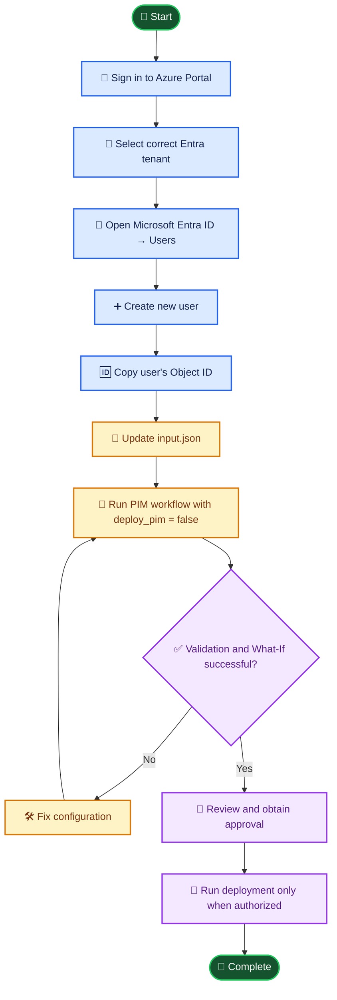
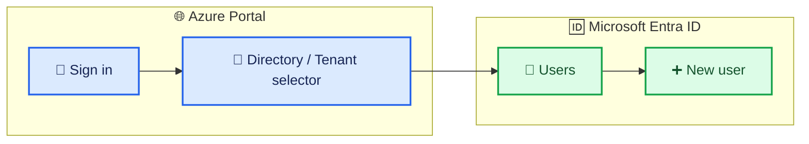
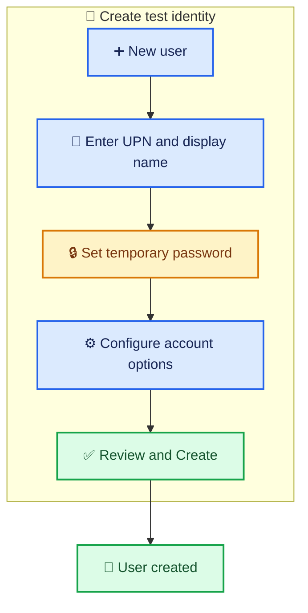
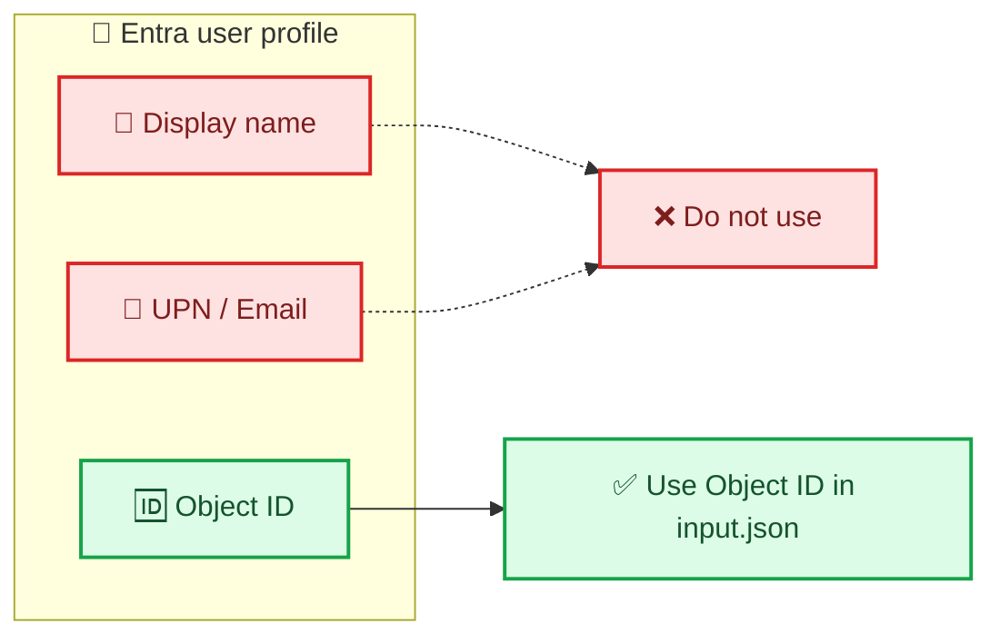
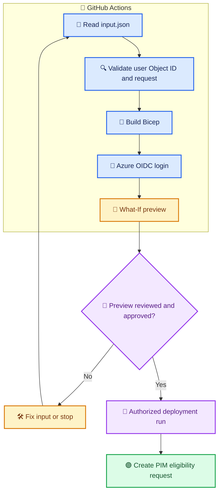
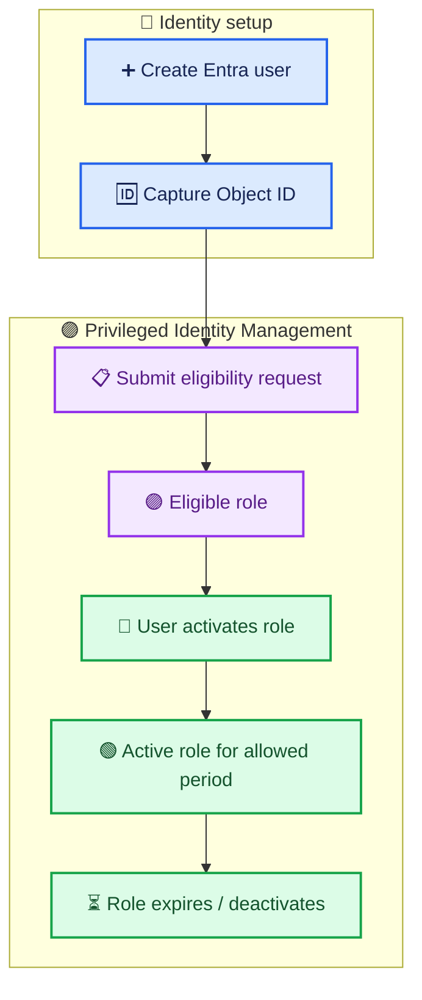

# 👤 Create a Microsoft Entra ID User in the Azure Portal

This guide explains how to create the test user `pim_user_1` through the Azure Portal UI and retrieve the user's **Object ID** for the BIFROST PIM workflow.

> ⚠️ **Important:** Create test users only in an authorized test tenant. Creating an Entra user does **not** automatically grant Azure subscription access. Do not assign permissions without approval.

---

## 🎯 Overview



## ✅ Prerequisites

- 🔑 Access to the correct Microsoft Entra tenant.
- 🛡️ Permission to create users, such as **User Administrator**, or another role with equivalent permissions.
- 🧾 Approved test-user naming convention.
- 🔒 Secure method to provide the temporary password to the test user.

---

## 1. 🏢 Open Microsoft Entra ID

1. Sign in to the [Azure Portal](https://portal.azure.com/).
2. Select the directory/tenant selector in the portal toolbar.
3. Choose the **correct tenant** for BIFROST testing.
4. Search for **Microsoft Entra ID** and open it.
5. Select **Users** from the left navigation.

### Tenant and navigation diagram



---

## 2. ➕ Create the user

1. On the **Users** page, select **New user**.
2. Select **Create new user**.
3. Fill in the user details:

| Field | Example / guidance |
|---|---|
| User principal name (UPN) | `pim_user_1@<your-verified-tenant-domain>` |
| Display name | `BIFROST PIM Test User` |
| Mail nickname | `pim_user_1` |
| Password | Generate a strong temporary password or use the portal-generated option |
| Account enabled | Enable if the test user needs to sign in |

⚠️ Replace `<your-verified-tenant-domain>` with a domain verified in your tenant. Do not copy the placeholder literally.

4. If available, select **Require password change on first sign-in**.
5. Review the details and select **Create**.

### User creation workflow



---

## 3. 🆔 Copy the user's Entra Object ID

1. Open the newly created user from the **Users** list.
2. On the user's **Overview** page, locate **Object ID**.
3. Copy the Object ID.

It should look like a GUID:

```text
xxxxxxxx-xxxx-xxxx-xxxx-xxxxxxxxxxxx
```

### ⚠️ Use the correct identifier

| Identifier | Use in `input.json`? |
|---|---|
| Entra **Object ID** | ✅ Yes |
| User email / UPN | ❌ No |
| Display name | ❌ No |
| Alias (`pim_user_1`) | ❌ No |
| Azure application Client ID | ❌ No |



---

## 4. 📝 Update `input.json` in GPT-BIFROST

In repository **`OLYMPUSPRIME/GPT-BIFROST`**, branch **`feature/PIM_mark_1`**, update the user section:

```json
"user": {
  "alias": "pim_user_1",
  "principalId": "PASTE_THE_NEW_USER_OBJECT_ID_HERE",
  "principalType": "User"
}
```

Replace `PASTE_THE_NEW_USER_OBJECT_ID_HERE` with the Object ID copied from Azure Portal. Keep the alias as `pim_user_1` because the current workflow validates that alias.

Commit the updated `input.json` to the intended branch.

---

## 5. 🧪 Validate the PIM workflow

### Recommended first run

1. Open **GitHub → GPT-BIFROST → Actions → PIM Mark-1**.
2. Select branch `feature/PIM_mark_1`.
3. Select **Run workflow**.
4. Set `deploy_pim = false`.
5. Run the workflow.
6. Review validation and What-If output.

### PIM pipeline process



> 🚨 Set `deploy_pim = true` only after reviewing the preview, confirming the subscription and scope, and obtaining required authorization.

---

## 6. 🔐 Understand eligibility versus active access

Creating the Entra user only creates the identity. It does **not** give the user Contributor access.

The current workflow requests **Contributor eligibility at subscription scope** for the configured duration (`P90D`, 90 days).

- 🟣 **Eligible:** User is allowed to activate the role under the PIM policy.
- 🟢 **Active:** The user has activated the role and currently has the permissions.
- ⏳ Eligibility does not mean the role is active immediately.
- 🔑 The user must activate the eligible role through the Azure Portal/PIM experience.



---

## 7. 🧹 Cleanup after testing

When testing is complete:

1. Remove or expire the user's PIM eligibility according to your organization's access-management process.
2. Delete or disable the test user if no longer needed and permitted by tenant policy.
3. Verify that no unintended role assignments remain.
4. Retain ticket and audit records as required.

---

## 📌 Quick checklist

- [ ] Correct Entra tenant selected
- [ ] Test user created successfully
- [ ] User Object ID copied (not UPN/email)
- [ ] `input.json` updated and committed
- [ ] `deploy_pim = false` validation/What-If completed
- [ ] Subscription, role, scope, duration, and ticket reviewed
- [ ] Approval obtained before actual PIM request
- [ ] Test identity and eligibility cleaned up when appropriate
