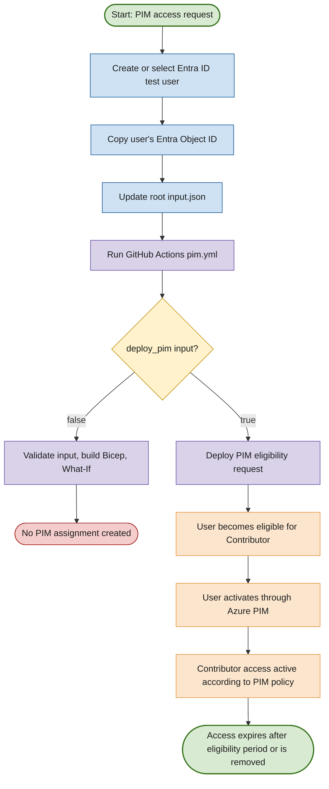
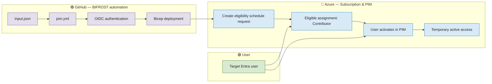

# BIFROST PIM Access — Purpose, Scope & Permissions

## 🎯 What access are we requesting?

The current BIFROST PIM configuration requests **Azure RBAC Privileged Identity Management (PIM) eligibility** for a test user.

| Setting | Current value |
|---|---|
| Subscription | `BIFROST-SC` |
| Principal alias | `pim_user_1` (input label only) |
| Principal ID | Entra ID Object ID of the target user |
| Principal type | User |
| Azure role | Contributor |
| Assignment type | Eligibility |
| Scope | Entire Azure subscription |
| Eligibility duration | 90 days (`P90D`) |
| Ticket reference | `PIKE-PIM-001` |
| Justification | Eligible Contributor access requested for BIFROST infrastructure support |

> **Important:** `pim_user_1` is only a friendly alias in the JSON. The `principalId` must be the actual Microsoft Entra ID user Object ID (GUID).

## 🔐 What does Contributor allow?

The **Contributor** Azure RBAC role can create, update, and delete Azure resources within the assigned scope. It does **not** allow the user to assign Azure RBAC roles to others or manage access permissions.

Because the current scope is the **subscription**, Contributor permissions can apply broadly across resource groups and resources in `BIFROST-SC` when activated.

| Capability | Contributor |
|---|---|
| Create and manage Azure resources | ✅ |
| Configure many resource settings | ✅ |
| Delete Azure resources | ✅ |
| Assign Azure RBAC roles to other users | ❌ |
| Automatically receive active access immediately | ❌ |

Contributor is a broad role at subscription scope. Use a dedicated test subscription or a narrower resource-group scope when practical, especially for initial testing.

## ⏳ Eligible access vs. active access

**Eligibility does not mean the user has active Contributor permissions immediately.**

The request registers the user as eligible for the role. The user must activate the eligible assignment through Azure PIM. Activation requirements—such as MFA, justification, approval, or activation duration—depend on the PIM policy configured for that scope.

This workflow creates the **eligibility request**. It does not configure activation policies and does not automatically activate the role.

## 🧭 End-to-end flow

## 🧩 Which permissions are being managed?

This implementation is for **Azure resource access (Azure RBAC)** at subscription scope.

It is **not** granting:
- Microsoft Entra directory roles such as Global Administrator.
- Permanent active Contributor access.
- Automatic PIM activation.
- Permission to grant other users Azure RBAC roles.

## 🛠️ What are we testing with this module?

The goal is to validate the BIFROST PIM automation lifecycle:

1. Create or select a dedicated Entra ID test user.
2. Obtain the user's Object ID.
3. Set the Object ID in the root `input.json`.
4. Run the GitHub Actions workflow using the `bifrost-dev` GitHub Environment.
5. Validate the request and review What-If output.
6. Explicitly enable deployment using `deploy_pim=true`.
7. Confirm that the user is eligible for Contributor at the configured scope.
8. Test PIM activation manually in the Azure Portal.
9. Remove the test assignment/user when testing is complete, as appropriate.

## ⚠️ Security and operational notes

- Confirm the subscription ID resolves to the intended `BIFROST-SC` subscription before deployment.
- Review the What-If output before setting `deploy_pim=true`.
- Use the least-privileged role and scope that meet the test requirement.
- Keep the target user dedicated to testing; avoid using a personal or production identity.
- The GitHub Actions identity needs the appropriate permissions to submit the PIM eligibility request.
- A 90-day eligibility period is **not** the same as a 90-day continuously active Contributor assignment.
- PIM activation controls are determined by Azure PIM policy and are separate from this Bicep request.

## 📌 Summary

**The current request makes a test user eligible to activate Azure Contributor at the entire `BIFROST-SC` subscription for up to 90 days.** The user does not receive active access merely because the eligibility request is deployed; they must activate it through PIM, subject to the configured policy.
