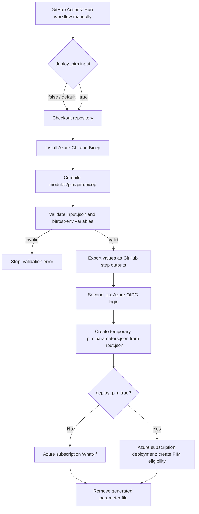

# BIFROST PIM Pipeline — Inputs and Execution Guide

## 1. Purpose

This pipeline creates **Azure subscription-scoped PIM role eligibility** for a user through the Bicep module at `modules/pim/pim.bicep`.

- Workflow: `.github/workflows/pim.yml`
- Input file: `input.json` (repository root)
- Bicep module: `modules/pim/pim.bicep`
- GitHub Actions environment: `bifrost-env`
- Azure deployment scope: subscription
- Workflow trigger: **manual only** (`workflow_dispatch`); no push or pull-request trigger is configured.

PIM eligibility does not activate the role immediately. The eligible user must activate the role through Microsoft Entra Privileged Identity Management (PIM), subject to configured activation policies.

## 2. Where inputs are received from

There are two main input sources: the GitHub Actions manual-run form and the repository's `input.json`.

### A. Manual workflow input

When manually starting the workflow in GitHub Actions, the UI asks for:

| Input | Type | Default | Meaning |
|---|---|---|---|
| `deploy_pim` | Boolean | `false` | `false`: validate, login, and run What-If. `true`: create the eligibility request. |

This input is defined under `on.workflow_dispatch.inputs` in `pim.yml`. It is read in the job conditions through the `inputs.deploy_pim` context.

**Safety:** leave `deploy_pim=false` for preview. Set it to `true` only when the request is approved and ready to create.

### B. Root `input.json`

The workflow checks out the repository and reads `input.json`. The file contains the PIM request details:

| JSON path | Used for |
|---|---|
| `request.approved` | Must be `true`; otherwise validation fails. |
| `request.ticketId` | Request/audit metadata in the input record. |
| `subscription.name` | Validated against `BIFROST-SC`. |
| `pim.enabled` | Must be `true`. |
| `pim.assignmentType` | Must be `Eligibility`. |
| `pim.user.alias` | Validated as `pim_user_1`; this is a label, not the Azure identity. |
| `pim.user.principalId` | Actual Microsoft Entra user Object ID (GUID). Replace the placeholder. |
| `pim.user.principalType` | Must be `User`. |
| `pim.role.roleName` | Human-readable role name (e.g. Contributor). |
| `pim.role.roleDefinitionId` | Azure built-in/custom role GUID. |
| `pim.scope.type` | Must be `Subscription`. |
| `pim.schedule.duration` | Eligibility period in ISO 8601 format (e.g. `P90D`). |
| `pim.schedule.expirationType` | Must be `AfterDuration`. |
| `pim.justification` | PIM assignment justification. |
| `pim.ticketInfo.ticketSystem` | Ticketing system (e.g. Jira). |
| `pim.ticketInfo.ticketNumber` | Ticket/reference number used in PIM request details and deterministic request name. |

The workflow currently supports one user alias (`pim_user_1`), subscription scope, and PIM eligibility only. Validation intentionally rejects other configurations.

## 3. GitHub Environment variables

The jobs reference GitHub **Environment variables**, not repository-level variables by default. Both jobs use the environment named `bifrost-env`.

Configure these under **Repository → Settings → Environments → bifrost-env → Environment variables**:

| Variable | Source | Purpose |
|---|---|---|
| `AZURE_CLIENT_ID` | Azure app/service principal client ID used for GitHub OIDC | Azure login identity |
| `AZURE_TENANT_ID` | Microsoft Entra tenant ID | Tenant context and validation |
| `AZURE_SUBSCRIPTION_ID` | Target Azure subscription ID | Deployment subscription and validation |

These values are referenced as `${{ vars.VARIABLE_NAME }}`. The workflow does not store client secrets: Azure login uses OIDC. The federated credential must trust this repository and the branch/environment context, and the identity needs permission to create PIM eligibility schedule requests at the target scope.

## 4. Pipeline execution flow

### Job 1 — Validate and prepare

1. Runs on `ubuntu-latest` in the `bifrost-env` GitHub Environment.
2. Checks out the branch that was selected for the manual workflow run.
3. Checks Azure CLI and installs Bicep.
4. Compiles `modules/pim/pim.bicep` to catch Bicep syntax/build issues.
5. Checks that `input.json` is valid JSON.
6. Validates request approval, target subscription name, GitHub environment variables, PIM settings, user Object ID, role GUID, scope, and duration.
7. Generates a deterministic UUID for the PIM schedule request based on subscription, principal, role, and ticket.
8. Publishes validated values as job outputs using `GITHUB_OUTPUT`.

### Job 2 — Preview or deploy

1. Waits for Job 1 (`needs: validate`).
2. Checks out the repository.
3. Authenticates to Azure using `azure/login@v2` and GitHub OIDC:
   - Client ID comes from `vars.AZURE_CLIENT_ID`.
   - Tenant ID and subscription ID come from Job 1 outputs.
4. Uses `jq` to transform request data from `input.json` into a temporary ARM deployment parameter file named `pim.parameters.json`.
5. Selects the operation based on the manual `deploy_pim` input:
   - `false` / not true: `az deployment sub what-if`
   - `true`: `az deployment sub create`
6. Removes the generated parameter file even if the previous step fails (`if: always()`).

The generated `pim.parameters.json` is not intended to be committed. It is created during the runner execution and deleted at the end.

## 5. Input flow / data mapping

| Source | Workflow variable/parameter | Destination |
|---|---|---|
| GitHub Environment `AZURE_SUBSCRIPTION_ID` | `subscription_id` output | Azure CLI subscription deployment |
| GitHub Environment `AZURE_TENANT_ID` | `tenant_id` output | Azure OIDC login |
| GitHub Environment `AZURE_CLIENT_ID` | Direct variable reference | Azure OIDC login |
| `input.json:pim.user.principalId` | `principal_id` output | Bicep `principalId` |
| `input.json:pim.role.roleDefinitionId` | `role_definition_id` output | Converted to subscription-scoped role definition resource ID |
| `input.json:pim.justification` | jq mapping | Bicep `justification` |
| `input.json:pim.schedule.duration` | jq mapping | Bicep `duration` |
| `input.json:pim.ticketInfo.ticketNumber` | jq mapping | Bicep `ticketNumber`; request-name input |
| `input.json:pim.ticketInfo.ticketSystem` | jq mapping | Bicep `ticketSystem` |
| Generated deterministic UUID | `request_name` output | Bicep `requestName` |

## 6. Bicep module parameters

The workflow passes these parameters to `modules/pim/pim.bicep`:

- `principalId`
- `roleDefinitionId` (full subscription role-definition resource ID)
- `justification`
- `duration`
- `requestName`
- `ticketNumber`
- `ticketSystem`

The module declares `targetScope = 'subscription'` and creates a resource of type:

`Microsoft.Authorization/roleEligibilityScheduleRequests@2022-04-01-preview`

with `requestType: 'AdminAssign'` and an expiration of `AfterDuration`.

## 7. Before running

1. Confirm the workflow file is present on the repository's **default branch** if you expect GitHub to list it in the Actions tab. GitHub's manual dispatch UI requires the workflow to be available on the default branch; you can then select the feature branch from the branch selector when running it.
2. Open **Actions → BIFROST | PIM User Eligibility Assignment → Run workflow**.
3. Select the intended branch (for example, `feature/PIM_mark_1`).
4. Keep `deploy_pim=false` for a preview run.
5. Verify the What-If output.
6. For the actual eligibility creation, rerun manually with `deploy_pim=true` only after approval.

## 8. Troubleshooting

| Symptom | Check |
|---|---|
| Workflow missing from Actions / no Run workflow button | Confirm `.github/workflows/pim.yml` exists on the default branch and the workflow is enabled. |
| Validation fails for subscription/tenant | Check `AZURE_SUBSCRIPTION_ID` and `AZURE_TENANT_ID` in GitHub Environment `bifrost-env`. |
| Azure login fails | Check `AZURE_CLIENT_ID`, OIDC federation subject/issuer/audience, and the selected GitHub branch/environment trust. |
| User principal ID validation fails | Replace the placeholder with the target user's Entra Object ID GUID. |
| Bicep build fails | Review `modules/pim/pim.bicep` syntax and Azure CLI/Bicep versions. |
| What-If/deployment authorization fails | Ensure the GitHub OIDC identity has sufficient permissions for PIM eligibility schedule requests at the subscription scope. |
| Role or scope is rejected | Verify role GUID and subscription scope; this branch currently supports only the specified subscription scope. |

## 9. Security and operational notes

- Never commit secrets, credentials, or access tokens to `input.json`.
- Use GitHub Environment protection rules/approvals if required for production access.
- Keep `deploy_pim` defaulted to `false`.
- A successful deployment creates **eligibility**, not immediate active Contributor access.
- The eligible user must activate the role through PIM, subject to tenant activation policy.
- This workflow is manually triggered only; it does not deploy on push.
