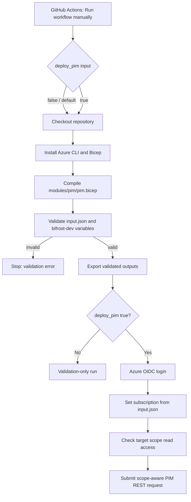

# BIFROST PIM Pipeline — Inputs and Execution Guide

## 1. Purpose

This pipeline creates **Azure PIM role eligibility** at Subscription, Resource Group, or individual Resource scope. The scope-aware REST request is driven by root `input.json`. The Bicep module remains subscription-targeted and is compiled for syntax validation only.

- Workflow: `.github/workflows/pim.yml`
- Input file: `input.json` (repository root)
- Bicep module: `modules/pim/pim.bicep`
- GitHub Actions environment: `bifrost-dev`
- Azure deployment scope: subscription
- Workflow trigger: **manual only** (`workflow_dispatch`); no push or pull-request trigger is configured.

PIM eligibility does not activate the role immediately. The eligible user must activate the role through Microsoft Entra Privileged Identity Management (PIM), subject to configured activation policies.

## 2. Where inputs are received from

There are two main input sources: the GitHub Actions manual-run form and the repository's `input.json`.

### A. Manual workflow input

When manually starting the workflow in GitHub Actions, the UI asks for:

| Input | Type | Default | Meaning |
|---|---|---|---|
| `deploy_pim` | Boolean | `false` | `false`: validation-only. `true`: authenticate, check scope readability, and submit the PIM request. |

This input is defined under `on.workflow_dispatch.inputs` in `pim.yml`. It is read in the job conditions through the `inputs.deploy_pim` context.

**Safety:** leave `deploy_pim=false` for preview. Set it to `true` only when the request is approved and ready to create.

### B. Root `input.json`

The workflow checks out the repository and reads `input.json`. The file contains the PIM request details:

| JSON path | Used for |
|---|---|
| `request.approved` | Must be `true`; otherwise validation fails. |
| `request.ticketId` | Request/audit metadata in the input record. |
| `subscription.name` | Validated against `BIFROST-SC`. |
| `subscription.subscriptionId` | Target subscription GUID; authoritative input. JSON does not expand `${...}` variables. |
| `pim.enabled` | Must be `true`. |
| `pim.assignmentType` | Must be `Eligibility`. |
| `pim.user.alias` | Validated as `pim_user_1`; this is a label, not the Azure identity. |
| `pim.user.principalId` | Actual Microsoft Entra user Object ID (GUID). Replace the placeholder. |
| `pim.user.principalType` | Must be `User`. |
| `pim.role.roleName` | Human-readable role name (e.g. Contributor). |
| `pim.role.roleDefinitionId` | Azure built-in/custom role GUID. |
| `pim.scope.type` | `Subscription`, `ResourceGroup`, or `Resource`. |
| `pim.scope.resourceGroupName` | Required for ResourceGroup scope. |
| `pim.scope.resourceId` | Required full ARM resource ID for Resource scope. |
| `pim.schedule.duration` | Eligibility period in ISO 8601 format (e.g. `P90D`). |
| `pim.schedule.expirationType` | Must be `AfterDuration`. |
| `pim.justification` | PIM assignment justification. |
| `pim.ticketInfo.ticketSystem` | Ticketing system (e.g. Jira). |
| `pim.ticketInfo.ticketNumber` | Ticket/reference number used in PIM request details and deterministic request name. |

The workflow supports the configured user alias and PIM eligibility (`AdminAssign`). Scope may be Subscription, ResourceGroup, or Resource. Other request types require a separate implementation with appropriate existing schedule IDs/user context.

## 3. GitHub Environment variables

The jobs reference GitHub **Environment variables**, not repository-level variables by default. Jobs use the environment named `bifrost-dev`.

Configure these under **Repository → Settings → Environments → bifrost-dev → Environment variables**:

| Variable | Source | Purpose |
|---|---|---|
| `AZURE_CLIENT_ID` | Azure app/service principal client ID used for GitHub OIDC | Azure login identity |
| `AZURE_TENANT_ID` | Microsoft Entra tenant ID | Tenant context and validation |
| `AZURE_SUBSCRIPTION_ID` | Not used for target selection | Target subscription is read from `input.json`; this variable must not override it. |

These values are referenced as `${{ vars.VARIABLE_NAME }}`. The workflow does not store client secrets: Azure login uses OIDC. The federated credential must trust this repository and the branch/environment context, and the identity needs permission to create PIM eligibility schedule requests at the target scope.

## 4. Pipeline execution flow



### Job 1 — Validate and prepare

1. Runs on `ubuntu-latest` in the `bifrost-dev` GitHub Environment.
2. Checks out the branch that was selected for the manual workflow run.
3. Checks Azure CLI and installs Bicep.
4. Compiles `modules/pim/pim.bicep` to catch Bicep syntax/build issues.
5. Checks that `input.json` is valid JSON.
6. Validates request approval, target subscription name, GitHub environment variables, PIM settings, user Object ID, role GUID, scope, and duration.
7. Generates a deterministic UUID for the PIM schedule request based on subscription, principal, role, and ticket.
8. Publishes validated values as job outputs using `GITHUB_OUTPUT`.

### Job 2 — Create PIM request (when `deploy_pim=true`)

1. Waits for Job 1 (`needs: validate`).
2. Checks out the repository.
3. Authenticates to Azure using `azure/login@v2` and GitHub OIDC:
   - Client ID comes from `vars.AZURE_CLIENT_ID`.
   - Tenant ID and subscription ID come from Job 1 outputs.
4. Sets Azure CLI context to the subscription ID from `input.json`.
5. Verifies the active subscription and checks read access to the configured scope.
6. Submits the PIM eligibility REST request at the exact scope path built from `input.json`.

There is no PIM What-If preview. The scope read preflight does not prove PIM write permissions; Azure validates those when the request is submitted.

## 5. Input flow / data mapping

| Source | Workflow variable/parameter | Destination |
|---|---|---|
| `input.json:subscription.subscriptionId` | `subscription_id` output | Azure OIDC login and Azure CLI context |
| GitHub Environment `AZURE_TENANT_ID` | `tenant_id` output | Azure OIDC login |
| GitHub Environment `AZURE_CLIENT_ID` | Direct variable reference | Azure OIDC login |
| `input.json:pim.user.principalId` | `principal_id` output | Bicep `principalId` |
| `input.json:pim.role.roleDefinitionId` | `role_definition_id` output | Converted to subscription-scoped role definition resource ID |
| `input.json:pim.justification` | jq mapping | Bicep `justification` |
| `input.json:pim.schedule.duration` | jq mapping | Bicep `duration` |
| `input.json:pim.ticketInfo.ticketNumber` | jq mapping | Bicep `ticketNumber`; request-name input |
| `input.json:pim.ticketInfo.ticketSystem` | jq mapping | Bicep `ticketSystem` |
| Generated deterministic UUID | `request_name` output | Bicep `requestName` |

## 6. Bicep module parameters

The workflow passes these parameters to `modules/pim/pim.bicep`:

- `principalId`
- `roleDefinitionId` (full subscription role-definition resource ID)
- `justification`
- `duration`
- `requestName`
- `ticketNumber`
- `ticketSystem`

The module declares `targetScope = 'subscription'` and creates a resource of type (subscription-scope module/local test only):

`Microsoft.Authorization/roleEligibilityScheduleRequests@2022-04-01-preview`

with `requestType: 'AdminAssign'` and an expiration of `AfterDuration`.

## 7. Before running

1. Confirm the workflow file is present on the repository's **default branch** if you expect GitHub to list it in the Actions tab. GitHub's manual dispatch UI requires the workflow to be available on the default branch; you can then select the feature branch from the branch selector when running it.
2. Open **Actions → BIFROST | PIM User Eligibility Assignment → Run workflow**.
3. Select the intended branch (for example, `feature/PIM_mark_1`).
4. Keep `deploy_pim=false` for a preview run.
5. Review validation output (no PIM What-If is performed).
6. For actual eligibility creation, rerun with `deploy_pim=true` only after approval.

## 8. Troubleshooting

| Symptom | Check |
|---|---|
| Workflow missing from Actions / no Run workflow button | Confirm `.github/workflows/pim.yml` exists on the default branch and the workflow is enabled. |
| Validation fails for subscription/tenant | Set `subscription.subscriptionId` in `input.json` to a valid GUID and verify `AZURE_TENANT_ID` in GitHub Environment `bifrost-dev`. |
| Azure login fails | Check `AZURE_CLIENT_ID`, OIDC federation subject/issuer/audience, and the selected GitHub branch/environment trust. |
| User principal ID validation fails | Replace the placeholder with the target user's Entra Object ID GUID. |
| Bicep build fails | Review `modules/pim/pim.bicep` syntax and Azure CLI/Bicep versions. |
| What-If/deployment authorization fails | Ensure the GitHub OIDC identity has sufficient permissions for PIM eligibility schedule requests at the subscription scope. |
| Role or scope is rejected | Verify role GUID/full role ID, RG name or full resource ID; scope must belong to the subscription ID in input.json. |

## 9. Security and operational notes

- Never commit secrets, credentials, or access tokens to `input.json`.
- Use GitHub Environment protection rules/approvals if required for production access.
- Keep `deploy_pim` defaulted to `false`.
- `input.json:subscription.subscriptionId` is the authoritative subscription; the GitHub environment variable is not used to choose it.
- The workflow verifies subscription context and scope read access before making the PIM request.
- A successful deployment creates **eligibility**, not immediate active Contributor access.
- The eligible user must activate the role through PIM, subject to tenant activation policy.
- This workflow is manually triggered only; it does not deploy on push.


## 10. Local testing with Azure CLI (without GitHub Actions)

These commands test the PIM module from your workstation using your interactive Azure CLI identity (not GitHub Actions OIDC).

> **Safety:** Start with What-If. Actual deployment/REST commands create a PIM request. Run them only after checking user, role, scope, and duration. Eligibility is not active access.

### Prerequisites
- Azure CLI installed; Bicep available through Azure CLI.
- Your signed-in identity has permissions to create PIM eligibility requests at the target scope.
- PIM is onboarded and required licensing is enabled.
- Replace placeholders with real values. Subscription placeholder: \`<AZURE_SUBSCRIPTION_ID>\`.

### Login and select subscription

**PowerShell**
\`\`\`powershell
az login
az account set --subscription "<AZURE_SUBSCRIPTION_ID>"
az account show --query "{name:name,id:id,tenantId:tenantId,user:user.name}" -o table
$env:AZURE_SUBSCRIPTION_ID = "<AZURE_SUBSCRIPTION_ID>"
$SUBSCRIPTION_ID = $env:AZURE_SUBSCRIPTION_ID
\`\`\`

**Bash**
\`\`\`bash
az login
az account set --subscription "<AZURE_SUBSCRIPTION_ID>"
az account show --query "{name:name,id:id,tenantId:tenantId,user:user.name}" -o table
export AZURE_SUBSCRIPTION_ID="<AZURE_SUBSCRIPTION_ID>"
SUBSCRIPTION_ID="$AZURE_SUBSCRIPTION_ID"
\`\`\`

### Set request values

**PowerShell**
\`\`\`powershell
$PRINCIPAL_ID = "<ENTRA_USER_OBJECT_ID>"
$ROLE_GUID = "b24988ac-6180-42a0-ab88-20f7382dd24c" # Contributor built-in role
$JUSTIFICATION = "BIFROST PIM local module test"
$DURATION = "P30D"
$REQUEST_NAME = [guid]::NewGuid().ToString()
$TICKET_NUMBER = "BIFROST-LOCAL-TEST"
$TICKET_SYSTEM = "ManualTest"
$ROLE_DEFINITION_ID = "/subscriptions/$SUBSCRIPTION_ID/providers/Microsoft.Authorization/roleDefinitions/$ROLE_GUID"
\`\`\`

**Bash**
\`\`\`bash
PRINCIPAL_ID="<ENTRA_USER_OBJECT_ID>"
ROLE_GUID="b24988ac-6180-42a0-ab88-20f7382dd24c" # Contributor built-in role
JUSTIFICATION="BIFROST PIM local module test"
DURATION="P30D"
REQUEST_NAME="$(uuidgen)"
TICKET_NUMBER="BIFROST-LOCAL-TEST"
TICKET_SYSTEM="ManualTest"
ROLE_DEFINITION_ID="/subscriptions/$SUBSCRIPTION_ID/providers/Microsoft.Authorization/roleDefinitions/$ROLE_GUID"
\`\`\`

Replace \`<ENTRA_USER_OBJECT_ID>\` with the target user's Microsoft Entra Object ID GUID, not email/UPN. Verify:
\`\`\`bash
az ad user show --id "$PRINCIPAL_ID" --query "{displayName:displayName,id:id,userPrincipalName:userPrincipalName}" -o table
az role definition list --name "$ROLE_GUID" --query "[0].{roleName:roleName,id:name}" -o table
\`\`\`

### Build the Bicep module

Run from the repository root:
\`\`\`bash
az bicep install
az bicep build --file modules/pim/pim.bicep
\`\`\`

Create a local ARM parameter file (do not commit real identity/ticket details):
\`\`\`bash
cat > pim.local.parameters.json <<'JSON'
{
  "$schema": "https://schema.management.azure.com/schemas/2019-04-01/deploymentParameters.json#",
  "contentVersion": "1.0.0.0",
  "parameters": {
    "principalId": { "value": "<ENTRA_USER_OBJECT_ID>" },
    "roleDefinitionId": { "value": "/subscriptions/<AZURE_SUBSCRIPTION_ID>/providers/Microsoft.Authorization/roleDefinitions/b24988ac-6180-42a0-ab88-20f7382dd24c" },
    "requestType": { "value": "AdminAssign" },
    "justification": { "value": "BIFROST PIM local module test" },
    "duration": { "value": "P30D" },
    "requestName": { "value": "<UNIQUE_REQUEST_GUID>" },
    "ticketNumber": { "value": "BIFROST-LOCAL-TEST" },
    "ticketSystem": { "value": "ManualTest" }
  }
}
JSON
\`\`\`

Replace placeholders; \`requestName\` must be a unique GUID.

### What-If preview (subscription scope)

\`\`\`bash
az deployment sub what-if \\
  --name "BIFROST-PIM-LOCAL-WHATIF" \\
  --location "centralindia" \\
  --template-file modules/pim/pim.bicep \\
  --parameters @pim.local.parameters.json
\`\`\`

What-If does not guarantee PIM licensing, onboarding, authorization, or service-side request processing.

### Create eligibility (subscription scope)

Only after reviewing the preview:
\`\`\`bash
az deployment sub create \\
  --name "BIFROST-PIM-LOCAL-$(date +%Y%m%d%H%M%S)" \\
  --location "centralindia" \\
  --template-file modules/pim/pim.bicep \\
  --parameters @pim.local.parameters.json \\
  --output json
\`\`\`

### Resource Group / individual Resource scope via Azure CLI REST

The Bicep module has \`targetScope = 'subscription'\`; the above Bicep commands test subscription scope. For RG/resource scopes, use Azure Authorization API with the complete scope path.

**PowerShell**
\`\`\`powershell
$SCOPE_ID = "/subscriptions/<AZURE_SUBSCRIPTION_ID>/resourceGroups/<RESOURCE_GROUP_NAME>"
# Individual resource scope example:
# $SCOPE_ID = "/subscriptions/<AZURE_SUBSCRIPTION_ID>/resourceGroups/<RESOURCE_GROUP_NAME>/providers/<PROVIDER>/<TYPE>/<RESOURCE_NAME>"

$BODY = @{
  properties = @{
    principalId = "<ENTRA_USER_OBJECT_ID>"
    roleDefinitionId = "/subscriptions/<AZURE_SUBSCRIPTION_ID>/providers/Microsoft.Authorization/roleDefinitions/<ROLE_DEFINITION_GUID>"
    requestType = "AdminAssign"
    justification = "BIFROST PIM local test"
    ticketInfo = @{ ticketNumber = "BIFROST-LOCAL-TEST"; ticketSystem = "ManualTest" }
    scheduleInfo = @{
      startDateTime = (Get-Date).ToUniversalTime().ToString("yyyy-MM-ddTHH:mm:ssZ")
      expiration = @{ type = "AfterDuration"; duration = "P30D" }
    }
  }
} | ConvertTo-Json -Depth 10

az rest --method put \`
  --url "https://management.azure.com$SCOPE_ID/providers/Microsoft.Authorization/roleEligibilityScheduleRequests/<UNIQUE_REQUEST_GUID>?api-version=2024-09-01-preview" \`
  --body $BODY
\`\`\`

**Bash**
\`\`\`bash
SCOPE_ID="/subscriptions/<AZURE_SUBSCRIPTION_ID>/resourceGroups/<RESOURCE_GROUP_NAME>"
# Resource example:
# SCOPE_ID="/subscriptions/<AZURE_SUBSCRIPTION_ID>/resourceGroups/<RESOURCE_GROUP_NAME>/providers/<PROVIDER>/<TYPE>/<RESOURCE_NAME>"

cat > pim-request-body.json <<'JSON'
{
  "properties": {
    "principalId": "<ENTRA_USER_OBJECT_ID>",
    "roleDefinitionId": "/subscriptions/<AZURE_SUBSCRIPTION_ID>/providers/Microsoft.Authorization/roleDefinitions/<ROLE_DEFINITION_GUID>",
    "requestType": "AdminAssign",
    "justification": "BIFROST PIM local test",
    "ticketInfo": { "ticketNumber": "BIFROST-LOCAL-TEST", "ticketSystem": "ManualTest" },
    "scheduleInfo": {
      "startDateTime": "2026-11-05T00:00:00Z",
      "expiration": { "type": "AfterDuration", "duration": "P30D" }
    }
  }
}
JSON

az rest --method put \\
  --url "https://management.azure.com\${SCOPE_ID}/providers/Microsoft.Authorization/roleEligibilityScheduleRequests/<UNIQUE_REQUEST_GUID>?api-version=2024-09-01-preview" \\
  --body @pim-request-body.json
\`\`\`

Replace all placeholders including UTC timestamp, resource ID, role GUID, and request GUID. The role definition ID is different from the target scope ID.

### Cleanup local files
\`\`\`bash
rm -f pim.local.parameters.json pim-request-body.json
\`\`\`

PowerShell:
\`\`\`powershell
Remove-Item pim.local.parameters.json, pim-request-body.json -ErrorAction SilentlyContinue
\`\`\`

### Troubleshooting
| Error | Check |
|---|---|
| \`AuthorizationFailed\` | Signed-in identity needs PIM schedule request permissions at target scope. |
| PIM licensing/onboarding error | Verify licensing and PIM onboarding in target tenant. |
| Principal not found | Use Entra Object ID and correct tenant. |
| Invalid role | Verify role GUID/full role definition ID. |
| Invalid scope | Check subscription, RG, and ARM resource ID. |
| Request name conflict | Generate a new GUID. |


## 11. Scope selection and subscription source of truth

The workflow reads target subscription and scope from root `input.json`. GitHub Environment variables provide authentication context only.

### Subscription scope
```json
"subscription": { "name": "BIFROST-SC", "subscriptionId": "<AZURE_SUBSCRIPTION_ID>" },
"pim": { "scope": { "type": "Subscription" } }
```
Replace the placeholder with the real subscription GUID. **Do not use** `"${AZURE_SUBSCRIPTION_ID}"` in JSON: JSON does not perform shell variable expansion.

### Resource Group scope
```json
"subscription": { "name": "BIFROST-SC", "subscriptionId": "<AZURE_SUBSCRIPTION_ID>" },
"pim": { "scope": { "type": "ResourceGroup", "resourceGroupName": "my-resource-group" } }
```

### Individual Resource scope
```json
"subscription": { "name": "BIFROST-SC", "subscriptionId": "<AZURE_SUBSCRIPTION_ID>" },
"pim": { "scope": { "type": "Resource", "resourceId": "/subscriptions/<AZURE_SUBSCRIPTION_ID>/resourceGroups/<RG>/providers/<PROVIDER>/<TYPE>/<RESOURCE_NAME>" } }
```
Supply the full ARM resource ID. Validation checks that the resource path is inside the subscription configured in the same JSON.

### GitHub Environment `bifrost-dev`
| Variable | Purpose |
|---|---|
| `AZURE_CLIENT_ID` | OIDC client/workload identity |
| `AZURE_TENANT_ID` | Tenant for Azure login |
| `AZURE_SUBSCRIPTION_ID` | Not used to select the target subscription |

Azure Login receives the subscription ID output from `input.json`. The workflow then calls `az account set`, confirms the active subscription, and runs a scope-level RBAC read preflight. This confirms read access only; the PIM schedule request itself checks the required PIM write authorization.

## 12. Scope-aware workflow implementation

- Subscription scope: `/subscriptions/{subscriptionId}`
- Resource Group scope: `/subscriptions/{subscriptionId}/resourceGroups/{resourceGroupName}`
- Resource scope: exact `pim.scope.resourceId`
- Role definition GUID: expanded to `/subscriptions/{subscriptionId}/providers/Microsoft.Authorization/roleDefinitions/{GUID}`
- Full role definition resource ID: passed through unchanged.
- Actual PIM eligibility creation uses Azure REST at the selected scope.
- `modules/pim/pim.bicep` remains `targetScope = 'subscription'`; it is built as a validation step, but not used for RG/resource scope deployment.
- `deploy_pim=false` is validation-only. There is no What-If for this PIM REST operation.
