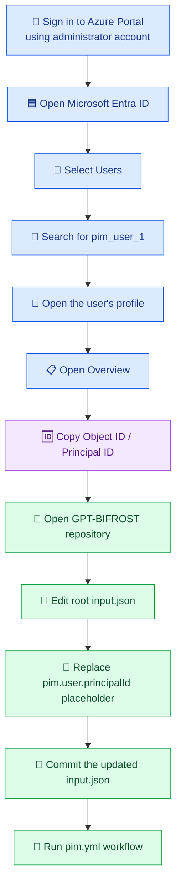
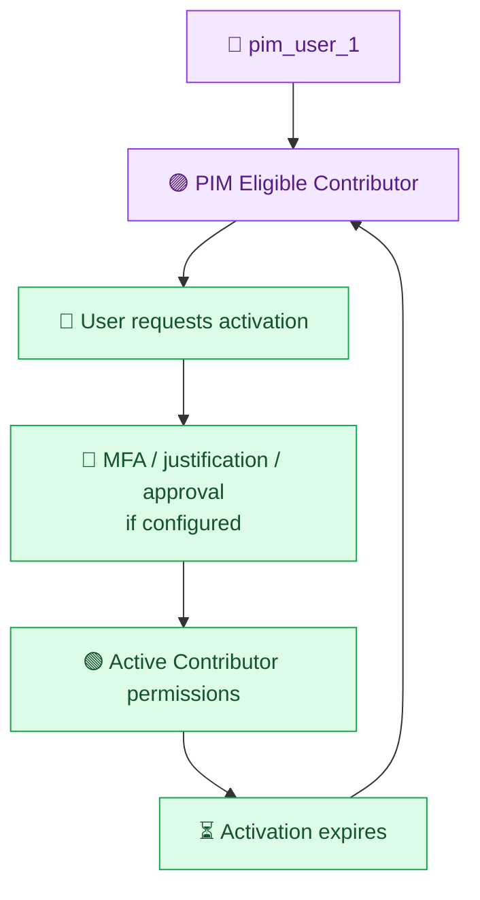

# PIM Troubleshooting Guide

This document covers common troubleshooting scenarios for the BIFROST PIM module and GitHub Actions workflow.

## 1. Prerequisites

Before running `.github/workflows/pim.yml`, confirm:

- The Azure subscription **BIFROST-SC** exists and is accessible.
- The subscription ID is correct.
- The GitHub Actions environment used by the workflow is **`bifrost-dev`**.
- The environment contains these variables/secrets:
  - `AZURE_CLIENT_ID`
  - `AZURE_TENANT_ID`
  - `AZURE_SUBSCRIPTION_ID`
- The Azure identity used by GitHub Actions has the required Azure RBAC permissions to create the PIM role eligibility assignment at the selected scope.
- The user being assigned exists in Microsoft Entra ID.
- The user's **Object ID (Principal ID)** is a valid GUID in `input.json`.

> **Important:** `pim_user_1` is a friendly alias only. Azure needs the actual Microsoft Entra user Object ID in `principalId`.

## 2. Troubleshooting checklist

| Symptom | Possible cause | Resolution |
|---|---|---|
| `principalId` validation fails | Placeholder text is still present or the value is not a GUID | Copy the user's Object ID from Entra ID and replace the placeholder in `input.json`. |
| User cannot be found | Wrong tenant, user does not exist, or incorrect Object ID | Confirm the user in **Microsoft Entra ID → Users** and copy the Object ID again. |
| Azure login fails in GitHub Actions | OIDC federation configuration mismatch | Verify `AZURE_CLIENT_ID`, `AZURE_TENANT_ID`, and the federated credential subject/issuer/audience. |
| Workflow cannot read environment variables | Job is not referencing the expected GitHub Environment | Check the workflow job's `environment: bifrost-dev` setting and verify variables/secrets in that environment. |
| Subscription is not found | Incorrect subscription ID or identity lacks access | Verify `AZURE_SUBSCRIPTION_ID` and that the workflow identity can access **BIFROST-SC**. |
| PIM assignment deployment returns authorization error | GitHub Actions identity lacks role-management permissions at the target scope | Ask a subscription administrator to grant the required least-privilege permissions. Confirm permissions for Azure role assignment/PIM schedule operations. |
| Subscription is not listed under PIM Azure resources | Subscription may not be managed/onboarded in PIM, or current account lacks access | In the Entra admin center, open **PIM → Azure resources** and check the subscription. If an onboarding/discovery action is shown, an authorized administrator may need to manage the resource. |
| Eligible assignment exists, but user cannot manage resources | Eligibility has not been activated | The assigned user must sign in and activate the eligible role in PIM. |
| User sees no activation option | Wrong tenant/account, assignment not yet available, wrong scope, or assignment expired | Confirm the user account, tenant, scope, and eligibility status in PIM. |
| User has Contributor but cannot assign RBAC roles | Contributor does not grant permission to assign Azure roles | Use an appropriately authorized role for role assignment operations; do not assume Contributor can grant access to others. |

## 3. Get the Principal ID (Object ID) from Azure Portal

You do **not** need to sign in as the newly created user to retrieve their Principal ID. Use your administrator account.

### Azure Portal navigation

1. Sign in to the [Azure Portal](https://portal.azure.com) using your administrator account.
2. Open **Microsoft Entra ID**.
3. Select **Users**.
4. Search for the test user (for example, `pim_user_1`).
5. Open the user's profile.
6. On the **Overview** page, locate **Object ID**.
7. Copy the Object ID (a GUID).
8. In the repository, open the root `input.json`.
9. Replace the placeholder value of `pim.user.principalId` with the copied Object ID.
10. Save and commit the change to the intended branch.

### Principal ID retrieval flow



### Example input.json snippet

Replace the placeholder with the actual Object ID from the user's Entra profile:

```json
{
  "pim": {
    "user": {
      "alias": "pim_user_1",
      "principalId": "REPLACE_WITH_ENTRA_USER_OBJECT_ID",
      "principalType": "User"
    }
  }
}
```

**Do not** use the user's email address, UPN, display name, or GitHub username for `principalId`. Use the Entra **Object ID** GUID.

## 4. PIM eligibility vs. activation

An eligible assignment is not the same as an active assignment.

- **Eligible:** The user is allowed to request activation of the role.
- **Activation:** The user requests activation, potentially providing MFA, justification, or approval depending on configured policy.
- **Active:** Azure permissions are available for the activation period.
- **Expiration:** Active permissions expire; the eligible assignment may remain until its own expiration.

### PIM user lifecycle



## 5. Verify the eligible assignment in Azure Portal

Using an administrator account:

1. Open the Microsoft Entra admin center.
2. Navigate to **Identity Governance → Privileged Identity Management**.
3. Select **Azure resources**.
4. Select the **BIFROST-SC** subscription.
5. Open **Assignments** or **Role assignments** (portal labels may vary).
6. Check **Eligible assignments**.
7. Verify the user, role (**Contributor**), scope, and assignment status.

If the subscription or assignment is not visible, confirm that you are in the correct tenant and that your administrator account has sufficient permissions.

## 6. Safety notes

- Subscription-level Contributor is broad access. Prefer a test subscription or narrower resource-group scope when possible.
- Contributor can manage many Azure resources but cannot generally assign Azure RBAC roles.
- Creating an eligible assignment does not automatically activate the role.
- Do not commit passwords, client secrets, access tokens, or other credentials to `input.json` or the repository.
- Confirm the target subscription and user before running the workflow with `deploy_pim = true`.
