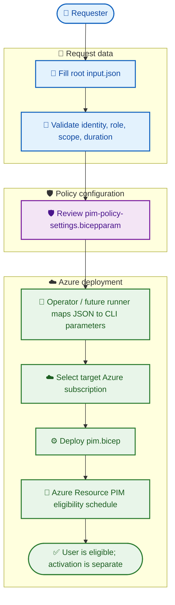

# 🌌 BIFROST — Azure Privileged Identity Management (PIM)

BIFROST is a reusable Azure PIM configuration and implementation workspace. This branch, `feature/PIM_mark_2`, contains a requester input example, an Azure Resource PIM eligibility Bicep template, PIM policy configuration intent, and operator documentation.

> ⚠️ **Implementation status:** The current Bicep template creates an Azure Resource PIM eligibility schedule request. Policy settings in the `.bicepparam` file represent desired policy configuration and are **not automatically applied**. Entra directory-role PIM and PIM for Groups policy updates need separate Microsoft Graph implementation. There is currently no complete runner that reads root `input.json` and maps all fields to Bicep.

## 🗂️ Repository structure

```text
BIFROST/
├── input.json                         # 🧾 Request-specific values
├── README.md                           # 📘 Project overview
├── docs/                               # 📚 Guides and audit notes
│   ├── README.md
│   ├── CLI_LOCAL_TESTING.md
│   ├── CREATE_ENTRA_USER_AZURE_PORTAL.md
│   ├── PIM_AZURE_PORTAL_VARIABLES.md
│   └── hardcoded_values_audit.md
└── modules/pim/
    ├── pim.bicep                       # ⚙️ Azure Resource PIM eligibility
    ├── pim-policy-settings.bicepparam  # 🛡️ Policy configuration intent
    └── README.md
```

## 🧩 Configuration responsibilities

### 🧾 Root `input.json` — requester input

Contains the identity receiving access, requested role/scope, request operation, eligibility duration, justification, and ticket metadata.

- **Identity:** display name, UPN, Microsoft Entra Object ID.
- **Access request:** platform, role, role definition GUID, scope, assignment type, request type, duration, justification.
- **Scope:** subscription ID, Resource Group name, or resource ID as applicable.
- **Ticket metadata:** ticket ID, ticket number, ticket system, requester, environment.

Use the Entra **Object ID (GUID)** for the principal—not display name or UPN. Ticket metadata stays in JSON and is not currently passed to the Azure PIM resource.

### 🛡️ `pim-policy-settings.bicepparam` — PIM policy intent

Contains desired policy settings for:
- Azure Resource PIM: Owner and User Access Administrator.
- Entra directory roles: Global Administrator and Exchange Administrator.
- PIM for Groups: Owner and Member.
- Assignment defaults and approval/eligibility policy intentions.

Approver Object ID placeholders must be replaced with approved identities. These values are configuration intent until policy API implementation is added.

### ⚙️ `pim.bicep` — Azure Resource eligibility

The template uses:

```bicep
targetScope = 'subscription'
```

It creates `Microsoft.Authorization/roleEligibilityScheduleRequests@2024-09-01-preview`.

It does **not** parse JSON, infer the subscription from JSON, apply activation policy objects, configure Entra/Group PIM policies, or activate a role.

## 🔄 Request lifecycle (current and intended)



## ⏱️ Request duration vs activation duration

- `requestType` (e.g. `AdminAssign`) is an Azure schedule request operation.
- `duration` (e.g. `P30D`) is the eligibility schedule duration.
- **Activation duration** (e.g. 1 hour) is a PIM policy setting, separate from eligibility duration.
- The Bicep `@allowed` duration list is finite; it is not every possible ISO 8601 expression.

## 🎯 Subscription targeting

`targetScope = 'subscription'` sets deployment scope—it does **not** select a subscription. The command/workflow must select one explicitly, e.g. Azure CLI `--subscription <SUBSCRIPTION_ID>`.

Root `input.json` contains a subscription ID, but Bicep does not read JSON automatically. Until a runner maps that field into CLI/deployment context, it does not control the target.

```bash
az account show --query "{Name:name, SubscriptionId:id, TenantId:tenantId}" -o table
```

## 📚 Documentation

- [Documentation index](docs/README.md)
- [Create an Entra user](docs/CREATE_ENTRA_USER_AZURE_PORTAL.md)
- [Portal values guide](docs/PIM_AZURE_PORTAL_VARIABLES.md)
- [Local CLI testing](docs/CLI_LOCAL_TESTING.md)
- [Hardcoded values audit](docs/hardcoded_values_audit.md)

## 🔒 Security checklist

- Use least privilege and approval controls.
- Never commit passwords, secrets, private keys, or real production identifiers.
- Verify tenant, subscription, principal, role, and scope before deployment.
- Eligibility creation does not activate the role.
