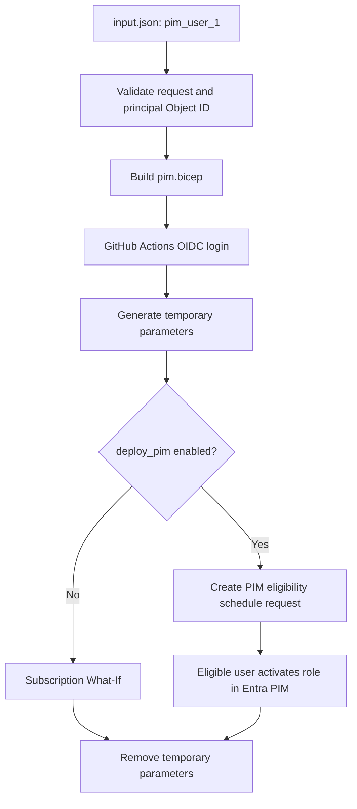

# GPT-BIFROST | PIM User Eligibility

**Branch:** `feature/PIM_mark_1`  
**Purpose:** This branch is dedicated only to granting Microsoft Entra users **Azure PIM eligible role access**. It does not deploy VMs, networks, resource groups, monitoring, backup, storage, or direct RBAC assignments.

## What this workflow does

- Reads the PIM request from root `input.json`.
- Uses GitHub Actions OIDC to authenticate to Azure.
- Builds and validates the PIM Bicep module.
- Validates input and can submit a PIM eligibility request at Subscription, Resource Group, or Resource scope.
- Creates a PIM eligibility schedule request only when `deploy_pim` is explicitly enabled.
- Assigns eligibility to the configured user (sample alias: `pim_user_1`) for the selected role and duration.

> **Important:** PIM eligibility is not immediate active access. The eligible user must activate the role through Microsoft Entra PIM and satisfy any configured MFA, approval, justification, or other activation requirements.

## Repository layout

```text
GPT-BIFROST/
├── .github/
│   └── workflows/
│       └── pim.yml
├── modules/
│   └── pim/
│       └── pim.bicep
├── input.json
└── README.md
```

## Input configuration

The root `input.json` is the single source of request configuration.

### Required user identity

```json
"user": {
  "alias": "pim_user_1",
  "principalId": "REPLACE_WITH_PIM_USER_1_ENTRA_OBJECT_ID",
  "principalType": "User"
}
```

`alias` is a human-readable label used in this repository. Azure PIM requires the user's **Microsoft Entra Object ID (GUID)**, not a display name or email address. Replace the placeholder with the actual object ID before running the workflow.

Find the Object ID in Azure Portal:

1. Open **Microsoft Entra ID → Users**.
2. Search for the intended user.
3. Open the user profile.
4. Copy **Object ID**.
5. Update `pim.user.principalId` in `input.json`.

Or use Azure CLI:

```bash
az ad user show --id "user@yourdomain.com" --query id --output tsv
```

The alias `pim_user_1` does not automatically create a user in Entra ID and is not a valid principal ID by itself.

## PIM parameters

| JSON property | Description |
|---|---|
| `request.approved` | Must be `true`; represents request approval in this sample. |
| `subscription.name` | Subscription guardrail; currently `BIFROST-SC`. |\n| `subscription.subscriptionId` | Target subscription GUID. This is read from `input.json`, not GitHub vars. |
| `pim.enabled` | Enables PIM configuration. |
| `pim.assignmentType` | Currently supports `Eligibility`. |
| `pim.user.principalId` | Entra Object ID of the user. |
| `pim.role.roleName` | Human-readable role name. |
| `pim.role.roleDefinitionId` | Azure role definition GUID. |
| `pim.scope.type` | `Subscription`, `ResourceGroup`, or `Resource`. |
| `pim.schedule.duration` | ISO 8601 duration; sample `P90D` (90 days). |
| `pim.justification` | Business reason for the access request. |
| `pim.ticketInfo.ticketNumber` | Request/ticket reference. |

### Default role

The sample uses **Contributor**:

```text
b24988ac-6180-42a0-ab88-20f7382dd24c
```

Contributor can manage Azure resources but does not grant permission to assign Azure roles. Review the role carefully and use least privilege.

## GitHub Environment configuration

Configure the GitHub repository environment named **`bifrost-env`**:

| Environment variable | Required | Purpose |
|---|---|---|
| `AZURE_CLIENT_ID` | Yes | Entra application / workload identity client ID used by Azure Login. |
| `AZURE_TENANT_ID` | Yes | Entra tenant ID. |
| `AZURE_SUBSCRIPTION_ID` | Yes | Target subscription ID for BIFROST-SC. |

`AZURE_CLIENT_ID` and `AZURE_TENANT_ID` are read from the GitHub Environment. The target subscription ID comes from `input.json:subscription.subscriptionId`; `AZURE_SUBSCRIPTION_ID` is not used to override it. Configure the federated credential to trust the repository and GitHub environment. Do not store client secrets when OIDC is available.

## Azure permissions

The GitHub OIDC identity needs sufficient permissions to submit subscription-level PIM eligibility schedule requests. Ordinary Contributor access is not sufficient.

Depending on your tenant's authorization model, use an appropriately authorized administrator/role such as Privileged Role Administrator or a delegated role with the required Microsoft.Authorization PIM schedule request permissions. Follow least privilege and organizational approval requirements.

The user creating eligibility should be authorized to assign the requested role at the target scope. The assigned role and scope must comply with tenant PIM policies.

## Run the workflow

1. Push the changes to `feature/PIM_mark_1`.
2. Open GitHub **Actions**.
3. Select **BIFROST | PIM User Eligibility Assignment**.
4. Select **Run workflow** and choose `feature/PIM_mark_1`.
5. Keep `deploy_pim` unchecked for validation and What-If only.
6. Review validation and What-If output.
7. After verifying the target user, role, scope, duration, and approval, run again with `deploy_pim` checked.
8. Review the Azure deployment result.

### Workflow safety

- `deploy_pim=false`: validation + What-If preview; no eligibility assignment is created.
- `deploy_pim=true`: submits the eligibility request to Azure.
- The workflow fails if the principal ID placeholder is not replaced with a valid GUID.
- The generated parameter file is temporary and removed at the end of the job.
- The PIM request is submitted using Azure Resource Manager REST at the selected scope. The Bicep module remains subscription-targeted and is compiled for syntax validation; it is not used to create the RG/resource scope request. There is no PIM What-If preview for this REST operation.

## Workflow flow



## Troubleshooting

### Invalid principal / PrincipalNotFound
- Ensure `pim.user.principalId` is the actual Entra user Object ID.
- Verify the user exists in the tenant associated with `AZURE_TENANT_ID`.

### AuthorizationFailed / insufficient privileges
- Confirm the GitHub OIDC identity has PIM schedule request permissions at subscription scope.
- Confirm the role assignment and PIM policies allow the requested Contributor eligibility.
- Check subscription ID and tenant ID environment variables.

### Federated credential / Azure login failure
- Verify `AZURE_CLIENT_ID`, `AZURE_TENANT_ID`, and `AZURE_SUBSCRIPTION_ID` in `bifrost-env`.
- Verify federated credential subject matches this repository and GitHub environment.
- Confirm workflow permissions include `id-token: write`.

### What-If reports errors
- Validate the principal ID and role definition GUID.
- Confirm the Bicep module builds successfully.
- Confirm the caller has permission to read/submit PIM schedule requests.

## Security notes

- Never put client secrets, passwords, or private keys in `input.json`.
- Confirm request approval and access justification before deployment.
- Avoid assigning broad roles at subscription scope unless explicitly approved.
- Review eligible access periodically and remove eligibility when no longer needed.
- A PIM eligibility request is privileged: use protected GitHub environment approvals and audit Azure activity logs.

## Related links

- [Azure Privileged Identity Management](https://learn.microsoft.com/azure/active-directory/privileged-identity-management/)
- [Azure role eligibility schedule requests](https://learn.microsoft.com/azure/templates/microsoft.authorization/roleeligibilityschedulerequests)


## Scope-aware PIM access

The root `input.json` defines both the target subscription and scope:

- **Subscription:** `pim.scope.type = "Subscription"`
- **Resource Group:** `pim.scope.type = "ResourceGroup"` plus `pim.scope.resourceGroupName`
- **Resource:** `pim.scope.type = "Resource"` plus the full `pim.scope.resourceId`

Set `subscription.subscriptionId` to a real subscription GUID in the JSON. JSON does not expand shell variables such as `${AZURE_SUBSCRIPTION_ID}`. The workflow passes this ID to Azure Login and verifies it with `az account show` after setting the CLI context.

The GitHub Environment `bifrost-dev` is used for OIDC identity variables:
- `AZURE_CLIENT_ID`
- `AZURE_TENANT_ID`

The scope preflight checks ARM read access to the configured target. PIM write authorization is checked by Azure when the REST request is submitted. For detailed examples and CLI testing, see [PIM_PIPELINE_INPUTS_AND_EXECUTION.md](PIM_PIPELINE_INPUTS_AND_EXECUTION.md).
