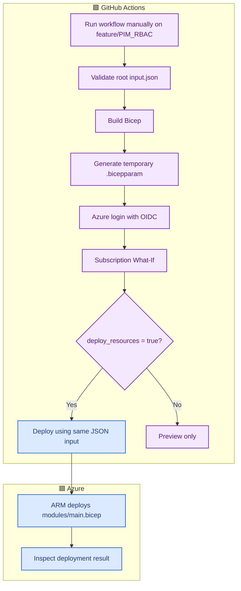
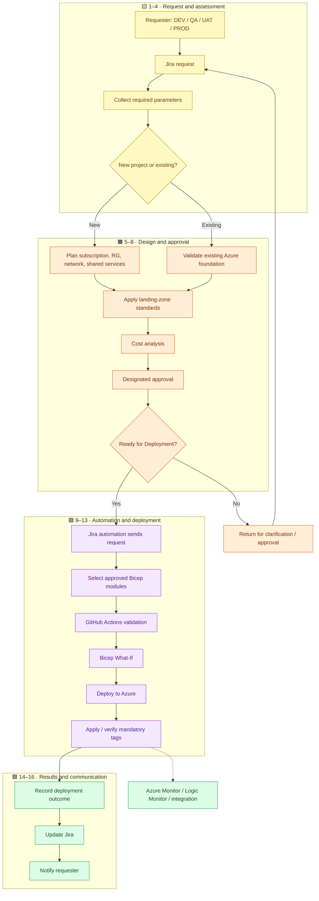
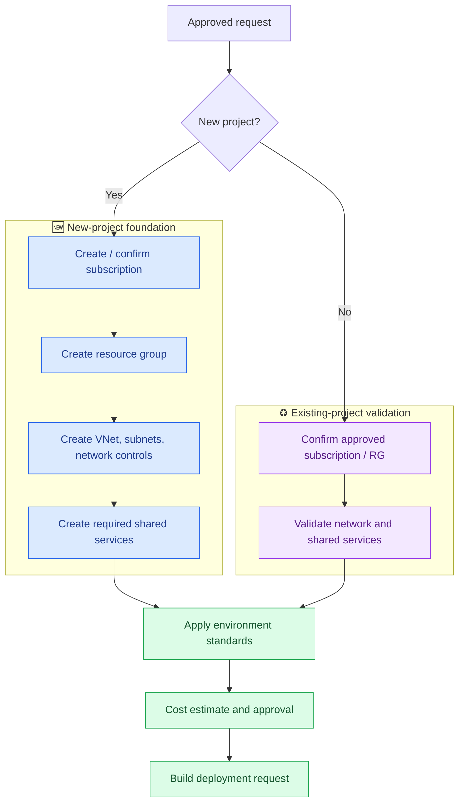
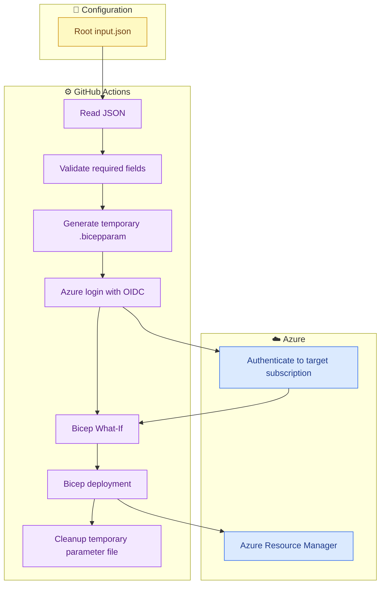
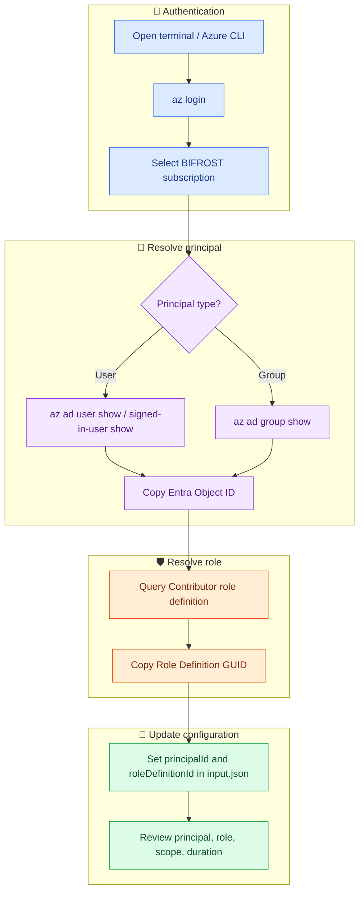

# 🌌 BIFROST — Azure Environment Provisioning with Bicep

> **Purpose:** BIFROST is an Infrastructure as Code (IaC) repository for provisioning and managing Azure infrastructure with reusable Bicep modules and GitHub Actions.

This guide covers the repository, deployment flow, PIKE alignment, JSON-driven deployment design, PIM configuration, and security considerations.

## 📚 Contents

- [Overview](#-overview)
- [Architecture and workflow](#-architecture-and-workflow)
- [PIKE end-to-end process](#-pike-end-to-end-process)
- [New project vs existing environment](#-new-project-vs-existing-environment)
- [Repository structure](#-repository-structure)
- [Module catalogue](#-module-catalogue)
- [JSON-driven deployment](#-json-driven-deployment)
- [PIM configuration guide](#-pim-configuration-guide)
- [Prerequisites](#-prerequisites)
- [Deployment and validation](#-deployment-and-validation)
- [PIKE alignment and implementation gaps](#-pike-alignment-and-implementation-gaps)
- [Security guidance](#-security-guidance)

---

## 🎯 Overview

BIFROST contains reusable Azure Bicep modules and GitHub Actions workflows. The intended deployment path is:

1. A request is raised and approved through Jira / PIKE.
2. Request details are validated against approved standards.
3. The selected subscription, region, resources, and module inputs are resolved.
4. GitHub Actions validates and previews the deployment.
5. Azure Resource Manager deploys the Bicep templates.
6. Results are verified and reported to the request system.

> **Current-state note:** Jira intake, cost approval, approval gates, requester notifications, and external monitoring are not all implemented in the current GitHub Actions workflow. Diagrams in this README distinguish the target process from current behavior.

### 🧭 Current workflow (manual workflow dispatch)



The updated `.github/workflows/deploy.yml` is **manual-only** (`workflow_dispatch`) to prevent accidental deployment on every push. It validates root `input.json`, compiles Bicep, generates a temporary `.bicepparam`, logs in with OIDC, and runs What-If. Deployment is opt-in using `deploy_resources`; PIM is separately opt-in using `deploy_pim`. Configure the GitHub environment `bifrost-dev` with approval protection if a deployment approval gate is required.

---

## 🔁 PIKE end-to-end process



This represents the **target PIKE process**, not a claim that every step is automated today.

## 🏗️ New project vs existing environment



---

## 📂 Repository structure

```text
.
├── input.json                       # Root deployment input (target single source)
├── config/
│   └── subscriptions.json           # Subscription / environment allowlist-matrix
├── .github/
│   └── workflows/
│       └── deploy.yml               # GitHub Actions deployment workflow
├── environments/
│   └── dev.bicepparam               # Legacy/current environment parameter file
└── modules/
    ├── main.bicep                   # Subscription-scope orchestrator
    ├── resourcegroup.bicep
    ├── compute/
    ├── networking/
    ├── storage/
    ├── security/
    ├── backup/
    ├── monitoring/
    ├── pim/
    └── rbac/
```

📖 Module-specific guides are available in the module directories and `modules/README.md`.

## 🧰 Module catalogue

| Module area | Function | Main dependencies |
|---|---|---|
| Resource group | Create Azure RGs | Subscription, region |
| Compute / VM | VM and NIC | RG, VNet/subnet, optional ASG/Key Vault |
| Networking / VNet | VNet and subnets | RG, CIDR plan |
| Networking / NSG | Network security rules | RG, approved rules |
| ASG | Application Security Group | RG |
| Route table | User-defined routes | RG, route design |
| VNet peering | VNet peering | Both VNets, non-overlapping CIDRs |
| VPN gateway | Gateway and public IP | VNet, GatewaySubnet |
| Storage | Storage account / container | RG, unique account name |
| Key Vault | Vault | RG, access-control design |
| Backup | Recovery vault, policy, VM protection | VM, vault, policy |
| Monitoring | Action group and metric alert | Target resource and action group |
| PIM | Eligible Azure RBAC access | Principal Object ID, role ID, PIM authorization |
| RBAC | Direct role assignment | Principal Object ID, role ID, role-assignment authorization |

PIM eligibility is optionally orchestrated by `modules/main.bicep` when both `input.json` enables PIM and the workflow input `deploy_pim` is true. RBAC direct assignment remains a separate module.

---

## 🔄 JSON-driven deployment

The planned approach uses root `input.json` as the resource configuration source. GitHub Actions parses and validates it, maps values to Bicep parameters, creates a temporary parameter file, performs What-If and deployment, and cleans up the generated file.

> ⚠️ **Implementation status:** This is the target workflow. The current `deploy.yml` still uses the existing subscription matrix and parameter-file path. The workflow and Bicep parameter schema must be updated before this diagram represents actual workflow behavior.



### Expected sequence

1. Checkout repository and read root `input.json`.
2. Validate JSON syntax, required fields, allowed values, and subscription target.
3. Map the input into the parameters declared by the chosen Bicep template.
4. Generate a temporary parameter file on the runner.
5. Authenticate to Azure using OIDC.
6. Run What-If and deployment using the **same generated parameter file**.
7. Clean up the temporary file, including on failure.

🔐 Do not commit or upload generated parameter files containing secrets. Use GitHub Secrets, Azure Key Vault, or secure runtime parameters for secrets. Do not store passwords or client secrets in `input.json`.

---

## 🔐 PIM configuration guide

The root `input.json` PIM section needs:

- `pim.principal.principalId`: Entra ID Object ID of the user, group, or service principal receiving access.
- `pim.role.roleDefinitionId`: Azure RBAC Role Definition ID for the requested role.

### Step 1 — Sign in to Azure CLI

```bash
az login
```

If needed, select the target subscription:

```bash
az account set --subscription "<BIFROST-SC-SUBSCRIPTION-ID>"
```

### Step 2 — Get the PIM Principal ID

For the currently signed-in user:

```bash
az ad signed-in-user show --query id --output tsv
```

For a specific user:

```bash
az ad user show --id "user@company.com" --query id --output tsv
```

For a group:

```bash
az ad group show --group "<group-name-or-id>" --query id --output tsv
```

Replace the sample user UPN or group identifier with the intended recipient. Set `principalType` to `User` or `Group` accordingly.

### Step 3 — Get the Contributor Role Definition ID

The built-in Azure Contributor role GUID is:

```text
b24988ac-6180-42a0-ab88-20f7382dd24c
```

Retrieve the GUID using Azure CLI:

```bash
az role definition list --name "Contributor" --query "[0].name" --output tsv
```

Retrieve the full role definition resource ID:

```bash
az role definition list --name "Contributor" --query "[0].id" --output tsv
```

Use the GUID or full resource ID according to the parameter contract of your PIM Bicep module. Contributor grants broad resource management rights but does not generally grant permission to assign roles or create PIM eligibility assignments.

### 🧭 PIM ID discovery flow



### Example PIM configuration

```json
"pim": {
  "enabled": true,
  "assignmentType": "Eligibility",
  "principal": {
    "principalId": "<ENTRA-USER-OBJECT-ID>",
    "principalType": "User"
  },
  "role": {
    "roleName": "Contributor",
    "roleDefinitionId": "b24988ac-6180-42a0-ab88-20f7382dd24c"
  }
}
```

⚠️ **Important:** Principal ID is not an email/UPN, subscription ID, or tenant ID. It is the Entra Object ID of the recipient. Confirm principal, role, scope, duration, and approval before creating privileged access.

---

## ✅ Prerequisites

Before deployment, verify:

1. The Azure subscription exists and is the intended target.
2. An Entra application/service principal is configured for GitHub OIDC federation.
3. GitHub Actions variables `AZURE_CLIENT_ID` and `AZURE_TENANT_ID` are configured.
4. The federated credential trusts the correct repository and branch/environment.
5. The deployment identity has required permissions. PIM eligibility and role assignment operations require specific authorization beyond ordinary Contributor.
6. Parameter files match the Bicep template parameters.
7. Resource provider registration, quotas, naming, regions, and tags are checked.

---

## 🚀 Deployment and validation

### Bicep build

Run from the repository root:

```bash
az bicep build --file modules/main.bicep
```

### Subscription What-If

```bash
az deployment sub what-if --location eastus --template-file modules/main.bicep --parameters environments/dev.bicepparam
```

### Current deployment behavior

The current workflow triggers on push to `Dev`. Before running:

1. Review `config/subscriptions.json` and verify the subscription and parameter file.
2. Review the deployment inputs and `landingZones` structure.
3. Check Azure identity, permissions, and workflow settings.
4. Review What-If output.
5. Deploy only after the appropriate review/approval.
6. Verify deployment result in Azure and GitHub Actions.

The deployment location in the current workflow is `eastus`. Change it only through a reviewed configuration update.

---

## 📊 PIKE alignment and implementation gaps

**Current status: partially aligned.**

| PIKE step | Status | Current note |
|---|---|---|
| Requester / Jira | ⏳ Not implemented | Jira intake is not wired into workflow |
| Request parameters | 🟢 Implemented for this workflow | Root JSON parsed and passed to Bicep |
| New vs existing project | ⏳ Not automated | Requires assessment flow |
| Standards / landing zone | 🟡 Partial | Reusable modules exist; enforcement incomplete |
| Cost analysis | ⏳ Not implemented | No cost gate |
| Approval / Ready status | 🟡 Partial | Manual workflow dispatch; request approval field is checked |
| Jira automation | ⏳ Not implemented | No ticket webhook/API intake |
| Bicep module selection | 🟡 Partial | Modules exist; dynamic mapping needs work |
| GitHub Actions / Azure deployment | 🟢 Implemented | OIDC, What-If, optional deploy, Linux SSH VM module |
| Mandatory tagging | 🟡 Partial | Some templates accept tags; universal enforcement not proven |
| Result reporting | 🟡 Partial | Azure/GitHub status available; no structured Jira result |
| Jira update / requester notification | ⏳ Not implemented | Integration pending |
| Monitoring integration | 🟡 Partial | Alert modules exist; external integration pending |

### 🔧 Recommended implementation order

1. Define a versioned Jira JSON request schema.
2. Add authenticated Jira event intake and Ready-for-Deployment validation.
3. Add new-project vs existing-environment assessment.
4. Enforce approved naming, SKU, OS, region, network, and security standards.
5. Add cost estimation and formal approval gates.
6. Extend JSON schema and module coverage for additional resource types.
7. Add lint, policy checks, and mandatory review/approval controls.
8. Add Azure Key Vault integration if future resources require secrets.
9. Enforce mandatory tags across supported resources.
10. Capture deployment status, resource IDs, and errors in structured outputs.
11. Update Jira and notify requester on completion.
12. Integrate monitoring, diagnostics, and external tooling.

---

## 🛡️ Security guidance

- Prefer GitHub OIDC/workload identity federation over long-lived client secrets.
- Separate test and production identities.
- Follow least privilege, especially for PIM/RBAC.
- Use approvals for production and privileged access.
- What-If is a preview, not an approval control.
- Use the same reviewed inputs for What-If and deployment.
- Never commit passwords, secrets, or generated credentials.
- Avoid printing sensitive data in workflow logs.
- Validate Bicep and parameters before deployment.
- Keep docs synchronized with actual workflows and modules.

---

## 🔗 Related documentation

- [Module documentation index](modules/README.md)
- [Main Bicep orchestration guide](modules/main.md)
- [PIM module guide](modules/pim/README.md)
- [RBAC module guide](modules/rbac/README.md)
- [GitHub Actions workflow](.github/workflows/deploy.yml)

> **Repository status:** BIFROST provides the core IaC foundation. Jira integration, project assessment, cost/approval gates, complete tag enforcement, structured request updates, notifications, and external monitoring integration remain future implementation work.
