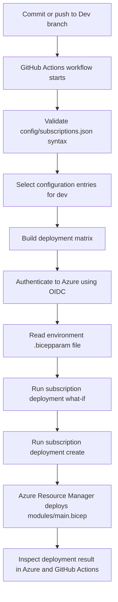
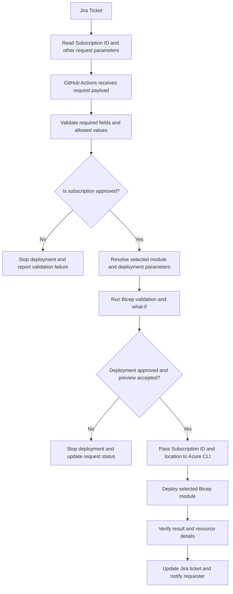
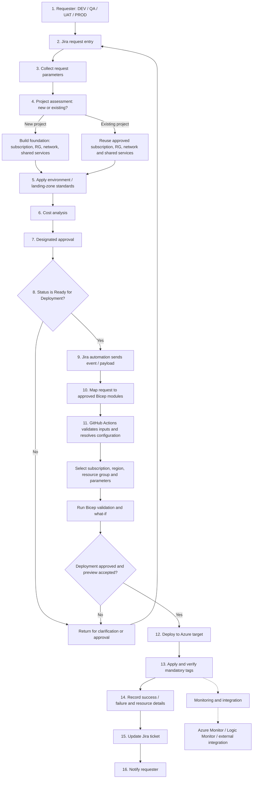
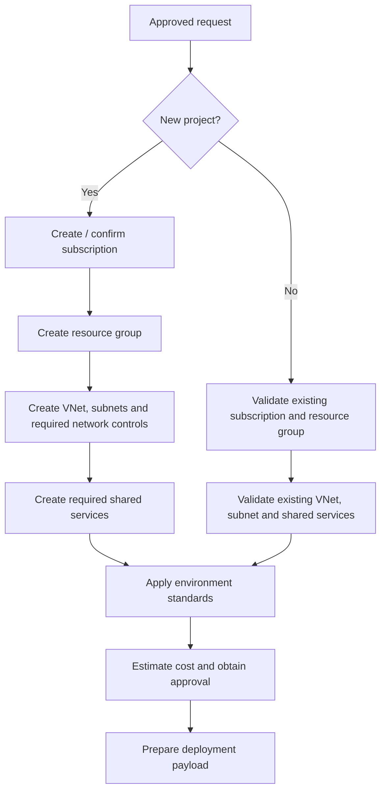
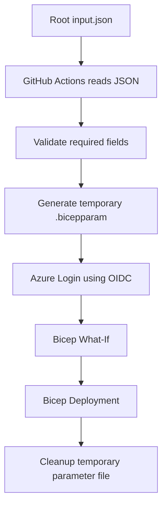

# BIFROST — Azure Environment Provisioning with Bicep

> **Purpose:** BIFROST is an Infrastructure as Code (IaC) repository for provisioning and managing Azure environment resources using Bicep modules and GitHub Actions.

This README explains the repository structure, how a deployment currently runs, how that process relates to the PIKE end-to-end Azure Environment Provisioning workflow, and what remains to be implemented for full alignment.

## Table of contents

- [Overview](#overview)
- [Repository workflow today](#repository-workflow-today)
- [End-to-end PIKE workflow](#end-to-end-pike-workflow)
- [New project vs existing environment](#new-project-vs-existing-environment)
- [Repository structure](#repository-structure)
- [Current module catalogue](#current-module-catalogue)
- [Deployment flow](#deployment-flow)
- [Prerequisites and configuration](#prerequisites-and-configuration)
- [How to run a deployment](#how-to-run-a-deployment)
- [Comparison with the PIKE process diagram](#comparison-with-the-pike-process-diagram)
- [Gaps to close for full alignment](#gaps-to-close-for-full-alignment)
- [Security and operational guidance](#security-and-operational-guidance)

## Overview

BIFROST separates Azure resource definitions into reusable Bicep templates, uses `modules/main.bicep` to orchestrate supported infrastructure modules, stores environment inputs in `environments/*.bicepparam`, and uses GitHub Actions to authenticate to Azure and run a subscription deployment.

The intended operating model is:

**Source-of-truth rule:** request-specific values such as the target subscription ID should come from the approved Jira request payload. GitHub Actions validates those values against approved configuration and passes them to the deployment. Environment `.bicepparam` files provide template parameters for the selected environment; they should not silently override a ticket's target subscription. For subscription-scope templates such as PIM, the subscription is selected with the deployment command's `--subscription` argument.

1. A requester raises an approved request in Jira or the agreed intake system.
2. Request details are assessed and mapped to an approved environment standard.
3. The deployment payload selects the environment, subscription, resource group, region, and required resource modules.
4. GitHub Actions validates and previews the requested infrastructure.
5. Azure Resource Manager deploys the selected Bicep resources.
6. The resulting resource details and deployment status are verified and reported back to the request process.

**Important:** Steps involving Jira, project assessment, formal cost approval, designated approvers, requester notification, and external monitoring are part of the target PIKE workflow. They are not all automated by the current repository workflow yet.

## Repository workflow today



The current workflow is `.github/workflows/deploy.yml`. It triggers on pushes to the `Dev` branch, selects configuration entries whose environment is `dev`, authenticates using `azure/login@v2` and GitHub OIDC, runs `what-if`, then runs `az deployment sub create`.

> **Current behavior to be aware of:** the workflow generates the VM administrator password independently in the what-if step and the deployment step. The preview and actual deployment therefore do not use the same generated value. Also, the current workflow proceeds from what-if to deployment without a separate human approval gate. Treat this as a test workflow until approval, secret handling, and deployment controls are reviewed.

## Jira ticket parameters and subscription validation

In the target PIKE workflow, the Jira ticket is the source for the request-specific deployment parameters. GitHub Actions must validate the payload and check the requested subscription against the approved subscription configuration before starting a deployment. The subscription ID is passed to Azure CLI as the deployment target; it is not implicitly selected from an environment `.bicepparam` file.

The exact fields should be defined in the Jira request contract. Typical request fields include:

- **Targeting:** Subscription ID, environment, Azure region/deployment location, resource group (if applicable).
- **Resource selection:** Resource type/module, OS and version, approved SKU/size, image, network/subnet selections, and required dependencies.
- **Project and governance:** Project/application ID, business unit/cost centre, financial ID, owner, business criticality, resource type, and required tags.
- **Request context:** Jira ticket/request ID, requester, business justification, uptime/downtime requirements, additional requirements, and approval/Ready for Deployment status.
- **Access requests (PIM/RBAC, when applicable):** Principal Object ID and type, role definition ID, requested access duration, justification, and any required approval evidence.

Only collect fields relevant to the selected module. For example, PIM requires the target subscription, principal identity, role definition, justification, and access schedule settings; it does not need VM-only inputs such as OS image or VM size. Secrets and credentials must not be sent as ordinary ticket fields.



The diagram above describes the **intended target flow**. Jira payload intake, request-schema validation, approved-subscription checking, approval gates, and Jira result updates must be implemented in the workflow before the process is fully automated. The existing deployment workflow remains configuration-driven until those integrations are added.

## End-to-end PIKE workflow

This is the intended business and technical process represented by the shared “Azure Environment Provisioning — End to End Flow (Updated)” diagram.



The Mermaid diagram is a representation of the target process, not a claim that every step is currently automated in this repository.

## New project vs existing environment

The project assessment step determines whether BIFROST should create foundational services or reuse existing approved infrastructure.



The current templates cover several foundation components, but subscription creation, request assessment, cost estimation, and approval are not implemented as a complete automated intake flow.

## Repository structure

```text
.
├── .github/
│   └── workflows/
│       └── deploy.yml             # GitHub Actions subscription deployment
├── config/
│   └── subscriptions.json         # Environment / subscription deployment matrix
├── environments/
│   ├── dev.bicepparam             # Development input values
│   ├── test.bicepparam            # Test input values
│   ├── uat.bicepparam             # UAT input values
│   └── prod.bicepparam            # Production input values
├── modules/
│   ├── main.bicep                 # Subscription-scope orchestrator
│   ├── README.md                  # Module documentation index
│   ├── resourcegroup.bicep
│   ├── resourcegroup/README.md
│   ├── main/README.md
│   ├── compute/
│   │   ├── vm.bicep
│   │   └── vm/README.md
│   ├── networking/                # VNet, NSG, ASG, routes, peering, VPN gateway
│   ├── storage/                   # Storage account and blob container
│   ├── security/                  # Key Vault
│   ├── backup/                    # Vault, policy, VM protection
│   ├── monitoring/                # Action groups and metric alerts
│   ├── pim/                       # Eligible Azure RBAC access
│   └── rbac/                      # Direct Azure RBAC assignments
└── README.md                      # Repository overview and process guide
```

See [`modules/README.md`](modules/README.md) for links to the module-specific guides.

## Current module catalogue

| Module area | What it provisions | Key dependencies |
|---|---|---|
| Resource group | Azure resource groups | Subscription and approved region |
| Compute / VM | Windows VM and NIC | Resource group, existing VNet/subnet, optional ASG, Key Vault |
| Networking / VNet | VNet and subnets | Resource group, CIDR plan, optional NSG/route table references |
| Networking / NSG | NSG and security rules | Resource group and approved network rules |
| Networking / ASG | Application Security Group | Resource group |
| Networking / route table | User-defined route table | Resource group and approved route design |
| Networking / peering | Source-to-remote VNet peering | Both VNets and non-overlapping address spaces |
| Networking / VPN gateway | VPN gateway and public IP | Existing VNet and GatewaySubnet |
| Storage | Storage account and blob container | Resource group, globally unique account name |
| Key Vault | Vault with Azure RBAC authorization | Resource group and access-control plan |
| Backup | Recovery Services vault, policy and VM protection | Existing VM/vault/policy in correct deployment order |
| Monitoring | Action group and metric alert | Existing target VM and action group |
| PIM | Eligible Azure RBAC role access | Principal Object ID, role definition ID, authorization to create eligibility requests |
| RBAC | Direct Azure RBAC role assignment | Principal Object ID, role definition ID, authorization to create role assignments |

PIM and direct RBAC are documented as separate modules. They are not currently orchestrated from `modules/main.bicep`.

## Deployment flow

### 1. Environment configuration

The current GitHub Actions workflow reads `config/subscriptions.json` and selects entries for `dev`; that is the current configuration-driven behavior. In the target PIKE flow, request-specific target details (including Subscription ID) should come from the approved Jira ticket payload, then be validated against `config/subscriptions.json` or an explicit approved-subscription allowlist. The validated request should determine the deployment target. Environment `.bicepparam` files supply Bicep template parameters; they are not automatically the source of the ticket's subscription ID.

The workflow currently logs in using these GitHub repository/environment variables:

- `AZURE_CLIENT_ID`
- `AZURE_TENANT_ID`

It uses the subscription ID from the matrix entry for the Azure login.

### 2. Bicep orchestration

`modules/main.bicep` is declared at subscription scope and loops through arrays in the `landingZones` parameter. It can deploy resource groups and invoke child templates for networking, VMs, storage, Key Vault, backup, and monitoring.

The environment parameter file must supply the structure and values expected by `main.bicep`. Review the actual file before running the workflow; the module documentation explains the intended inputs.

### 3. Preview and deployment

The workflow runs:

- `az deployment sub what-if` to preview changes.
- `az deployment sub create` to submit the deployment.

The subscription deployment location is currently set to `eastus` in the workflow. Change this only through a reviewed configuration update if your operational standard requires a different deployment location.

## Prerequisites and configuration

Before using the workflow, ensure:

1. The Azure subscription exists and is the intended target.
2. A Microsoft Entra application/service principal is configured for GitHub Actions workload identity federation (OIDC).
3. `AZURE_CLIENT_ID` and `AZURE_TENANT_ID` are configured as GitHub Actions variables.
4. The federated credential trusts the correct repository and branch/environment subject.
5. The identity has sufficient permissions for every resource type in the deployment. Creating role assignments or PIM eligibility requires specific authorization beyond ordinary Contributor access.
6. The chosen `.bicepparam` file matches the parameters and object structure expected by `modules/main.bicep`.
7. Required resource providers, naming rules, regional availability, quota, and mandatory tags are reviewed.

Do not store real credentials, passwords, client secrets, or other secrets in committed JSON or Bicep parameter files.

## How to run a deployment

The current automated workflow is configured to trigger on a push to the `Dev` branch. Before using it:

1. Review `config/subscriptions.json` and confirm the selected `dev` entry points to the intended subscription and parameter file.
2. Review the parameter file and verify the `landingZones` values.
3. Review the workflow's Azure identity and permissions.
4. Run a Bicep build and inspect the Azure what-if output.
5. Deploy only after the change has been reviewed and approved according to your team's process.
6. Verify the resources in Azure and inspect the GitHub Actions run logs.

For local validation, from the repository root:

```bash
az bicep build --file modules/main.bicep
```

A subscription-level preview can be run with the intended parameter file and a valid deployment location:

```bash
az deployment sub what-if \
  --location eastus \
  --template-file modules/main.bicep \
  --parameters environments/dev.bicepparam
```

Do not copy a production deployment command blindly: check Azure CLI authentication, target subscription, parameter-file syntax, and secure parameter handling first.

## Comparison with the PIKE process diagram

**Overall assessment: partially aligned.** The repository implements the infrastructure-as-code and GitHub Actions deployment portion of the diagram, but it is not yet a full implementation of all 16 business and automation stages.

| PIKE stage in diagram | Repository alignment | Notes |
|---|---|---|
| 1. Requester | Process / external | Not represented in code. |
| 2. Jira request entry | Not implemented in current workflow | No Jira intake integration is present in `.github/workflows/deploy.yml`. |
| 3. Request parameters | Partially implemented | Current deployments use environment parameter files and `landingZones`; the target flow should read request-specific values (including Subscription ID) from Jira and validate/normalize them before deployment. |
| 4. Project assessment | Not implemented as automation | No automated new-vs-existing project decision or foundation branch is present. |
| 5. Environment standard / landing zone | Partially implemented | Resource templates and environment files exist; a centralized enforcement/approval layer is not demonstrated. |
| 6. Cost analysis | Not implemented | No cost estimation or budget approval gate is present. |
| 7. Designated approval | Not implemented as a deployment gate | Current workflow runs what-if and then deploys without a separate approval job/environment gate. |
| 8. Ready for deployment | Not implemented as Jira status trigger | Current trigger is a push to `Dev`, not a Jira Ready-for-Deployment event. |
| 9. Jira automation | Not implemented | No webhook/API intake in the workflow shown. |
| 10. List of Azure resource modules | Implemented in part | Reusable Bicep modules and a main orchestrator exist. |
| 11. GitHub Actions | Implemented in part | Selects dev config, authenticates with OIDC, runs what-if and deployment. Additional request-payload validation and module selection logic need work. |
| 12. Azure target deployment | Implemented in part | Subscription deployment is configured; validate resource scopes, dependencies, and parameter-file compatibility. |
| 13. Mandatory tagging | Partially implemented | Tags are passed to some templates, but universal enforcement and verification across every resource are not demonstrated. |
| 14. Deployment result | Partially implemented | Azure/GitHub Actions reports success/failure, but no structured result payload or resource inventory is sent to Jira. |
| 15. Update request | Not implemented | No Jira ticket update integration is present. |
| 16. Notify requester | Not implemented | No requester email/Jira notification step is present. |
| Monitoring and integration | Partial / TBD | Action groups and metric alert templates exist; external Logic Monitor integration and a centralized monitoring workflow are not present in the deployment workflow. |

## Gaps to close for full alignment

Recommended implementation order:

1. **Request contract:** Define a versioned JSON schema for the Jira request payload, required fields, allowed resource types, approved SKU/OS choices, region, environment, and business/project identifiers.
2. **Jira automation:** Add an authenticated webhook/API entry point that triggers the workflow only when the ticket is in the approved Ready for Deployment state.
3. **Project assessment:** Add an explicit decision and validation for new project vs existing environment, with separate foundation and workload paths.
4. **Standards validation:** Enforce naming, region, SKU, OS image, security baseline, network design, and approved module selection before deployment.
5. **Cost analysis and approval:** Integrate a cost estimation stage and require designated approval before production deployment. Use GitHub Environments or an equivalent controlled approval mechanism as appropriate.
6. **Parameter generation:** Convert the validated request into the exact `.bicepparam`/deployment input shape expected by the selected Bicep modules.
7. **Validation and preview:** Add Bicep build/lint and policy checks, then publish what-if output for review before applying changes.
8. **Secure secret handling:** Generate the VM administrator credential once per deployment, pass the same secure value to preview/deployment where required, and use an approved secret store or secure generation flow. Never log it.
9. **Mandatory tagging:** Define the mandatory tag set (environment, application, project ID, financial ID, business unit/cost center, criticality, resource type, region, owner) and validate coverage consistently. Some Azure resources may require tags at different scopes or have resource-specific support.
10. **Result reporting:** Capture deployment ID, target subscription, resource IDs, status, errors, and timestamps in a structured output.
11. **Jira update and notification:** Update the request ticket and notify the requester after success or failure, with appropriate redaction.
12. **Monitoring integration:** Define alert standards, action-group ownership, diagnostic settings, and the Logic Monitor/external integration.

## Security and operational guidance

- Use GitHub OIDC/workload identity federation instead of long-lived Azure client secrets where possible.
- Separate test and production identities and permissions.
- Use least privilege, especially for RBAC and PIM operations.
- Require an approval gate for production and privileged access changes.
- Treat `what-if` as a review aid, not as an approval control by itself.
- Ensure what-if and actual deployment use the same reviewed inputs.
- Do not commit generated passwords or secrets; avoid printing sensitive values to logs.
- Validate all Bicep files and environment parameter files before deploying.
- Keep the README and module documentation synchronized with changes to the actual workflow and templates.

---

## Related documentation

- [Module documentation index](modules/README.md)
- [Main orchestration template guide](modules/main/README.md)
- [Virtual Machine module guide](modules/compute/vm/README.md)
- [PIM module guide](modules/pim/README.md)
- [Direct RBAC module guide](modules/rbac/README.md)
- [GitHub Actions deployment workflow](.github/workflows/deploy.yml)

**Status:** BIFROST currently provides the core IaC deployment foundation. Jira intake, project assessment, cost/approval gates, mandatory tag enforcement, structured Jira result updates, requester notifications, and external monitoring integration remain additional work for full PIKE process alignment.


## JSON-driven deployment using `input.json`

The planned deployment approach uses the root `input.json` as the single source of resource configuration. GitHub Actions will parse and validate the JSON, then generate a temporary `.bicepparam` file with values mapped to the parameters expected by the selected Bicep template. The temporary parameter file is used for the What-If preview and deployment, then removed from the runner.

> **Implementation note:** This is the target workflow design. The current `deploy.yml` still uses the existing `config/subscriptions.json` matrix and environment parameter-file path. The workflow and Bicep parameter schema must be updated before this diagram describes the actual automated behavior.



### Expected processing sequence

1. Check out the repository and read root `input.json`.
2. Validate the JSON syntax, required properties, approved values, and target subscription.
3. Map the request data to the Bicep template's declared parameters and write a temporary parameter file on the GitHub Actions runner.
4. Authenticate to Azure with OIDC.
5. Run Bicep What-If using the generated parameters.
6. Deploy using the **same generated parameter file** used for What-If.
7. Remove the temporary file, including on failure (use an always-run cleanup step).

The generated parameter file should not be committed or uploaded as an artifact if it contains sensitive values. Prefer GitHub Secrets, Azure Key Vault, or secure runtime parameters for secrets; never put passwords or client secrets in `input.json`.


## PIM configuration: finding Principal ID and Role Definition ID

The root `input.json` PIM configuration requires:

- `pim.principal.principalId`: Microsoft Entra ID **Object ID** of the user, group, or service principal that will receive eligible access.
- `pim.role.roleDefinitionId`: Azure RBAC **Role Definition ID** for the role being requested.

### Get the Principal ID (user)

Sign in to Azure CLI:

```bash
az login
```

To retrieve the Object ID of the currently signed-in user:

```bash
az ad signed-in-user show --query id --output tsv
```

To retrieve the Object ID for a specific user by UPN or email:

```bash
az ad user show --id "user@company.com" --query id --output tsv
```

Replace `user@company.com` with the intended PIM recipient. For a group, use `az ad group show --group "<group-name-or-id>" --query id --output tsv`; set `principalType` to `Group` in `input.json`.

### Get the Contributor Role Definition ID

The Azure built-in **Contributor** role definition GUID is:

```text
b24988ac-6180-42a0-ab88-20f7382dd24c
```

You can retrieve it with Azure CLI:

```bash
az role definition list --name "Contributor" --query "[0].name" --output tsv
```

The command returns the role definition GUID. To retrieve the full role definition resource ID:

```bash
az role definition list --name "Contributor" --query "[0].id" --output tsv
```

Use the GUID or full resource ID according to the parameter contract of the PIM Bicep module. The Contributor role grants broad resource-management permissions, but it does **not** generally grant permission to assign roles or create PIM eligibility assignments.

### Example PIM input

```json
"pim": {
  "enabled": true,
  "assignmentType": "Eligibility",
  "principal": {
    "principalId": "<ENTRA-USER-OBJECT-ID>",
    "principalType": "User"
  },
  "role": {
    "roleName": "Contributor",
    "roleDefinitionId": "b24988ac-6180-42a0-ab88-20f7382dd24c"
  }
}
```

**Important:** Principal ID is not the user's email/UPN, subscription ID, or tenant ID. It must be the Entra Object ID of the access recipient. Confirm the recipient and scope before deploying a privileged assignment.
