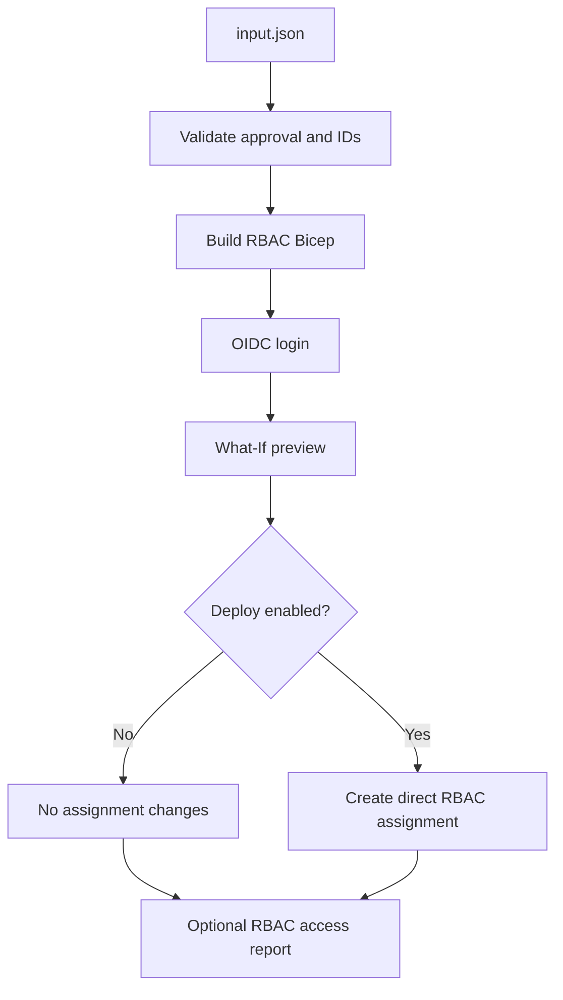

# GPT-BIFROST | Azure RBAC Assignment

**Branch:** `feature/RBAC_mark_1`  
This branch is RBAC-only: it creates **direct Azure RBAC role assignments**. It does not create PIM eligibility or activation requests.

## Workflow
- Read root `input.json`.
- Validate approval, subscription, principal Object ID/type, role GUID, and scope.
- Authenticate to Azure using GitHub Actions OIDC.
- Build Bicep and run subscription What-If.
- Create the direct assignment only when `deploy_rbac=true`.
- Optionally collect existing role assignments for the principal.

> Direct RBAC grants access immediately and has no PIM activation or duration. Remove the role assignment when no longer needed.

## Repository layout
```text
.github/workflows/rbac.yml
modules/rbac/rbac.bicep
modules/rbac/README.md
input.json
RBAC_ACCESS_PURPOSE_AND_SCOPE.md
RBAC_PIPELINE_INPUTS_AND_EXECUTION.md
RBAC_TROUBLESHOOTING.md
CREATE_ENTRA_PRINCIPAL_AZURE_PORTAL.md
hardcoded_values_audit.md
```

## Input
Replace `rbac.principal.principalId` with the Entra Object ID GUID. Supported principal types: User, Group, ServicePrincipal. Current module supports subscription scope and validates subscription name `BIFROST-SC`.

Role examples:
- Reader: `acdd72a7-3385-48ef-bd42-f606fba81ae7`
- Contributor: `b24988ac-6180-42a0-ab88-20f7382dd24c`
- Owner: `8e3af657-a8ff-443c-a75c-2fe8c4bcb635`

Prefer least privilege.

## GitHub Environment
Configure `bifrost-env`: `AZURE_CLIENT_ID`, `AZURE_TENANT_ID`, `AZURE_SUBSCRIPTION_ID`. Configure OIDC federation to trust the repository/environment. Avoid client secrets.

## Azure permissions
The OIDC principal needs role assignment write permissions at target scope (e.g. appropriately scoped Role Based Access Control Administrator or User Access Administrator per policy). Contributor alone is insufficient.

## Run
1. Actions → **BIFROST RBAC Mark-1**.
2. Select `feature/RBAC_mark_1`.
3. Run with `deploy_rbac=false` first and review What-If.
4. Verify principal, role, scope, and ticket approval.
5. Run with `deploy_rbac=true` only after authorization.

## Flow


Troubleshooting: [RBAC_TROUBLESHOOTING.md](RBAC_TROUBLESHOOTING.md).

## Security
Never commit credentials. Review role/scope carefully. Direct assignment is active immediately; remove it when no longer needed.
