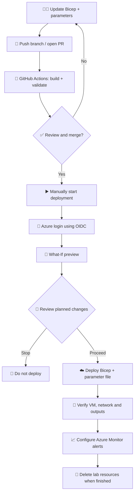
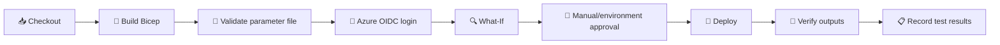

   

# 🌉 BIFROST — Azure VM Deployment & Monitoring Demo

🚀 A repeatable Azure lab to deploy **one Windows VM and one Linux VM** using **Bicep + GitHub Actions**. This is a demo/testing workload, not a production landing zone.

## 🎯 Demo goals

- 🪟 Deploy a Windows test virtual machine.
- 🐧 Deploy a Linux test virtual machine.
- 🌐 Create a VNet, subnet, and Network Security Group.
- 🧩 Keep configurable values in a Bicep parameters file; avoid hardcoding environment-specific values in templates.
- 🤖 Validate and deploy through GitHub Actions.
- 🔐 Prefer GitHub OIDC federation for Azure authentication; never commit credentials.
- 📈 Prepare for the next lab: Azure Monitor Agent, Data Collection Rules (DCRs), and alerts.

## 🔁 Target deployment workflow

## ⚙️ GitHub Actions stages

## 🛡️ Safety checklist

- 🔒 Use a dedicated test resource group and approved subscription.
- 🌍 Keep region, names, address ranges, VM sizes, image references, and admin username configurable.
- 🔑 Never commit passwords, private keys, tokens, or client secrets.
- 🧱 Restrict RDP (TCP 3389) and SSH (TCP 22) to an approved admin IP/CIDR; never expose them broadly to the internet.
- 💸 Check current VM, disk, public IP, and data-transfer costs before deployment.
- 🧪 Inspect What-If output before applying changes.
- 🧹 Delete test resources when finished.

## 📈 Monitoring target

| Area | Demo validation |
|---|---|
| 🧮 CPU | Confirm metrics; add approved tier-based threshold alerts |
| 🧠 Memory | Configure guest-level collection through Azure Monitor Agent + DCR |
| 💽 Disk | Collect supported guest-level free-space data |
| 💓 Heartbeat | Alert when heartbeat is missing for the approved interval |
| 🌐 Connectivity | Test VM/network and application availability as appropriate |
| 📣 Notifications | Link approved alerts to the Pike Action Group and test delivery |

> ⚠️ Azure platform metrics do not automatically provide every guest-level metric. Memory and guest disk free-space monitoring typically require Azure Monitor Agent, suitable DCRs, and the correct guest performance data source. Confirm the chosen data source and alert-rule type before building the monitoring phase.

## 🌿 Demo branch

`Monitor/Test_1/VMs_Deploy` — test Bicep templates, parameter files, and the GitHub Actions workflow.

## 🧹 Cleanup

After testing, delete the dedicated test resource group only after confirming it contains lab resources only. Verify VMs, disks, public IPs, NICs, VNet, and NSG are removed, and check for any remaining billable resources.

---

🌉 <b>BIFROST</b> · Learn by building · Validate before deploying · Clean up after testing 🧹

---

## 🧹 Azure Account Resource Cleanup — Delete/Azure/RG

> **⚠️ Highly destructive operation.** This workflow is intended to delete resource groups and the resources contained in them. This can permanently destroy data, workloads, networking, and services. Run it only in an account/subscription you own and are explicitly authorized to clean up.

### 📌 Files in this workflow

- **Workflow:** `.github/workflows/delete-azure-resource-groups.yml`
- **Script:** `scripts/delete-resource-groups.sh`
- **Branch:** `Delete/Azure/RG`

### 🔎 What it currently deletes

The current implementation targets **all resource groups in one configured Azure subscription** (`AZURE_SUBSCRIPTION_ID`). Deleting a resource group deletes the resources within it, subject to Azure permissions, locks, policies, and service-specific constraints.

**It does not currently loop through every subscription in your Azure account.** If your account has multiple subscriptions, each must be assessed separately; do not assume this workflow cleans them all up.

### 🔐 GitHub Actions configuration

Add these repository **Variables** under **Settings → Secrets and variables → Actions → Variables**:

| Variable | Value |
|---|---|
| `AZURE_CLIENT_ID` | Microsoft Entra application (client) ID for the federated identity |
| `AZURE_TENANT_ID` | Microsoft Entra tenant ID |
| `AZURE_SUBSCRIPTION_ID` | Exact subscription ID to target |

With GitHub OIDC federation, **no `AZURE_CLIENT_SECRET` is required**. Configure a federated credential for this repository and branch:

- Issuer: `https://token.actions.githubusercontent.com`
- Audience: `api://AzureADTokenExchange`
- Subject: `repo:OLYMPUSPRIME/GPT-BIFROST:ref:refs/heads/Delete/Azure/RG`

The identity must have the minimum required permissions to list and delete resource groups and their contained resources. Review Azure role assignments and constraints before running.

### ▶️ Run safely

1. Open **Actions → Delete Azure Resource Groups**.
2. Select branch `Delete/Azure/RG` and click **Run workflow**.
3. Keep `dry_run = true` for the first run. This lists resource groups without deleting them.
4. Inspect the run logs and verify the subscription ID and every resource group listed.
5. Only when you have approved the complete deletion, rerun with `dry_run = false` and enter exactly `DELETE-ALL-RESOURCE-GROUPS`.
6. Monitor the workflow and verify the final state in Azure Portal.

The workflow is manually triggered and includes a dry-run default, subscription validation, and a destructive confirmation phrase. These safeguards do not make deletion reversible.

### ✅ Pre-deletion checklist

- Confirm the signed-in identity and target tenant/subscription.
- Export or back up any data that must be retained.
- Check production/shared resources, resource locks, dependencies, policies, and recovery requirements.
- Confirm that deleting **every** resource group in the selected subscription is intended.
- Review the Azure Activity Log after execution.

**Do not run destructive mode against a production or shared subscription unless an approved change explicitly authorizes it.**
