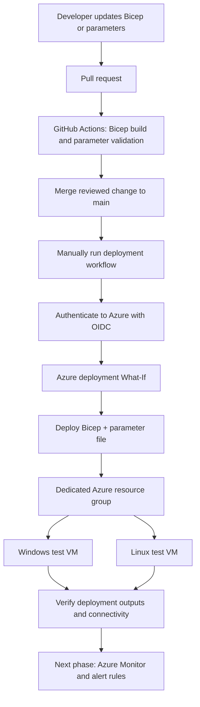
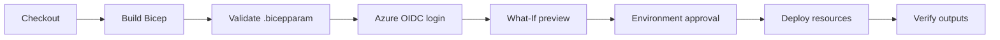

# BIFROST

Azure networking, infrastructure, and cloud operations learning labs.

BIFROST contains practical Azure demonstrations and testing exercises built with Infrastructure as Code. Each lab focuses on reproducible deployments, validation, and documented results.

## Target deployment workflow

This workflow uses Bicep to define two test virtual machines—one Windows and one Linux—and the supporting network resources. GitHub Actions validates the templates, previews changes, and deploys only when manually triggered.

## GitHub Actions deployment stages

The test VM deployment is maintained in the `Monitor/Test_1/VMs_Deploy` branch. Use a dedicated test resource group, restrict RDP/SSH to a trusted administrator CIDR, keep credentials in GitHub Secrets, and review Azure costs before deployment. Delete test resources when they are no longer needed.
