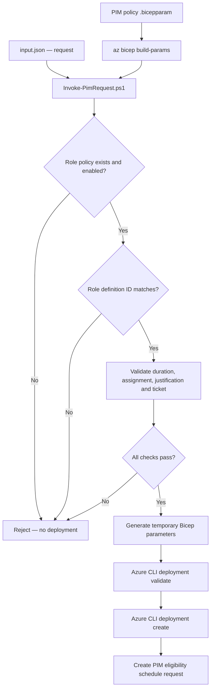

# 🌌 BIFROST — Azure Privileged Identity Management (PIM)

BIFROST is a reusable Azure PIM configuration and implementation workspace. This branch contains request input, a subscription-scoped Azure Resource PIM eligibility Bicep template, PIM policy configuration, and a PowerShell request runner.

> **Current implementation:** The runner validates the JSON request against the compiled Azure Resource role policy in `pim-policy-settings.bicepparam` before deployment. A role must have an enabled policy entry and matching role definition GUID. Eligibility duration, assignment type, request type, justification, and ticket requirements are validated. Live PIM policy writes and live Azure policy verification are not yet implemented.

## Repository structure

```text
BIFROST/
├── input.json
├── scripts/
│   └── Invoke-PimRequest.ps1
├── docs/
│   ├── CLI_LOCAL_TESTING.md
│   └── PIM_REQUEST_FLOW.md
└── modules/pim/
    ├── pim.bicep
    ├── pim-policy-settings.bicepparam
    └── README.md
```

## How the PIM request flow works

BIFROST separates request data from approved policy configuration:

1. **`input.json`** contains the requester identity, requested role and role definition GUID, subscription scope, assignment type, request type, eligibility duration, justification, and ticket metadata.
2. **`modules/pim/pim-policy-settings.bicepparam`** defines approved Azure Resource PIM policy intent and assignment defaults. The request JSON cannot override these policy rules.
3. **`scripts/Invoke-PimRequest.ps1`** compiles the policy parameter file to JSON using `az bicep build-params`, loads both request and policy, and performs validation.
4. If any check fails, the script stops before submitting an Azure deployment.
5. If all checks pass, the script creates a temporary `.bicepparam` file containing the request values and runs Azure CLI deployment validation followed by deployment creation.
6. **`modules/pim/pim.bicep`** submits the Azure Resource PIM role eligibility schedule request at subscription scope.



## Configuration responsibilities

### `input.json` — access request

Contains request-specific values. It describes **what access is being requested**, not which security rules are allowed.

### `pim-policy-settings.bicepparam` — policy intent

Contains Azure Resource role policies and assignment defaults, including role enablement, role definition GUID, maximum eligibility duration, justification/ticket requirements, and other PIM settings.

Azure Resource roles currently configured for policy validation:

- **Owner** — role definition GUID `8e3af657-a8ff-443c-a75c-2fe8c4bcb635`
- **User Access Administrator** — role definition GUID `18d7d88d-d35e-4fb5-a5c3-7773c20a72d9`

A role must have a matching policy entry, be enabled, and have the exact role definition GUID expected by policy.

> **Current sample input:** `input.json` requests **Contributor**, but Contributor does not currently have a policy entry. The request is therefore expected to be rejected. Do not change only the JSON to bypass policy validation; add a role policy entry only after it is approved.

### `Invoke-PimRequest.ps1` — policy validator and CLI orchestrator

Before deployment, the runner checks:

- Required request fields and placeholder values
- Subscription scope (currently the only supported scope)
- Eligible assignment type and `AdminAssign` request type
- Role policy existence and enabled status
- Exact role definition GUID match
- Requested duration against the policy maximum
- Required justification
- Required ticket number and ticket system

If validation fails, the script throws a `POLICY DENIED` error and does not submit the Azure deployment.

### `pim.bicep` — eligibility schedule request

The Bicep template creates an Azure Resource PIM role eligibility schedule request. It requires `requestPolicyValidated=true` as an additional deployment guardrail. This parameter is not a cryptographic attestation and does not replace execution of the PowerShell validator.

**PIM eligibility is not active access.** A user generally must separately activate eligible access according to the configured PIM controls.

## Local Azure CLI testing

### Prerequisites

- PowerShell 7 (`pwsh`)
- Azure CLI and Bicep support
- Authenticated Azure CLI session
- Appropriate permissions in a non-production subscription

### Setup and preview

```powershell
az login
az account list --output table
az bicep install
az bicep build --file modules/pim/pim.bicep

# Run request validation and parameter generation only; do not deploy
pwsh ./scripts/Invoke-PimRequest.ps1 -WhatIf
```

The `-WhatIf` mode validates the request against the policy and generates a temporary parameter file, but does not run Azure deployment validation or create access. The temporary parameter file is removed when the script exits.

### Submit the request

After reviewing the request and policy, and only in a test subscription:

```powershell
pwsh ./scripts/Invoke-PimRequest.ps1
```

The script selects the subscription from `input.json`, runs Azure deployment validation, and then submits the eligibility request. Review Azure CLI output and the deployment result afterwards.

Optional deployment location (default is `eastus`):

```powershell
pwsh ./scripts/Invoke-PimRequest.ps1 -Location centralindia
```

Detailed instructions: [Local CLI testing](docs/CLI_LOCAL_TESTING.md).

## Can the same runner be used in GitHub Actions?

Yes. The PowerShell runner is designed to be reused locally and from GitHub Actions. A workflow can check out the repository, authenticate to Azure (preferably using OIDC through `azure/login`), and invoke the same script. The workflow should use protected environment approvals and appropriate least-privilege permissions.

**A GitHub Actions workflow has not yet been implemented in this branch.** The runner does not perform `az login` itself; the workflow must authenticate before invoking it.

## Important implementation boundaries

- **Subscription scope only:** Resource Group and individual resource scopes are not supported by the current runner/template.
- **Policy intent vs live Azure policy:** MFA, Conditional Access, approval, notification, and activation-duration values in the parameter file are not automatically applied to Azure PIM by this implementation.
- **Live policy verification:** The runner does not query Azure's existing PIM policy and compare it with the policy file.
- **Entra directory roles and PIM for Groups:** These require separate Microsoft Graph/API implementation and are not created by this Azure Resource Bicep template.
- **Approval and Jira integration:** Not implemented.
- **GitHub Actions workflow:** Not implemented yet.

The current template submits an Azure Resource PIM eligibility schedule request. It does **not** configure all PIM policy settings or guarantee that the live policy matches the local policy file. Configure and verify those controls separately before treating MFA, Conditional Access, or approval requirements as enforced.

## Documentation

- [Local CLI testing](docs/CLI_LOCAL_TESTING.md)
- [PIM request flow](docs/PIM_REQUEST_FLOW.md)
- [PIM module README](modules/pim/README.md)

## Security reminders

- Test in a non-production subscription first.
- Never store credentials, client secrets, or certificates in `input.json`.
- Verify tenant, subscription, principal, role, and scope before submitting.
- Keep the policy file controlled through review and branch protection.
- PIM eligibility is separate from PIM activation and active access.
