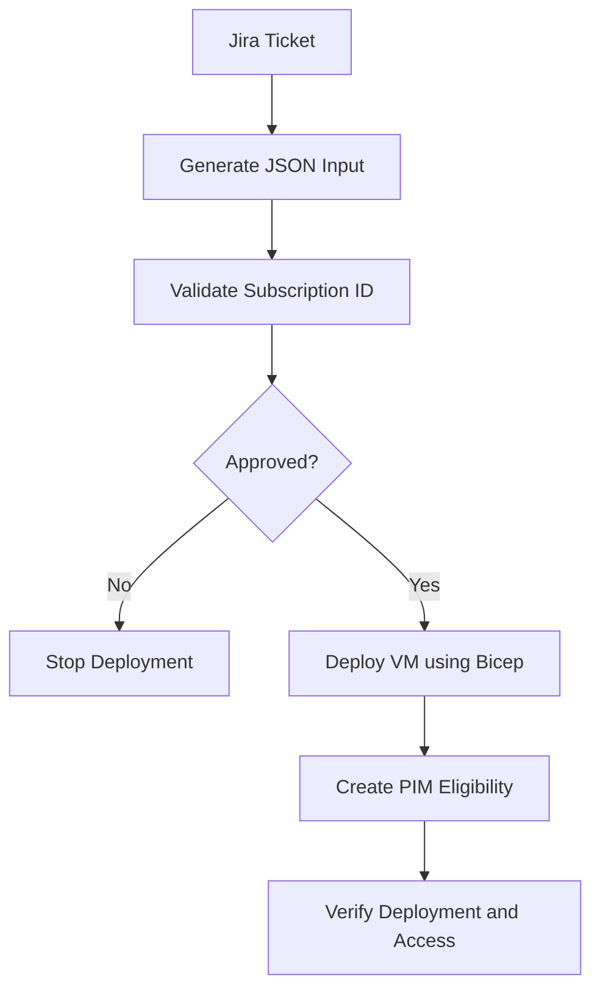

# Sample VM Deployment + PIM Access Request

This document explains the sample JSON request used to deploy an Azure virtual machine (VM) and create a Privileged Identity Management (PIM) eligible Azure RBAC assignment from one approved Jira ticket.

> **Important:** `vm-pim-sample.json` is an example request payload, not a directly executable Bicep parameter file. GitHub Actions must validate and map ticket data to the parameters expected by the VM and PIM Bicep modules. Do not put passwords, client secrets, or other credentials in this JSON.

## Workflow

## Sample input file

The sample payload is maintained at [`vm-pim-sample.json`](./vm-pim-sample.json).

| Group | Purpose | Example fields |
|---|---|---|
| `request` | Ticket and approval details | `ticketId`, `approvalStatus` |
| `target` | Deployment destination | `subscriptionId`, `environment`, `deploymentLocation`, `resourceGroupName` |
| `modules` | Requested actions | `compute-vm`, `pim` |
| `vm` | VM configuration | VM name/size/image, network, subnet, tags |
| `pim` | Eligible access request | principal Object ID/type, role definition ID, justification, duration |

## Input sources and validation

- **Jira ticket:** requested subscription, environment, resource group, VM configuration, principal, role, justification and eligibility duration.
- **Approval workflow:** verify approval using a trusted Jira integration or approval system. Do not trust a JSON field alone to authorize deployment.
- **Azure configuration:** validate subscription ID against an approved allowlist. Validate role definition IDs, principal Object IDs, region, VM image/size, network and resource-group targets.
- **GitHub Actions runtime/secrets:** Azure authentication through configured identity/federation. Generate or retrieve the VM admin password securely at runtime; never commit credentials.

## Deployment sequence

1. Read the Jira ticket and generate the normalized JSON request.
2. Validate required fields and identifiers, including Subscription ID.
3. Verify approval from the trusted source. If denied or missing, stop without deploying.
4. Select the approved subscription and authenticate to Azure.
5. Run Bicep validation and a `what-if` preview using the intended deployment target and inputs.
6. Deploy the VM and its dependencies.
7. Create the PIM eligibility request through `modules/pim/pim.bicep`.
8. Verify both the VM deployment and eligibility request.

## Implementation notes

- `modules/main.bicep` expects infrastructure inputs under `landingZones` and a secure `vmAdminPassword`. The sample JSON must be mapped to that schema, or the workflow must deploy the VM module directly using its own parameter contract.
- PIM has separate inputs such as `principalId`, `roleDefinitionId`, and `justification`; pass these separately from VM parameters.
- Use the approved subscription consistently for validation, what-if, VM deployment, and PIM deployment.
- Restrict ticket-selected subscriptions and privileged roles through allowlists and least-privilege policy.
- PIM **eligibility is not activation**. Activation is separate and can require MFA, approval, justification and policy checks.
- If VM deployment succeeds but PIM creation fails, report a partial failure and follow the approved recovery/retry process.
- Sample values and placeholders are illustrative. Validate Bicep/API versions before production.

## Related files

- [Sample request JSON](./vm-pim-sample.json)
- [VM module](./modules/compute/vm.bicep)
- [PIM module](./modules/pim/pim.bicep)
- [Main Bicep orchestration](./modules/main.bicep)
- [Root README](./README.md)
