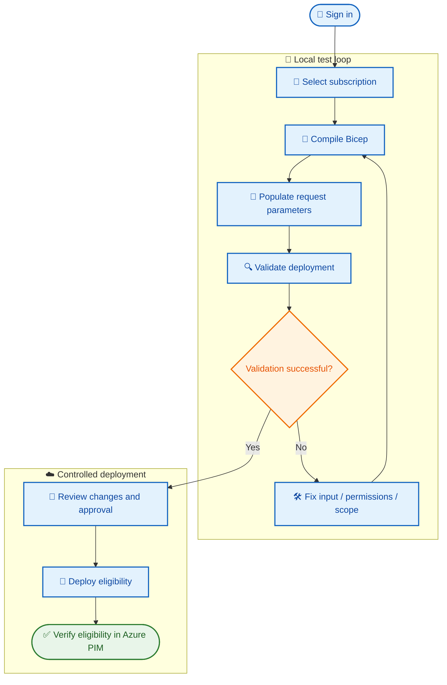

# 🧪 BIFROST PIM — Local CLI testing

This guide covers manual Azure CLI testing. Jira integration is not included in this current workflow.

> ⚠️ Use a non-production subscription first. Verify the principal, role, subscription, scope, and duration before submitting.

## 🔧 Prerequisites

- Azure CLI and Bicep installed.
- Test subscription with Azure Resource PIM enabled.
- Permission to create role eligibility schedule requests.
- Correct principal Object ID and role definition resource ID.
- Required Bicep parameters available.
- PowerShell 7 (`pwsh`) available when using the shared runner script.

## 🔐 Login and select subscription

```powershell
az login
az account list --output table
az account set --subscription <SUBSCRIPTION_ID>
az account show
az bicep install
```

> `targetScope = 'subscription'` does not select a subscription. The active Azure CLI context or explicit `--subscription` determines the target.

## 🧱 Compile

```powershell
az bicep build --file modules/pim/pim.bicep
```

## 🔍 Validate deployment

The policy parameter file is:

```text
modules/pim/pim-policy-settings.bicepparam
```

The parameter file contains policy configuration intent; it does not necessarily provide all request-specific Bicep parameters. Supply the required parameters from your request input/approved values.

Example command shape (replace placeholders and provide required parameters):

```powershell
az deployment sub validate `
  --subscription <SUBSCRIPTION_ID> `
  --location <AZURE_REGION> `
  --template-file modules/pim/pim.bicep `
  --parameters modules/pim/pim-policy-settings.bicepparam `
  principalId=<ENTRA_OBJECT_ID> `
  roleDefinitionId=<FULL_ROLE_DEFINITION_RESOURCE_ID> `
  requestType=AdminAssign `
  justification="<BUSINESS_JUSTIFICATION>" `
  duration=P30D `
  requestName=<UNIQUE_REQUEST_NAME>
```

⚠️ Check the actual Bicep parameter declarations and parameter-file compatibility before running. Root `input.json` is not automatically parsed or mapped by Azure CLI.

## 🚀 Deploy eligibility

Use the same validated parameters with `az deployment sub create` only after approval and review.

This creates **eligibility**, not immediate active access. The user must activate through PIM later, subject to policy.

## 🛡️ Policy implementation status

The policy parameter file records intended policy values. This Bicep template does not apply them. Azure Resource role policies require Azure Authorization API operations; Entra directory-role and PIM Group policies require Microsoft Graph operations. Those writes and verification are not implemented in this branch.

## 🗺️ Testing sequence



## 🧰 Shared PowerShell runner — local CLI and GitHub Actions

The repository uses **`scripts/Invoke-PimRequest.ps1`** as the request-processing and deployment runner. It is not intended to be a local-only script. The same PowerShell file can be invoked from a developer workstation for local testing or from a GitHub Actions job for controlled automation.

### What the PowerShell runner does

1. Reads the root `input.json` request feeder file.
2. Validates required request fields and supported scope/request values.
3. Extracts the subscription, principal Object ID, role, duration, justification, and request type from the JSON input.
4. Selects the target Azure subscription using Azure CLI (`az account set`).
5. Builds a temporary `.bicepparam` file that maps request-specific JSON values to the Bicep parameters. The temporary file is removed after execution.
6. Runs Azure CLI deployment validation and, when not in preview mode, submits the deployment.

This avoids manually copying values from `input.json` into CLI parameters. **Azure CLI does not parse the JSON feeder file by itself**; the PowerShell script performs that mapping.

### Local execution

Run from the repository root after authenticating to Azure CLI:

```powershell
az login
pwsh ./scripts/Invoke-PimRequest.ps1 -WhatIf
```

Review the request values and generated parameter mapping first. When ready to submit the deployment:

```powershell
pwsh ./scripts/Invoke-PimRequest.ps1
```

`-WhatIf` is the runner's preview mode. It is intended to help inspect the request without submitting the Azure deployment. Azure CLI must be installed and authenticated for normal execution.

### GitHub Actions execution

The same script can be called from a workflow after the runner has checked out the repository and the workflow has authenticated to Azure. For example:

```yaml
- name: Submit PIM request
  shell: pwsh
  run: ./scripts/Invoke-PimRequest.ps1
```

Azure authentication should be a separate preceding step, preferably using GitHub Actions OIDC with `azure/login`. The workflow needs appropriate `id-token: write` permission and a federated identity configuration. Do not put Azure credentials or secrets in `input.json`.

The workflow runner must have PowerShell (`pwsh`) and Azure CLI installed. A self-hosted Windows agent can run this script as long as those prerequisites are available. The script itself does **not** perform `az login`; it relies on the authenticated Azure CLI session provided locally or by the workflow.

> **Important:** The PowerShell runner is shared by local testing and Actions, but a GitHub Actions workflow has not yet been added in this branch. Azure deployment execution has not yet been verified end-to-end. The script currently submits the Azure Resource PIM eligibility schedule request; policy configuration writes, Entra directory-role PIM, PIM Groups, and Jira integration are separate implementation work.
