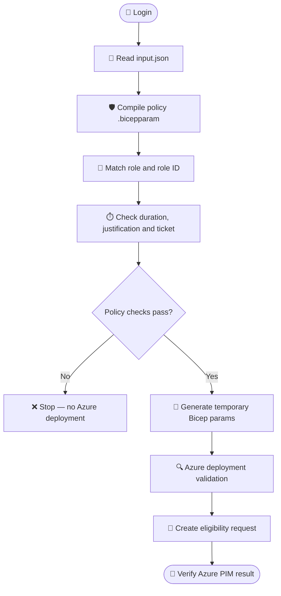

# 🧪 BIFROST PIM — Local CLI testing

This guide covers local Azure CLI execution of BIFROST's subscription-scoped Azure Resource PIM eligibility request.

> ⚠️ Use a non-production subscription first. The JSON file in the repository is a sample and contains placeholders. Do not submit until the values are populated and reviewed.

## Prerequisites

- PowerShell 7 (`pwsh`)
- Azure CLI with Bicep support
- Azure login to the intended tenant
- Permission to create Azure Resource PIM role eligibility schedule requests
- An approved request principal, subscription, and role

## Local setup

```powershell
az login
az account list --output table
az bicep install
az bicep build --file modules/pim/pim.bicep
```

## Policy-controlled request validation

The runner reads two inputs:

- `input.json`: requester, role, role definition GUID, subscription, assignment type, duration, justification and ticket fields.
- `modules/pim/pim-policy-settings.bicepparam`: authoritative policy configuration used by the pre-deployment validator.

The runner compiles the policy parameter file with `az bicep build-params`, reads the compiled JSON, and checks the request before Azure deployment:

1. Requested role must have a matching entry under `azureResourcePimPolicy`.
2. The policy entry must be enabled.
3. The role definition GUID in the JSON must exactly match the configured policy GUID.
4. `assignmentType` must be `Eligible` and this runner currently requires `requestType=AdminAssign`.
5. Requested eligibility duration must be supported and not exceed `pimAssignmentDefaults.maximumEligibilityDuration`.
6. Justification must be provided if policy requires it.
7. Ticket number and ticket system must be provided if policy requires ticket information.
8. Eligibility must be enabled in defaults.

If any check fails, the script throws a `POLICY DENIED` error and does not invoke the deployment.

### Roles currently configured for Azure Resource PIM

- Owner
- User Access Administrator

**Contributor is not configured in the policy file and will be rejected.** Do not add it to the JSON alone. Add an approved role entry with the correct role definition GUID and policy requirements to the policy file first.

## Preview and deployment

```powershell
# Policy checks + parameter generation only; no Azure deployment
pwsh ./scripts/Invoke-PimRequest.ps1 -WhatIf

# Policy checks + Azure deployment validation + submit request
pwsh ./scripts/Invoke-PimRequest.ps1
```

The preview validates against the policy file and creates a temporary `.bicepparam` file, but it does **not** perform Azure-side deployment validation. The temporary file is removed on exit.

To select a different deployment location:

```powershell
pwsh ./scripts/Invoke-PimRequest.ps1 -Location centralindia
```

## What is and is not enforced

**Enforced by the current PowerShell pre-deployment validator:** role policy presence/enabled state, role ID matching, eligibility flag, request operation, duration limit, justification and ticket-required checks.

**Not implemented by this runner:** writing live Azure PIM role management policy settings; configuring Entra directory-role PIM or PIM for Groups; querying Azure's current PIM policy and comparing it with this file; scope beyond subscription; approval orchestration; ticketing/Jira integration.

MFA, Conditional Access, approval, notifications and activation duration in the parameter file are policy intent. The script reports those fields but does not configure or independently verify live Azure policy. Azure policy settings must be configured separately in Azure and verified before claiming those controls are enforced.

The Bicep template has a required `requestPolicyValidated` parameter constrained to `true`. The runner supplies it only after policy checks. This guardrail helps prevent accidental direct template deployment, but it is not cryptographic proof that the runner was used.

## GitHub Actions

The same runner can be called from GitHub Actions after checkout and Azure authentication (prefer OIDC). Workflow should use `id-token: write`, `azure/login`, and a protected GitHub Environment/approval gate. The workflow is not yet included in this branch.

## Testing sequence



## Scope limitation

`pim.bicep` and this runner currently support **subscription scope only**. Resource Group and individual resource scope are not implemented in this branch.
