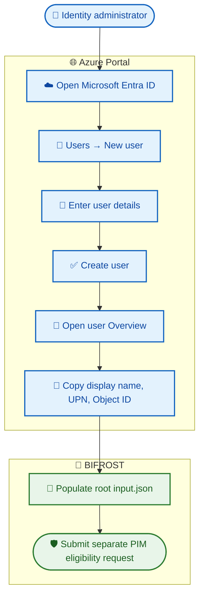

# 👤 Create a Microsoft Entra user in Azure Portal

This guide helps prepare an identity for a BIFROST PIM access request. Creating a user **does not grant Azure access**; PIM eligibility is a separate operation.

## 🧰 Before you begin

- Sign in to [Azure Portal](https://portal.azure.com/).
- Confirm you have permission to create users in the correct Microsoft Entra tenant.
- Confirm whether the identity should be an internal member or external guest.
- Follow your organization's identity creation and approval process.

## 🪄 Create the user

1. Open **Microsoft Entra ID**.
2. Navigate to **Users** → **New user** → **Create new user**.
3. Enter the user's UPN and display name.
4. Complete required profile and sign-in fields according to organizational policy.
5. Select **Review + create** / **Create** as shown in the portal.
6. Open the newly created user's profile.

## 🪪 Collect identifiers

From the user's **Overview** page, collect:

| Portal value | BIFROST use |
|---|---|
| Display name | Requestor display label in root `input.json` |
| User principal name (UPN) | Requestor login/reference |
| Object ID | `principalId` / `entraObjectId` |

> 🔑 **Use the Object ID GUID for PIM principalId.** Do not use display name, email, UPN, or alias instead.

## 🔄 Identity preparation flow



## 🧾 Update BIFROST

- Populate `pimAccessRequest.requestor` in root `input.json`.
- Use the user's Entra Object ID for the Bicep `principalId`.
- Confirm subscription, role, scope, request operation, eligibility duration, and justification with the access owner.
- The policy configuration belongs in `modules/pim/pim-policy-settings.bicepparam`.

## 🔎 Verify with Azure CLI (optional)

```bash
az ad user show --id "user@yourdomain.com" --query id --output tsv
```

This requires Azure CLI sign-in to the correct tenant and directory read permission.

## 🔒 Security reminders

- Never put temporary passwords or secrets in GitHub, JSON, or chat.
- Do not grant privileged roles just to create an account.
- Apply least privilege and verify tenant context.
