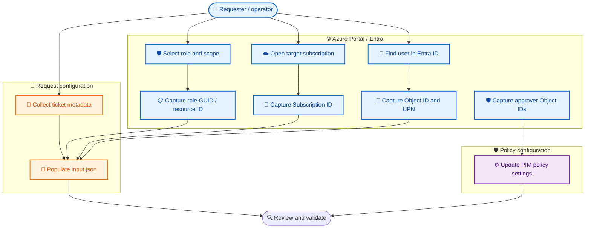

# 🧭 BIFROST PIM — Azure Portal values and variable guide

Use this guide to collect values for the BIFROST request. **Request values** go in root `input.json`; **policy settings** go in `modules/pim/pim-policy-settings.bicepparam`.

> 🔒 Do not commit real user Object IDs, subscription IDs, tenant IDs, secrets, or private keys to a public repository. Use placeholders and your organization's secure storage standards.

## 🧾 1. Request-specific values

| Value | JSON location | Azure Portal source |
|---|---|---|
| Requestor display name | `pimAccessRequest.requestor.displayName` | Entra ID → Users → user → Overview |
| Requestor UPN | `pimAccessRequest.requestor.userPrincipalName` | User Overview → User principal name |
| Entra Object ID | `pimAccessRequest.requestor.entraObjectId` | User Overview → Object ID (GUID) |
| Subscription ID | `requestedAccess.scope.subscriptionId` | Subscriptions → target subscription → Overview |
| Role name | `requestedAccess.roleName` | Scope → Access control (IAM) → Roles |
| Role GUID | `requestedAccess.roleDefinitionId` | IAM → Roles → role details/JSON |
| Resource Group name | `requestedAccess.scope.resourceGroupName` | Resource groups → exact name |
| Resource ID | `requestedAccess.scope.resourceId` | Resource → Properties / JSON View |
| Justification | `requestedAccess.justification` | Requester/business owner |
| Ticket ID | `requestMetadata.ticketId` | Ticketing system |
| Ticket number | `requestMetadata.ticketNumber` | Ticketing system |
| Ticket system | `requestMetadata.ticketSystem` | Ticketing system/source |
| Requested by | `requestMetadata.requestedBy` | Requester's UPN |
| Environment | `requestMetadata.environment` | Team environment convention |

## ⚙️ 2. Bicep request parameters

| Parameter | Purpose | How to set/obtain |
|---|---|---|
| `principalId` | Eligible principal Object ID | Entra user Overview → Object ID |
| `roleDefinitionId` | Full Azure role definition resource ID | Subscription ID + Azure role GUID |
| `requestType` | Schedule operation (typically `AdminAssign` for new eligibility) | Request operation, not a portal ID |
| `justification` | Business need | Requester/approver |
| `duration` | Eligibility period, ISO 8601 (e.g. `P30D`) | Approved request duration; constrained by Bicep `@allowed` |
| `startDateTime` | Schedule start | Template default / approved override |
| `requestName` | Unique schedule request name | Generated or supplied by caller |

## 🧱 Role definition resource ID

The Bicep parameter expects the full Azure role definition resource ID:

```text
/subscriptions/<SUBSCRIPTION_ID>/providers/Microsoft.Authorization/roleDefinitions/<ROLE_GUID>
```

Make sure the subscription ID matches the intended target.

## 🛡️ 3. Approver Object IDs

Approver placeholders appear in the policy settings for Azure Resource PIM, Entra roles, and group Owner policies.

1. Open Microsoft Entra ID → Users (or Groups if the policy expects a group).
2. Select the approved approver identity.
3. Copy the **Object ID** from Overview.
4. Replace the correct placeholder in `pim-policy-settings.bicepparam`.
5. Confirm identity type, approval requirements, and that self-approval is not inadvertently configured.

## 🔐 4. GitHub Actions / Azure identity values

| Value | Portal location | Purpose |
|---|---|---|
| Tenant ID | Entra ID → Overview → Tenant ID | Azure login tenant |
| Application/client ID | App registrations → app → Overview | GitHub Actions OIDC identity |
| Federated credential | App registration → Certificates & secrets → Federated credentials | OIDC trust configuration |
| Subscription ID | Subscriptions → target → Overview | CLI deployment target |

Prefer GitHub Actions OIDC. Do not store client secrets or certificates in JSON or parameter files.

## 🧭 Collection workflow



## ✅ 5. Pre-deployment checklist

- [ ] Verify tenant and subscription.
- [ ] Confirm principal Object ID (not UPN/display name).
- [ ] Check role name and role GUID match.
- [ ] Confirm scope type and required scope fields.
- [ ] Confirm role definition ID uses the intended subscription.
- [ ] Validate duration and justification.
- [ ] Replace required approver Object ID placeholders.
- [ ] Review ticket ID, number, and system values.

## ⚠️ 6. JSON-to-Bicep mapping caveat

Bicep does not automatically parse root `input.json`. A runner or script must explicitly read its values and pass request parameters to Azure CLI/Bicep. Policy settings remain in the renamed `.bicepparam` file.
