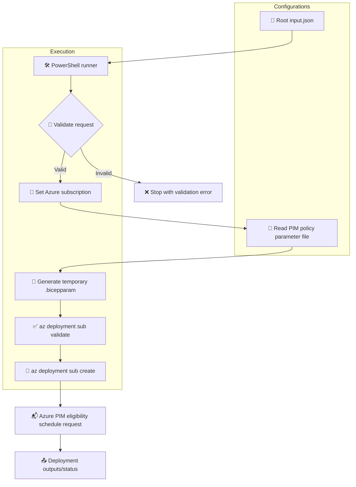
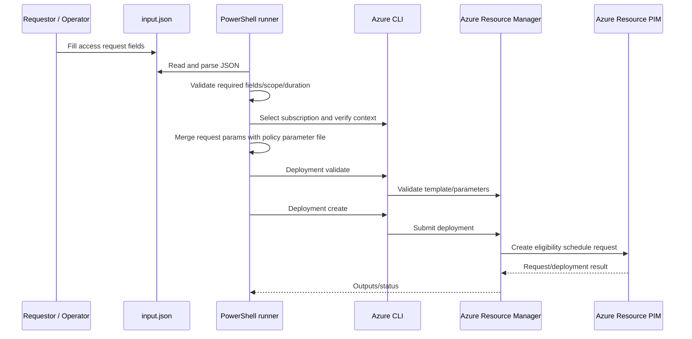

# BIFROST PIM Request Flow — Input JSON to Azure Deployment

> **Status:** Implementation guide for the request runner. The runner submits an Azure Resource PIM *eligibility schedule request*. It does **not** configure PIM activation policy settings.

## 🎯 Purpose

This closes the request-data wiring gap by separating:
- **Request data** — who gets access, role, subscription scope, duration, justification, and ticket metadata in root `input.json`.
- **Policy configuration** — PIM policy intent in `modules/pim/pim-policy-settings.bicepparam`.
- **Deployment logic** — reusable Azure Resource PIM eligibility resource in `modules/pim/pim.bicep`.
- **Orchestration** — PowerShell runner in `scripts/Invoke-PimRequest.ps1`.

## 🧭 Architecture



## 📁 File responsibilities

| File | Responsibility |
|---|---|
| `input.json` | Requestor, access role, scope, request type, duration, justification, ticket metadata |
| `modules/pim/pim-policy-settings.bicepparam` | PIM policy configuration only |
| `modules/pim/pim.bicep` | Azure Resource PIM eligibility schedule request resource |
| `scripts/Invoke-PimRequest.ps1` | Reads JSON, validates it, selects subscription, combines policy + request parameters, validates and deploys |
| `docs/PIM_REQUEST_FLOW.md` | This implementation and operating guide |

## 🧰 Prerequisites

1. PowerShell 7+ (recommended) or compatible PowerShell.
2. Azure CLI installed and available as `az`.
3. Bicep support available through Azure CLI.
4. Sign in interactively or through the intended automation identity:
   ```powershell
   az login
   ```
5. The executing identity must have sufficient Azure permissions to submit role eligibility schedule requests at the target subscription. Confirm required permissions with your Azure administrator.

## ✍️ Configure `input.json`

Replace placeholder values such as `<REQUESTOR_ENTRA_OBJECT_ID>`, `<AZURE_SUBSCRIPTION_ID>`, and `<BUSINESS_JUSTIFICATION>`. Keep the role definition ID as a **GUID** (not a full resource ID); the runner builds the subscription-scoped role resource ID.

Current supported scope:
- `scope.type = "Subscription"`

Current supported request types are `AdminAssign`, `AdminUpdate`, `AdminRemove`, `AdminExtend`, and `AdminRenew` (subject to Azure API semantics and the template's constraints).

The duration must be one of the ISO 8601 values allowed in `pim.bicep`. The script validates the duration before deployment.

Ticket fields are logged for traceability. They are not passed as Azure Resource PIM policy configuration.

## ▶️ Run the request

From repository root:

```powershell
# First preview the generated deployment parameter file (no Azure deployment)
pwsh ./scripts/Invoke-PimRequest.ps1 -WhatIf

# Submit the request
pwsh ./scripts/Invoke-PimRequest.ps1
```

Optional custom paths:

```powershell
pwsh ./scripts/Invoke-PimRequest.ps1 \
  -InputFile ./input.json \
  -PolicyParameterFile ./modules/pim/pim-policy-settings.bicepparam \
  -TemplateFile ./modules/pim/pim.bicep
```

> **Note:** The temporary request-specific `.bicepparam` file is created in the same folder as the policy file to preserve its relative `using './pim.bicep'` reference, then deleted when the runner exits.

## 🔐 Security and validation behavior

- Fails if required values are missing or still placeholders.
- Checks the request type and allowed duration.
- Validates that roleDefinitionId is a GUID.
- Rejects non-subscription scope (not implemented in this runner).
- Sets Azure CLI's active subscription to the input subscription and verifies it.
- Runs Azure deployment validation before submitting the deployment.
- Does not print or store credentials.
- Uses the JSON ticket fields for traceability only.

## ⚠️ Important implementation boundary

The policy objects in `pim-policy-settings.bicepparam` currently describe desired policy configuration. **They are not applied by this Bicep resource.** The template only creates an Azure Resource PIM role eligibility schedule request.

These remain separate future work:
- Azure Resource PIM role management policy updates via Azure Authorization APIs.
- Microsoft Entra directory role PIM policy updates via Microsoft Graph.
- PIM for Groups policy updates via Microsoft Graph.
- Scope expansion for Resource Group and individual resource levels.
- Automated approval/ticketing workflow.

## 🧪 Troubleshooting

| Symptom | Likely cause | Action |
|---|---|---|
| Placeholder validation error | Input values not replaced | Fill all required JSON values |
| Azure CLI not found | CLI missing from PATH | Install Azure CLI on the host/runner |
| Subscription mismatch | Wrong Azure CLI context | Confirm subscription ID and account access |
| Deployment validation failure | RBAC, API, Bicep or parameter issue | Review Azure deployment validation error |
| Unsupported scope | JSON scope not Subscription | Use Subscription for now; implement scope-specific templates before expanding |
| Role definition ID error | Input contains full resource ID | Use the role definition GUID in JSON |

## 📌 Operational flow



## ✅ Acceptance checklist

- [ ] Request details exist only in `input.json`.
- [ ] Policy settings exist only in `pim-policy-settings.bicepparam`.
- [ ] Runner validates JSON before calling Azure.
- [ ] Subscription is selected from JSON, not hardcoded.
- [ ] Deployment validation succeeds.
- [ ] Eligibility request deployment succeeds in a test subscription.
- [ ] Policy API automation is tracked separately.
