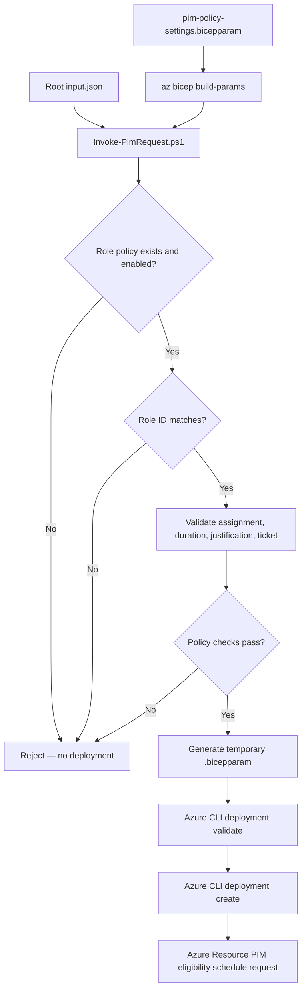

# BIFROST PIM Request Flow — Policy Validation and Azure Deployment

> **Current scope:** Azure Resource PIM eligible assignment at subscription scope. The runner validates request data against the compiled policy parameter file. It does not yet configure or independently verify the live Azure PIM policy.

## Responsibility separation

- **Request data:** root `input.json` describes the requester, role, scope, duration, justification and ticket.
- **Policy intent:** `modules/pim/pim-policy-settings.bicepparam` defines the approved Azure Resource role policy entries and assignment defaults.
- **Policy validation:** `scripts/Invoke-PimRequest.ps1` compiles the policy file to JSON and validates the request against it.
- **Eligibility resource:** `modules/pim/pim.bicep` creates the role eligibility schedule request only after the runner passes validation.

## Flow



## Role policy matching

The runner normalizes the requested role name and finds the corresponding property in `azureResourcePimPolicy`. The matched policy must:

- Exist
- Have `enabled = true`
- Include a role definition GUID equal to the GUID supplied in `input.json`

The runner then validates eligible assignment type, new request operation (`AdminAssign`), requested duration against `pimAssignmentDefaults.maximumEligibilityDuration`, and justification/ticket requirements.

If a policy entry is absent, the runner throws a `POLICY DENIED` error before invoking Azure deployment.

### Current configured Azure Resource role policies

- Owner — role GUID `8e3af657-a8ff-443c-a75c-2fe8c4bcb635`
- User Access Administrator — role GUID `18d7d88d-d35e-4fb5-a5c3-7773c20a72d9`

Contributor is currently in the sample `input.json`, but no Contributor policy exists. Therefore the sample is intentionally rejected until a Contributor policy entry is approved and added. Do not change only the JSON to bypass this policy gate.

## Local usage

```powershell
az login
az bicep install
az bicep build --file modules/pim/pim.bicep

# Runs policy validation and parameter generation only; no deployment
pwsh ./scripts/Invoke-PimRequest.ps1 -WhatIf

# Runs policy validation, Azure deployment validation, and submits eligibility
pwsh ./scripts/Invoke-PimRequest.ps1
```

The script supports `-Location` (default `eastus`). It uses the target subscription ID from `input.json` to set Azure CLI context.

## Important implementation boundaries

The policy file currently acts as a local policy source for pre-deployment validation. The script does not query Azure's existing PIM policy, update live PIM policy settings, or enforce MFA/Conditional Access/approval by itself.

The Bicep parameter `requestPolicyValidated` is constrained to `true`, which prevents an ordinary direct deployment from omitting the runner's validation flag. This is a deployment guardrail, not a tamper-proof attestation.

Not implemented yet:
- Live Azure Resource PIM role management policy update and verification
- Microsoft Graph policy writes for Entra directory roles and PIM for Groups
- Resource Group and individual resource scope
- Approval workflow / Jira integration
- GitHub Actions workflow

## Troubleshooting

| Error | Cause | Resolution |
|---|---|---|
| `POLICY DENIED: Role ... is not defined` | No role policy entry | Add approved role policy entry to `.bicepparam` |
| Role ID mismatch | Request GUID differs from policy GUID | Correct JSON or policy entry after verifying Azure role definition |
| Duration exceeds maximum | Requested eligibility duration exceeds policy limit | Request a shorter duration or update policy through approval |
| Missing ticket/justification | Policy requires request metadata | Fill the required input fields |
| Scope not supported | Input is not Subscription | Scope expansion is not implemented in this branch |
| Azure deployment validation error | Azure RBAC, API, Bicep or request issue | Inspect Azure CLI error and deployment validation output |
