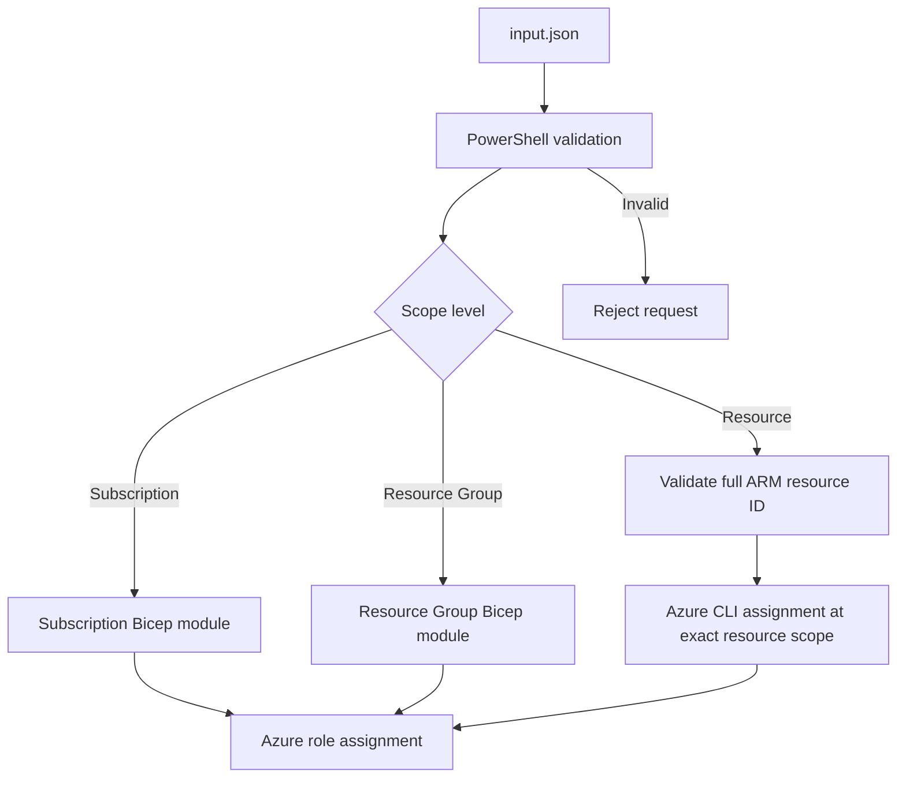

# BIFROST RBAC request flow

Subscription scope uses `/subscriptions/<id>`. Resource group scope uses `/subscriptions/<id>/resourceGroups/<name>`. Resource scope uses the exact resource ARM ID. The runner never broadens scope.

RBAC grants active access immediately. It is distinct from PIM eligibility.
