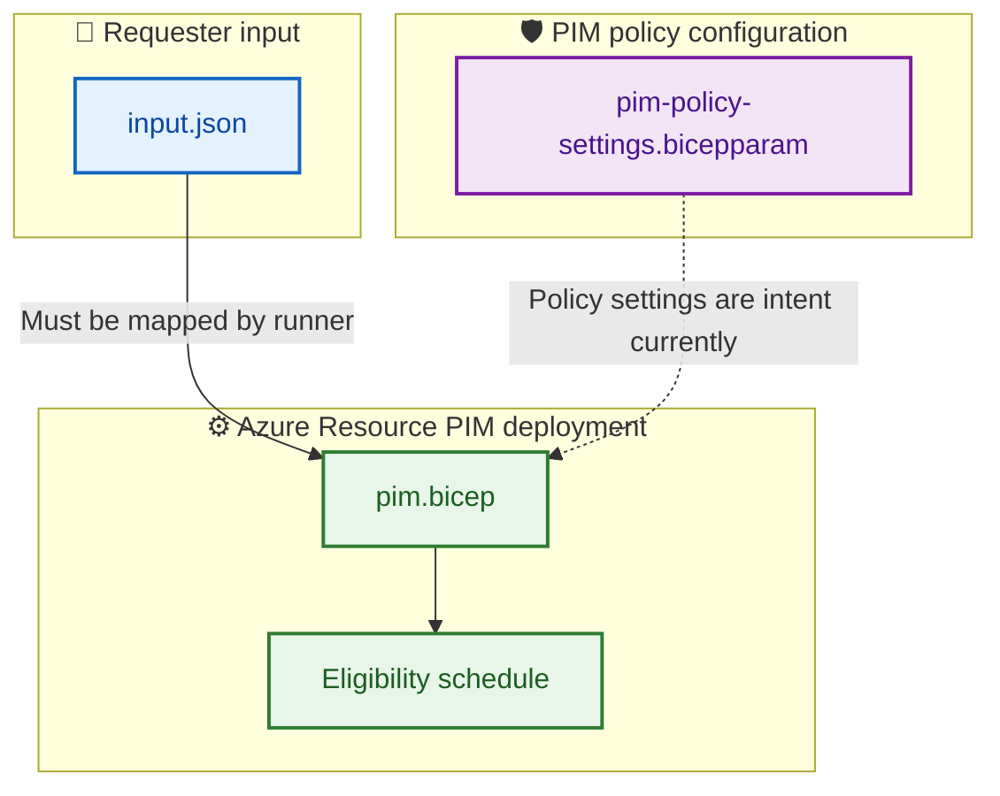

# 📚 BIFROST documentation hub

Welcome to the BIFROST Azure PIM operator/requester docs.

## 🧭 Guides

| Document | What it covers |
|---|---|
| [CLI_LOCAL_TESTING.md](CLI_LOCAL_TESTING.md) | Azure CLI login, compile, validation, and testing. |
| [CREATE_ENTRA_USER_AZURE_PORTAL.md](CREATE_ENTRA_USER_AZURE_PORTAL.md) | Create an Entra user and collect identity IDs. |
| [PIM_AZURE_PORTAL_VARIABLES.md](PIM_AZURE_PORTAL_VARIABLES.md) | Portal locations for request, role, scope, approver, and OIDC values. |
| [hardcoded_values_audit.md](hardcoded_values_audit.md) | Review hardcoded/default values and external inputs. |

## 🧩 Which file is responsible for what?

## 🚦 Implementation status

The current template creates Azure Resource PIM eligibility. Policy settings are not automatically enforced; Entra directory-role and PIM for Groups policy updates require separate API implementation. Root JSON is not read automatically by Bicep.

For architecture and constraints, see [root README](../README.md) and [module README](../modules/pim/README.md).
