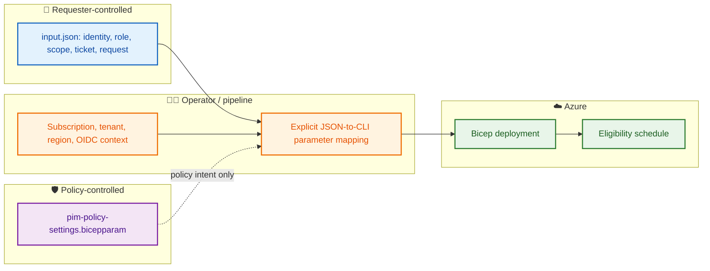

# 🔎 BIFROST PIM — Hardcoded values and configuration audit

This document distinguishes values that are fixed in the code from values that should come from request input, environment configuration, or policy settings.

> ⚠️ This is an audit snapshot of the current branch. Recheck the actual source files before deployment; do not rely on this document as a substitute for reviewing the live Bicep and workflow code.

## 🧩 Configuration ownership

| Value | Intended source | Notes |
|---|---|---|
| Requestor Object ID / UPN | Root `input.json` | Request-specific identity |
| Subscription ID | Root JSON + deployment command/runner | CLI must explicitly select the subscription |
| Role / scope | Root `input.json` | Validate role GUID and scope |
| Request type / eligibility duration | Root `input.json` | Runner must map values to Bicep parameters |
| Ticket ID / number / system | Root `input.json` | Request metadata; not currently passed to PIM resource |
| PIM policy settings | `pim-policy-settings.bicepparam` | Policy intent, not automatically enforced |
| Tenant / client ID | Secure environment or GitHub configuration | Do not store secrets in JSON |
| Azure deployment region | CLI/workflow parameter | Required for subscription deployment operation |
| Azure PIM API version | Bicep resource declaration | Review API compatibility before updates |

## 🔄 Configuration flow

## 🛑 Review items

- Confirm the target subscription is explicitly selected.
- Confirm the Bicep API version matches the intended Azure Resource PIM operation.
- Check for placeholder approver IDs and role IDs.
- Ensure no secrets or real sensitive identities are committed.
- Confirm JSON values are actually wired into the deployment; currently Bicep does not read JSON itself.
- Policy objects are not applied unless the relevant API/Graph implementation exists.
