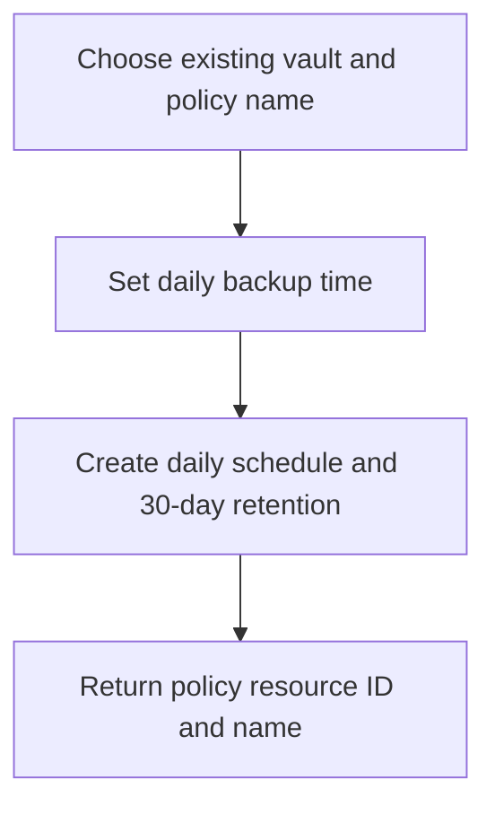

# VM Backup Policy Module

**Source template:** [`modules/backup/backupPolicy.bicep`](../backupPolicy.bicep)

## Purpose
Creates a daily Azure IaaS VM backup policy in an existing Recovery Services vault. The current policy retains daily recovery points for 30 days.

## Inputs

| Input | Required | Description |
|---|---:|---|
| `vaultName` | Yes | Name of an existing Recovery Services vault. |
| `policyName` | Yes | Name for the backup policy. |
| `backupTime` | Yes | UTC schedule time passed into the policy's schedule and retention settings. Use the date-time format accepted by Azure Backup, e.g. an approved UTC timestamp. |

## Dependencies and permissions
- The Recovery Services vault must already exist in the deployment resource group/scope.
- Deploy the vault before the policy.
- The deployment identity needs permission to create backup policies in the vault.

## Workflow

## Outputs
- `policyId` — backup policy resource ID.
- `policyNameOut` — policy name.

## Important notes
The template currently hard-codes daily scheduling and 30-day daily retention. Confirm the `backupTime` format and the policy schema supported by the selected API version before deployment. This module creates the policy only; it does not protect a VM.
