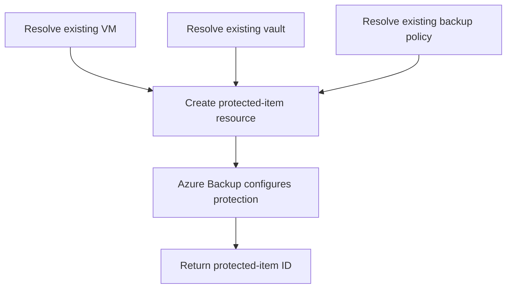

# VM Backup Protection Module

**Source template:** [`modules/backup/backupProtection.bicep`](../backupProtection.bicep)

## Purpose
Registers an existing Azure virtual machine for protection by an existing Recovery Services vault backup policy.

## Inputs

| Input | Required | Description |
|---|---:|---|
| `vmName` | Yes | Name of the VM to protect. |
| `vmResourceGroup` | Yes | Resource group containing the VM. |
| `vaultName` | Yes | Existing Recovery Services vault name. |
| `policyName` | Yes | Existing backup policy name in the vault. |

## Dependencies and permissions
- The VM must already exist in `vmResourceGroup`.
- The vault and named backup policy must already exist.
- Deployment ordering should be: vault → policy → VM (if needed) → protection.
- The deployment identity needs permission to configure backup protection and read the VM/vault/policy.

## Workflow

## Output
- `backupProtectionId` — protected-item resource ID.

## Important notes
This template uses the Azure IaaS VM protected-item naming convention. Verify that the vault, VM, and policy are in compatible scopes and that the vault is ready for VM backup before deploying.
