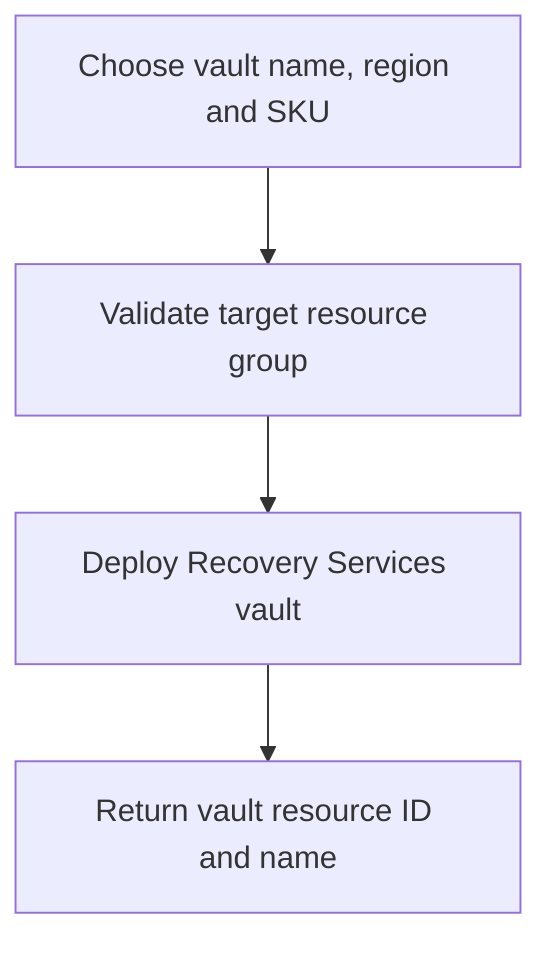

# Recovery Services Vault Module

**Source template:** [`modules/backup/recoveryVault.bicep`](../recoveryVault.bicep)

## Purpose
Creates an Azure Recovery Services vault for backup workloads.

## Inputs

| Input | Required | Description |
|---|---:|---|
| `vaultName` | Yes | Globally valid vault name within Azure naming constraints. |
| `location` | Yes | Azure region for the vault. |
| `sku` | No | Vault SKU; defaults to `Standard`. |

## Dependencies and permissions
- The target resource group must exist.
- The deployment identity needs permission to create Recovery Services vaults.
- Confirm regional support, organizational backup standards, and required network/security settings.

## Workflow

## Outputs
- `vaultId` — vault resource ID.
- `vaultName` — vault name.

## Important notes
The current template sets `publicNetworkAccess` to `Enabled`. Review whether this matches your security baseline; private connectivity and other hardening settings are not configured here.
