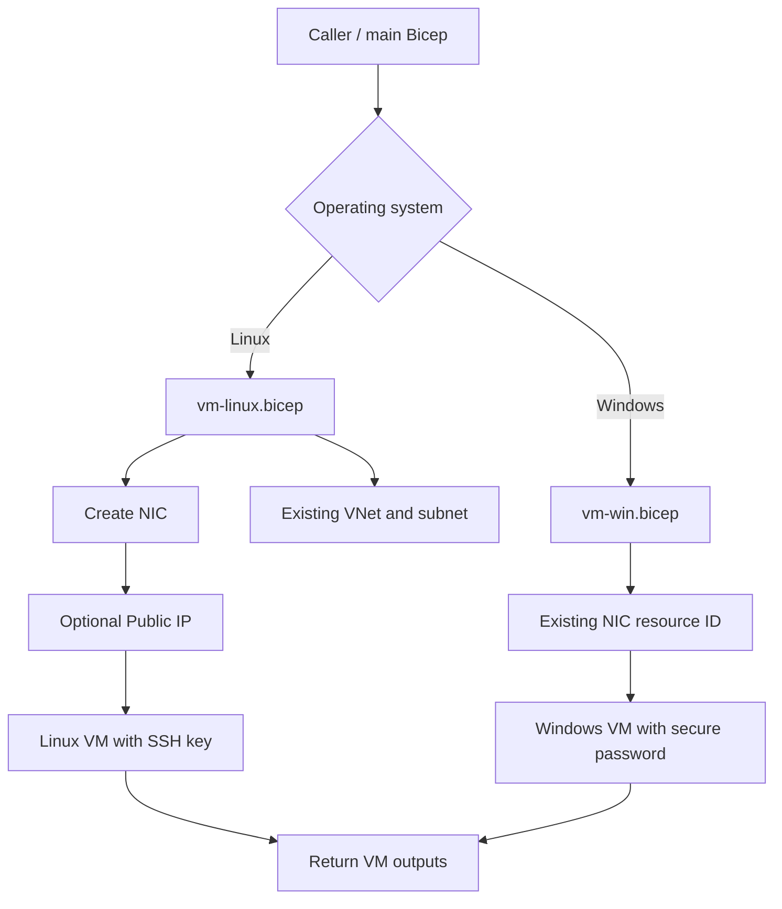

# 🖥️ BIFROST Compute Modules — Linux & Windows

> [!NOTE]
> This guide covers both reusable VM modules in `modules/compute`. The modules provision compute resources; networking (VNet/subnet and, for Windows, NIC) must exist or be deployed by the caller.

## Module overview

| Badge | Module | OS | Authentication | Network behavior |
|---|---|---|---|---|
| <span style="color:green">🟢 Linux</span> | `vm-linux.bicep` | Linux | SSH public key | Creates NIC; references existing VNet/subnet; optionally creates Public IP |
| <span style="color:blue">🔵 Windows</span> | `vm-win.bicep` | Windows Server image | Admin username + secure password | Uses an existing NIC resource ID |

## Deployment flow



## 🟢 Linux module — `vm-linux.bicep`

### Inputs

| Parameter | Type | Required | Purpose |
|---|---|---:|---|
| `location` | string | Yes | Azure region |
| `vmName` | string | Yes | VM resource and guest computer name |
| `adminUsername` | string | Yes | Linux admin user |
| `vmSize` | string | Yes | Azure VM SKU |
| `sshPublicKey` | string | Yes | OpenSSH public key; never provide private key |
| `image` | object | Yes | Image publisher, offer, SKU, version |
| `osDisk` | object | Yes | Disk name, size, caching, storage SKU |
| `vnetName`, `subnetName` | string | Yes | Existing VNet and subnet |
| `networkInterfaceName` | string | Yes | NIC to create |
| `createPublicIp` | bool | Yes | Whether module creates a Public IP |
| `publicIpName` | string | Yes | Public IP name when enabled |
| `publicIpAllocationMethod` | string | Yes | Static or Dynamic |
| `publicIpSku` | string | Yes | Basic or Standard |
| `tags` | object | Yes | Azure resource tags |

### Authentication & prerequisites

- SSH public key must be a valid OpenSSH public key (for example, `ssh-ed25519 AAAA...`).
- VNet and subnet must already exist in the module's deployment scope.
- Deployment identity needs permission to create VM, NIC, and optional Public IP resources.

## 🔵 Windows module — `vm-win.bicep`

### Inputs

| Parameter | Type | Required | Purpose |
|---|---|---:|---|
| `location` | string | Yes | Azure region |
| `vmName` | string | Yes | Azure VM resource name |
| `computerName` | string | Yes | Windows guest hostname; max 15 characters |
| `adminUsername` | string | Yes | Local Windows administrator |
| `adminPassword` | secure string | Yes | Password supplied securely at runtime |
| `vmSize` | string | Yes | Azure VM SKU |
| `image` | object | Yes | Windows image publisher, offer, SKU, version |
| `osDisk` | object | Yes | OS disk configuration |
| `networkInterfaceId` | string | Yes | ID of existing NIC |
| `tags` | object | Yes | Azure resource tags |

### Security and prerequisites

- Keep `adminPassword` in GitHub Environment **Secrets** (not Variables or source code).
- Do not put credentials in `input.json`, committed `.bicepparam` files, or logs.
- Windows hostname (`computerName`) must be 15 characters or fewer.
- NIC must already exist and be configured with the desired subnet, NSG, and optional Public IP.
- The selected Windows image and VM size must be available in the target Azure region.

## Outputs (both modules)

| Output | Description |
|---|---|
| `vmId` | Azure VM resource ID |
| `vmNameOut` | Deployed VM name |

Linux module additionally outputs `networkInterfaceId` and `publicIpId`.

## Build validation

Run from repository root:

```bash
az bicep build --file modules/compute/vm-linux.bicep
az bicep build --file modules/compute/vm-win.bicep
```

> [!WARNING]
> These are standalone reusable modules. Creating `vm-win.bicep` does **not** automatically add Windows VM deployment to the GitHub Actions workflow or root `modules/main.bicep`. The caller/workflow must pass the Windows parameters and run the module.
