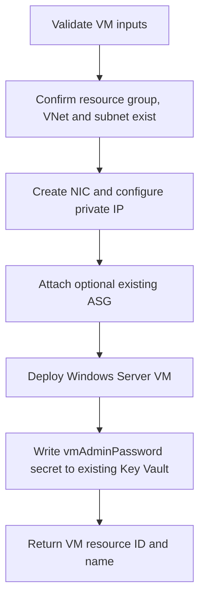

# Virtual Machine Module

**Source template:** [`modules/compute/vm.bicep`](../vm.bicep)

## Purpose
Deploys a Windows Server 2019 Datacenter Azure virtual machine and its network interface in the resource group selected by the calling module. It connects the NIC to an **existing** VNet/subnet and can optionally associate an existing Application Security Group (ASG). It also writes the supplied VM administrator password to a secret named `vmAdminPassword` in an **existing** Key Vault.

## Dependencies and inputs

| Input | Required | Description / source |
|---|---:|---|
| `location` | Yes | Azure region for the VM and NIC; usually the target resource group's region. |
| `vmName` | Yes | VM name; also used to name the NIC and OS computer. |
| `vmsize` | Yes | Azure VM size, e.g. `Standard_D2s_v3`; confirm regional availability and quota. |
| `adminUsername` | Yes | Local Windows administrator username. |
| `vmAdminPassword` | Yes | Secure parameter supplied at deployment time. Do not commit the value to source control or parameter files. |
| `tags` | Yes | Key/value tags applied to the VM. |
| `vnetName`, `subnetName` | Yes | Names of an existing VNet and subnet visible in the deployment resource group. |
| `privateIPAllocationMethod` | Yes | NIC private IP allocation mode, typically `Dynamic` or `Static`. |
| `keyVaultName` | Yes | Name of an existing Key Vault accessible at the module's deployment scope. |
| `asgName` | No | Existing ASG name; defaults to empty, which skips ASG association. |

## Required existing resources and permissions
- The target resource group must exist before this module runs.
- The VNet and subnet must exist and be address-compatible.
- If `asgName` is provided, that ASG must already exist at the expected scope.
- The Key Vault must exist, and the deployment identity must have permission to create/set secrets under its configured authorization model.
- The deployment identity needs permissions to create VMs and NICs and read referenced network resources.

## Workflow

## Outputs
- `vmId` — VM resource ID.
- `vmNameOut` — deployed VM name.

## Important notes
- This template is Windows-specific; it currently uses the Windows Server 2019 Datacenter image.
- The template references an existing subnet and Key Vault; it does not create either.
- The password is passed as a secure parameter, but the template also writes it to Key Vault. Review Key Vault access, secret naming, rotation, and retention policies before production use.
- Verify the resource scopes for the existing VNet, subnet, ASG, and Key Vault. Cross-resource-group references may require explicit scopes in the template.
- Run `az bicep build --file modules/compute/vm.bicep` and a subscription/resource-group what-if using the parent deployment before deploying.
