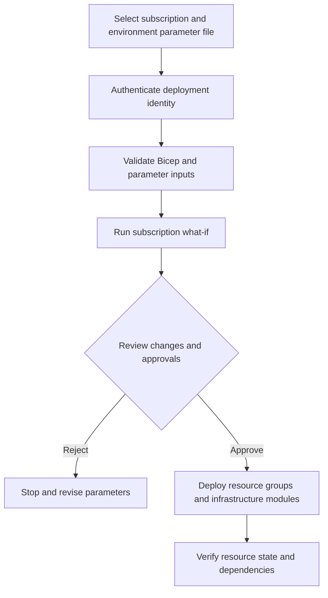

# Main Infrastructure Orchestration Template

**Source template:** [`modules/main.bicep`](../main.bicep)

## Purpose
Orchestrates the infrastructure modules using the `landingZones` object. Depending on the arrays provided, it can create resource groups, VNets/subnets, NSGs, route tables, ASGs, VMs, storage accounts, Key Vaults, VNet peerings, VPN gateways, Recovery Services vaults, backup policies/protection, action groups, and metric alerts.

The main template is a subscription-scope orchestrator. Individual child modules deploy at subscription or resource-group scope as defined in the source.

## Top-level inputs

| Input | Required | Description |
|---|---:|---|
| `environment` | Yes | Environment label used in deployment names. |
| `location` | Yes | Default/primary region used in child deployment names and selected module parameters. |
| `landingZones` | Yes | Object containing resource arrays consumed by each module. See the environment parameter files for the expected object shape. |
| `vmAdminPassword` | Yes, secure | Password passed to VM modules. Supply securely; do not commit a real password. |

## Resource arrays in `landingZones`
- `resourceGroups`: `rgName`, `location`, `tags`.
- `vnets`: `vnetName`, `resourceGroupName`, `location`, `addressPrefixes`, `subnets`, `tags`.
- `vms`: `vmName`, `resourceGroupName`, `location`, `vnetName`, `subnetName`, `adminUsername`, `keyVaultName`, `vmsize`, `tags`, optional `asgName`.
- `nsg`: `nsgName`, `resourceGroupName`, `location`, optional `securityRules`.
- `asgs`: `asgName`, `resourceGroupName`, `location`.
- `routeTables`: `routeTableName`, `resourceGroupName`, `location`, `disableBgpRoutePropagation`, optional `routes`.
- `storageAccounts`: `storageAccountName`, `resourceGroupName`, `location`, `tags`.
- `keyVaults`: `keyVaultName`, `resourceGroupName`, `location`.
- `peerings`: `peeringName`, source VNet/resource group, remote VNet/resource group.
- `backupVaults`: `vaultName`, `resourceGroupName`, `location`, `sku`.
- `backupPolicies`: `policyName`, `resourceGroupName`, `vaultName`, `backupTime`.
- `vmBackups`: `vmName`, `resourceGroupName`, `vaultName`, `policyName`.
- `vnetGateways`: `gatewayName`, `resourceGroupName`, `location`, `vnetName`, `gatewaySubnetName`, optional `gatewaySku`.
- `actionGroups`: `actionGroupName`, `resourceGroupName`, `emailReceivers`.
- `alerts`: `alertName`, `resourceGroupName`, `targetResourceName`, `actionGroupName`, `metricNamespace`, `metricName`, `operator`, `threshold`, optional `severity`, `alertDescription`.

## Dependencies and deployment ordering
- The selected subscription and deployment location must be valid.
- Resource groups are created by this template; child resources must target the correct existing/new resource groups.
- VNets depend on resource-group and NSG deployments in the current source. VM deployments depend on resource groups and VNets; ensure referenced subnet, ASG, and Key Vault are actually deployed and correctly scoped.
- Backup policies depend on vaults; backup protection depends on the VM and policy.
- Metric alerts depend on the target VM and action group.
- Peerings require both VNets; VPN gateways require a VNet and gateway subnet.
- The deployment identity needs all permissions required by every included resource type. A single successful login does not imply permission to create all resources.

## Workflow


## Suggested commands

```bash
az bicep build --file modules/main.bicep
az deployment sub what-if --location eastus --template-file modules/main.bicep --parameters environments/test.bicepparam
az deployment sub create --location eastus --template-file modules/main.bicep --parameters environments/test.bicepparam
```

## Review before production
- Check that every referenced resource group, VNet, subnet, ASG, Key Vault, vault, policy, and action group exists or is created with the correct deployment scope.
- Validate dependency expressions and deployment scopes in the main template; a module's resource-group scope must be explicit and valid.
- The source currently expects every array property referenced by a loop to exist in `landingZones`, even when empty.
- Do not use empty or placeholder VM passwords in a real deployment. Keep secrets in approved secret handling and use workload identity federation for GitHub Actions where possible.
- Run build and what-if; documentation does not replace schema validation or a successful test deployment.
