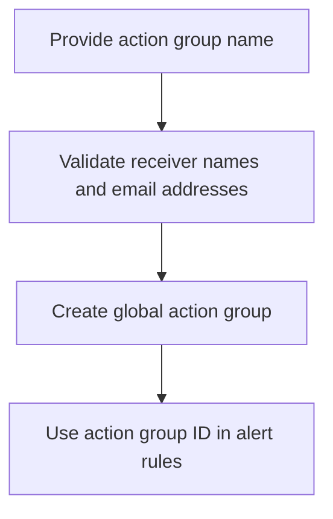

# Azure Monitor Action Group Module

**Source template:** [`modules/monitoring/actionGroup.bicep`](../actionGroup.bicep)

## Purpose
Creates an enabled Azure Monitor action group with email receivers. Alerts can reference this action group to notify operations or support contacts.

## Inputs

| Input | Required | Description |
|---|---:|---|
| `actionGroupName` | Yes | Name of the action group. |
| `emailReceivers` | Yes | Array of receiver objects, each with `name` and `emailAddress`. |

Example input shape:
```json
[
  { "name": "OperationsTeam", "emailAddress": "ops@example.com" }
]
```

## Dependencies and permissions
- Deploys at the resource-group scope selected by the parent template.
- The deployment identity needs permission to create Azure Monitor action groups.
- Use approved operational email addresses and ensure recipients are authorized to receive alert information.

## Workflow


## Outputs
- `actionGroupId` — action group resource ID.
- `actionGroupNameOut` — action group name.

## Important notes
The short name is derived from the first 12 characters of `actionGroupName`. The action group is created with the common alert schema enabled for each email receiver.
