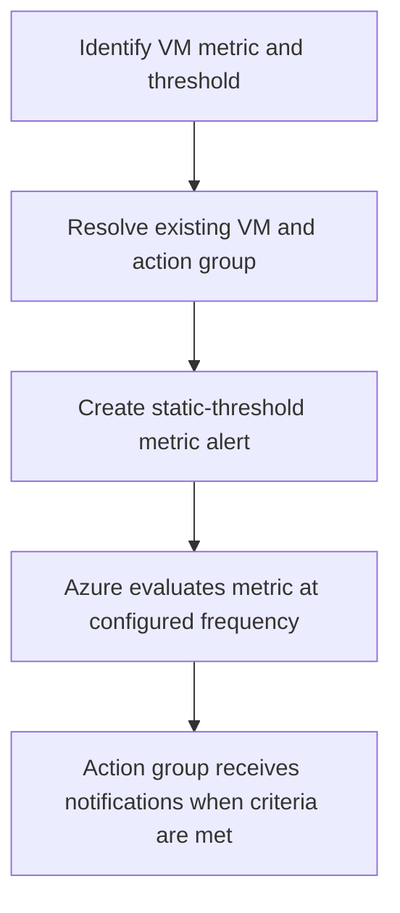

# Azure Monitor Metric Alert Module

**Source template:** [`modules/monitoring/metricAlert.bicep`](../metricAlert.bicep)

## Purpose
Creates an enabled static-threshold metric alert scoped to an existing Azure virtual machine and routes notifications to an existing action group.

## Inputs

| Input | Required | Description |
|---|---:|---|
| `alertName` | Yes | Alert rule name. |
| `targetResourceName` | Yes | Existing VM name targeted by this template. |
| `actionGroupName` | Yes | Existing action group name. |
| `metricNamespace` | Yes | Metric namespace, e.g. `Microsoft.Compute/virtualMachines`. |
| `metricName` | Yes | Azure Monitor metric name, e.g. `Percentage CPU`. |
| `operator` | Yes | Threshold comparison operator supported by Azure Monitor, e.g. `GreaterThan`. |
| `threshold` | Yes | Integer threshold. |
| `severity` | No | Alert severity from 0 (critical) to 4 (verbose); defaults to 2. |
| `alertDescription` | Yes | Human-readable description. |
| `evaluationFrequency` | No | Evaluation cadence; defaults to `PT5M`. |
| `windowSize` | No | Aggregation window; defaults to `PT5M`. |

## Dependencies and permissions
- The VM and action group must already exist in the target resource group/scope.
- Deploy the action group before the alert.
- The deployment identity needs permission to create metric alerts and read referenced resources.

## Workflow

## Output
- `alertId` — metric alert resource ID.

## Important notes
The current implementation is VM-specific and uses average aggregation with a single static-threshold criterion. Validate metric namespace/name/operator combinations for the target VM and region before deployment.
