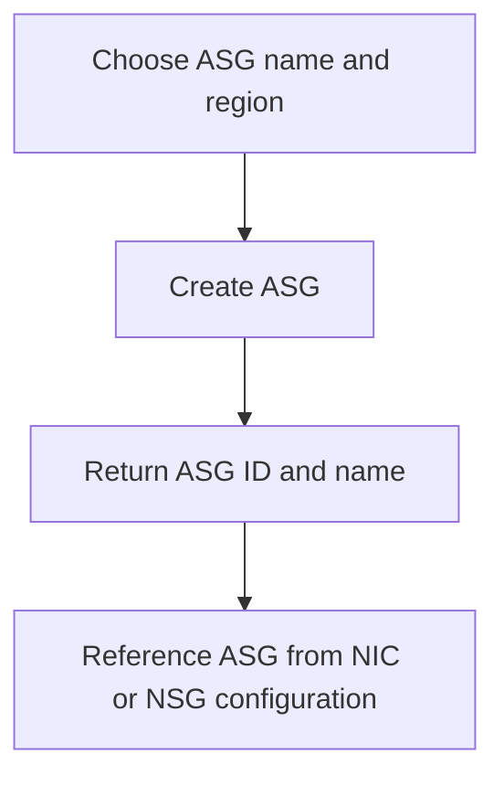

# Application Security Group Module

**Source template:** [`modules/networking/asg.bicep`](../asg.bicep)

## Purpose
Creates an Azure Application Security Group (ASG), which can be referenced by network interfaces and used in NSG rules to group workloads logically.

## Inputs
- `asgName` (required): ASG name.
- `location` (required): Azure region.

## Dependencies and permissions
The target resource group must exist. The deployment identity needs permission to create ASGs. This module creates the ASG only; it does not add NICs or NSG rules.

## Workflow

## Outputs
- `asgId` — ASG resource ID.
- `asgName` — ASG name.
