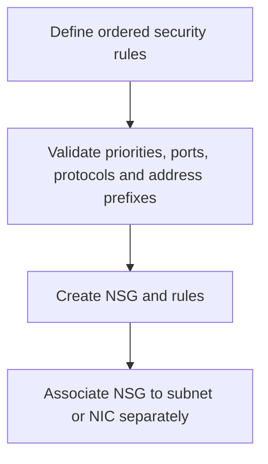

# Network Security Group Module

**Source template:** [`modules/networking/nsg.bicep`](../nsg.bicep)

## Purpose
Creates an Azure Network Security Group (NSG) with the security rules supplied as input.

## Inputs

| Input | Required | Description |
|---|---:|---|
| `location` | Yes | Azure region. |
| `nsgName` | Yes | NSG name. |
| `securityRules` | No | Array of rule objects; defaults to an empty array. |

Each rule currently requires `name`, `priority`, `direction`, `access`, `protocol`, `sourcePortRange`, `destinationPortRange`, `sourceAddressPrefix`, and `destinationAddressPrefix`.

## Dependencies and permissions
- The target resource group must exist.
- The deployment identity needs permission to create/update NSGs.
- If associating the NSG to a subnet or NIC, configure that association in the relevant resource template.

## Workflow

## Outputs
- `nsgId` — NSG resource ID.
- `nsgName` — NSG name.

## Security notes
Use least-privilege inbound/outbound rules. Avoid broad source ranges such as `*` for management ports unless explicitly approved.
