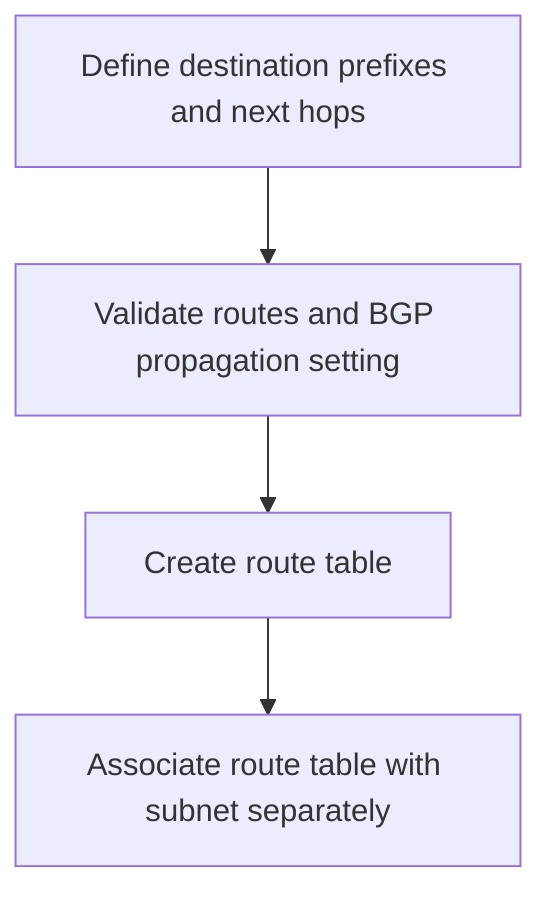

# User-Defined Route Table Module

**Source template:** [`modules/networking/routetable.bicep`](../routetable.bicep)

## Purpose
Creates an Azure route table and configures optional BGP route-propagation behavior and user-defined routes.

## Inputs

| Input | Required | Description |
|---|---:|---|
| `routeTableName` | Yes | Route table name. |
| `location` | No | Azure region; defaults to the current resource group's location. |
| `disableBgpRoutePropagation` | No | Disables BGP route propagation when true; defaults to false. |
| `routes` | No | Array of Azure route objects; defaults to empty. |

Route objects should match the Azure route schema, typically including `name` and `properties` with `addressPrefix` and `nextHopType` (and `nextHopIpAddress` when required).

## Dependencies and permissions
The target resource group must exist. The deployment identity needs permission to create route tables. Subnet association is configured separately in the VNet/subnet configuration.

## Workflow

## Outputs
- `routeTableId` — route table resource ID.
- `routeTableName` — route table name.

## Important notes
A route table by itself does not affect subnet traffic until associated with a subnet. Verify next-hop reachability and avoid accidental traffic black-holing.
