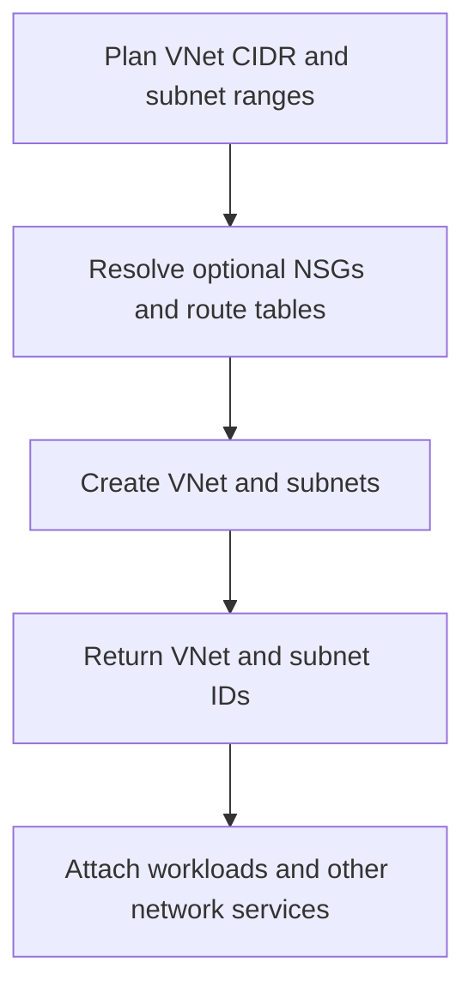

# Virtual Network Module

**Source template:** [`modules/networking/vnet.bicep`](../vnet.bicep)

## Purpose
Creates an Azure Virtual Network (VNet), its address spaces, and the configured subnets. Subnets can optionally reference existing NSGs and route tables by name.

## Inputs

| Input | Required | Description |
|---|---:|---|
| `location` | Yes | Azure region. |
| `vnetName` | Yes | VNet name. |
| `addressPrefixes` | Yes | Array of VNet CIDR address spaces. |
| `subnets` | Yes | Array of subnet objects containing `name` and `addressPrefix`; optional `nsgName` and `routeTableName`. |
| `tags` | Yes | Tags applied to the VNet. |

## Dependencies and permissions
- The target resource group must exist.
- CIDR ranges must be valid, non-overlapping where required, and large enough for the intended workloads.
- If NSG or route-table names are supplied, those resources must exist in the expected scope.
- The deployment identity needs permission to create/update VNets and subnets.

## Workflow

## Outputs
- `subnetIds` — array of subnet names and resource IDs.
- `vnetName` — VNet name.
- `vnetId` — VNet resource ID.

## Important notes
This template does not create NSGs or route tables. Confirm the names and scopes of referenced resources and avoid overlapping IP ranges.
