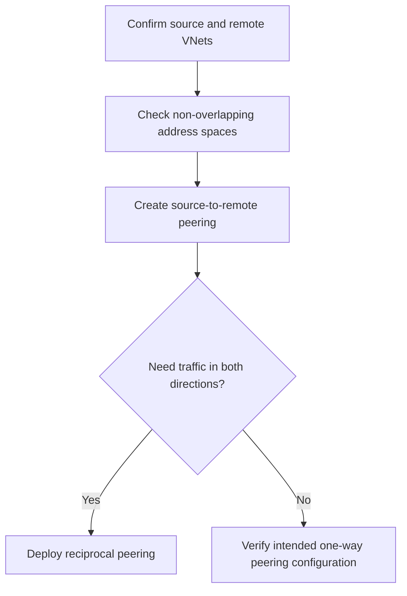

# Virtual Network Peering Module

**Source template:** [`modules/networking/vnetPeering.bicep`](../vnetPeering.bicep)

## Purpose
Creates a peering from a source VNet to an existing remote VNet. Azure VNet peering is directional; for bidirectional connectivity, configure a reciprocal peering as well.

## Inputs

| Input | Required | Description |
|---|---:|---|
| `peeringName` | Yes | Name of the peering resource on the source VNet. |
| `sourceVnetName` | Yes | Existing source VNet name in the module's deployment resource group. |
| `remoteVnetName` | Yes | Existing remote VNet name. |
| `remoteVnetResourceGroupName` | Yes | Resource group containing the remote VNet. |

## Dependencies and permissions
- Both VNets must exist, and their address spaces must not overlap.
- The deployment scope must resolve the source VNet; the remote VNet is looked up in the specified resource group.
- The deployment identity needs permission to create peering on the source VNet and read the remote VNet.
- For cross-subscription peering, verify the template's scope and identity permissions support the target subscription.

## Workflow

## Output
- `peeringId` — source peering resource ID.

## Important notes
Current settings allow VNet access and forwarded traffic, but disable gateway transit and remote-gateway use. The template creates only one direction per invocation.
