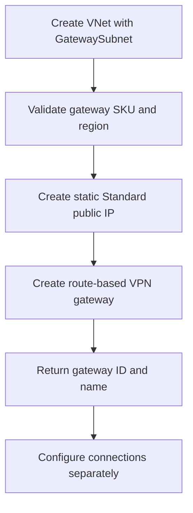

# VPN Virtual Network Gateway Module

**Source template:** [`modules/networking/vnetgateway.bicep`](../vnetgateway.bicep)

## Purpose
Creates a Standard static public IP address and a route-based Azure VPN Virtual Network Gateway in an existing VNet's gateway subnet.

## Inputs

| Input | Required | Description |
|---|---:|---|
| `location` | Yes | Azure region for gateway and public IP. |
| `gatewayName` | Yes | VPN gateway name. |
| `vnetName` | Yes | Existing VNet name. |
| `gatewaySubnetName` | Yes | Existing gateway subnet name; normally `GatewaySubnet`. |
| `gatewaySku` | No | Gateway SKU; defaults to `VpnGw1AZ`. |

## Dependencies and permissions
- The VNet and gateway subnet must exist before deployment.
- The subnet must be named and sized according to Azure VPN Gateway requirements.
- Confirm SKU availability, zone support, regional capacity, and cost.
- The deployment identity needs permissions to create public IP addresses and VPN gateways.

## Workflow

## Outputs
- `gatewayId` — gateway resource ID.
- `gatewayNameOut` — gateway name.

## Important notes
This template does not create VPN connections, local network gateways, certificates, or BGP configuration. It currently configures a zone-1 public IP; validate zone and SKU compatibility for your region and requirements.
