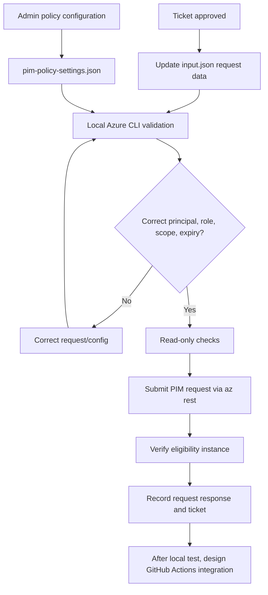

# BIFROST PIM Mark-2 — Azure CLI first

This guide tests **Azure Resource PIM eligibility** locally before any GitHub Actions integration. Commands are intentionally manual and gated: review every identity, role, scope, and duration before running a write.

> PIM Mark-2 separates ticket/request inputs from security policy settings. The root `input.json` is a sample request feeder. `modules/pim/policies/pim-policy-settings.json` is an administrator-owned policy intent/configuration file. It is **not** a native ARM or Microsoft Graph payload and is not automatically applied by the Azure Resource PIM eligibility request.

## 1. Prerequisites

- Azure CLI installed and updated.
- Access to the target Azure subscription.
- PIM for Azure resources onboarded and licensing enabled as applicable.
- Your interactive identity authorized to create Azure role eligibility schedule requests at the target scope.
- A real Entra user Object ID (GUID), Azure role definition ID, and approved ticket.
- Start in a non-production subscription.

## 2. Login and verify the context

### PowerShell
```powershell
az login
az account list --output table
$SUBSCRIPTION_ID = "<AZURE_SUBSCRIPTION_ID>"
az account set --subscription $SUBSCRIPTION_ID
az account show --query "{subscription:name,id:id,tenant:tenantId,user:user.name}" --output table
```

### Bash
```bash
az login
az account list -o table
export SUBSCRIPTION_ID="<AZURE_SUBSCRIPTION_ID>"
az account set --subscription "$SUBSCRIPTION_ID"
az account show --query "{subscription:name,id:id,tenant:tenantId,user:user.name}" -o table
```

Verify the target user and built-in role:
```bash
az ad user show --id "<ENTRA_USER_OBJECT_ID>" --query "{displayName:displayName,id:id,upn:userPrincipalName}" -o table
az role definition list --name "b24988ac-6180-42a0-ab88-20f7382dd24c" --query "[0].{name:roleName,id:name}" -o table
```

Contributor built-in role GUID: `b24988ac-6180-42a0-ab88-20f7382dd24c`. Confirm the role and scope are appropriate for the ticket.

## 3. Select the Azure Resource scope

Subscription:
```bash
SCOPE_ID="/subscriptions/$SUBSCRIPTION_ID"
```

Resource Group:
```bash
SCOPE_ID="/subscriptions/$SUBSCRIPTION_ID/resourceGroups/<RESOURCE_GROUP_NAME>"
```

Individual resource:
```bash
SCOPE_ID="/subscriptions/$SUBSCRIPTION_ID/resourceGroups/<RESOURCE_GROUP_NAME>/providers/<PROVIDER_NAMESPACE>/<RESOURCE_TYPE>/<RESOURCE_NAME>"
```

For nested resource types, include the full ARM resource ID exactly as returned by Azure.

## 4. Prepare the PIM eligibility request body

Use the scope from the previous step and the role definition resource ID. Role definition ID and scope ID are distinct.

```bash
PRINCIPAL_ID="<ENTRA_USER_OBJECT_ID>"
ROLE_GUID="b24988ac-6180-42a0-ab88-20f7382dd24c"
ROLE_DEFINITION_ID="/subscriptions/$SUBSCRIPTION_ID/providers/Microsoft.Authorization/roleDefinitions/$ROLE_GUID"
REQUEST_GUID="$(python -c 'import uuid; print(uuid.uuid4())')"
JUSTIFICATION="Approved BIFROST test access - <TICKET_NUMBER>"
```

Create the request body (Bash/Git Bash):
```bash
cat > pim-request-body.json <<JSON
{
  "properties": {
    "principalId": "$PRINCIPAL_ID",
    "roleDefinitionId": "$ROLE_DEFINITION_ID",
    "requestType": "AdminAssign",
    "justification": "$JUSTIFICATION",
    "ticketInfo": {
      "ticketNumber": "<TICKET_NUMBER>",
      "ticketSystem": "Jira"
    },
    "scheduleInfo": {
      "startDateTime": "$(date -u +%Y-%m-%dT%H:%M:%SZ)",
      "expiration": {
        "type": "AfterDuration",
        "duration": "P30D"
      }
    }
  }
}
JSON
```

For PowerShell, save the same JSON shape to `pim-request-body.json` and replace all placeholders. Make sure JSON strings are escaped if the justification contains quotes.

## 5. Read-only checks before the write

Check access at the intended scope:
```bash
az role assignment list --scope "$SCOPE_ID" --include-inherited --all -o table
```

This is only a read/access check; it does **not** prove you have PIM schedule-request write permissions.

## 6. Create Azure Resource PIM eligibility (write operation)

> **This creates eligibility. It does not immediately activate the role.** Run only after ticket approval and review.

```bash
az rest --method put \
  --url "https://management.azure.com$SCOPE_ID/providers/Microsoft.Authorization/roleEligibilityScheduleRequests/$REQUEST_GUID?api-version=2024-09-01-preview" \
  --headers "Content-Type=application/json" \
  --body @pim-request-body.json
```

Save the response/request GUID for tracking. Azure service authorization and PIM onboarding/licensing determine whether this succeeds.

## 7. Verify eligibility

```bash
az rest --method get \
  --url "https://management.azure.com$SCOPE_ID/providers/Microsoft.Authorization/roleEligibilityScheduleInstances?api-version=2020-10-01"
```

Review the returned entries for the target principal, role, and scope. The list API may return multiple records; filter the response carefully rather than assuming the first item is yours.

## 8. What-If and Bicep note

Azure Resource PIM eligibility schedule requests are service operations submitted to the Authorization API. ARM What-If is **not** a reliable preview for the REST operation itself.

The existing subscription-scope Bicep module can be syntax-compiled:
```bash
az bicep install
az bicep build --file modules/pim/pim.bicep
```

The REST request above is the local end-to-end test for subscription, resource group, and resource scopes. Do not run `az deployment sub create` as a substitute for the REST PIM API unless using a separately validated Bicep template.

## 9. Microsoft Entra directory-role PIM — Graph CLI exploration

Entra directory-role PIM uses Microsoft Graph, not the Azure Resource Manager PIM endpoint. Confirm your Graph permissions and use a tenant test role.

Read directory role eligibility policy assignments:
```bash
az rest --method get \
  --url "https://graph.microsoft.com/v1.0/roleManagement/directory/roleManagementPolicyAssignments"
```

Read role eligibility schedule requests:
```bash
az rest --method get \
  --url "https://graph.microsoft.com/v1.0/roleManagement/directory/roleEligibilityScheduleRequests"
```

These are discovery/read examples. **Do not POST or PATCH directory-role policies in production** until the required policy ID, role definition, Graph permission, approver configuration, and API payload have been validated in a dedicated test tenant. The policy JSON in this repo is an intent/configuration document, not a Graph API body.

## 10. PIM for Groups — Graph CLI exploration

PIM for Groups is also Microsoft Graph based. Read group PIM eligibility schedule requests:
```bash
az rest --method get \
  --url "https://graph.microsoft.com/v1.0/identityGovernance/privilegedAccess/group/eligibilityScheduleRequests"
```

Read group eligibility schedule instances:
```bash
az rest --method get \
  --url "https://graph.microsoft.com/v1.0/identityGovernance/privilegedAccess/group/eligibilityScheduleInstances"
```

These are read-only discovery commands. Group PIM policy/eligibility writes require Graph permissions and group-specific IDs/payloads; test separately in a sandbox. The PIM policy settings JSON is not directly submitted to Graph.

## 11. Cleanup local files

```bash
rm -f pim-request-body.json
```

PowerShell:
```powershell
Remove-Item pim-request-body.json -ErrorAction SilentlyContinue
```

## 12. Common errors

| Error | Checks |
|---|---|
| `AuthorizationFailed` | PIM schedule request write permission at exact scope; eligible/active admin permissions. |
| PIM not enabled/licensing | Onboard the subscription and verify required licensing. |
| Principal not found | Correct tenant and Entra Object ID, not UPN. |
| Invalid role/scope | Role definition resource ID vs target scope; verify ARM scope path. |
| Invalid request GUID | Use a new UUID for each request. |
| Graph `403` | Graph delegated/application permissions, consent, role authorization, and tenant configuration. |

## 13. CLI-first workflow



## Safety
- Keep `input.json` and local request bodies free of secrets.
- Do not commit real user IDs, ticket details, tenant IDs, or sensitive business justification to public repositories.
- Policy settings are administrator-owned; ticket input should not be able to weaken MFA, approval, or activation controls.
- Do not automatically create permanent active privileged assignments.
