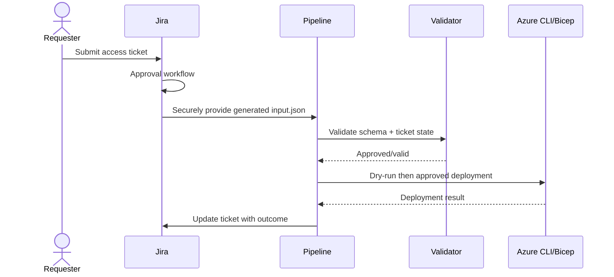

# BIFROST PIM Mark-2 — CLI testing

## Jira input handling

Jira automation should create the request JSON from ticket fields after its approval workflow. The JSON is a **runtime artifact**; do not commit ticket-specific JSON to the repository.

Validate the request shape against `schemas/pim-request.schema.json` (JSON Schema Draft 2020-12) before invoking privileged automation. The pipeline must independently check approval status, allowed platform/scope/role, and maximum duration. Never trust the JSON approval field alone as proof of approval; verify ticket state through the Jira integration.

## Azure Resource PIM — subscription eligible assignment

### Prerequisites

- Azure CLI and Bicep CLI installed.
- Access to a non-production subscription.
- PIM for Azure resources configured.
- Approved Jira ticket and actual principal/role/subscription values.
- Azure authorization to submit role eligibility schedule requests.

### Login/context

```powershell
az login
az account list --output table
az account set --subscription <SUBSCRIPTION_ID>
az account show --query "{subscription:name,id:id,tenant:tenantId,user:user.name}" --output table
```

### Dry-run request mapping

```powershell
pwsh ./scripts/Invoke-PimRequest.ps1 -InputJsonPath ./input.json -DeploymentLocation eastus
```

This validates basic input fields and prints the mapping. It does not submit a deployment.

### Execute (privileged write)

Only after validating the ticket's approval directly in Jira and reviewing the dry-run output:

```powershell
pwsh ./scripts/Invoke-PimRequest.ps1 -InputJsonPath ./input.json -DeploymentLocation eastus -Execute
```

Use Azure CLI's `--what-if` only if supported and meaningful for the selected deployment; note it does not preview all service-side PIM schedule request behavior. The script's default is dry-run.

## Scope limitations

The current Bicep template is subscription-targeted. Resource Group and resource-level requests require the Azure Authorization REST API with the actual scope path and must be separately implemented/tested. Do not pass an RG/resource request to this subscription-only Bicep runner.

## Microsoft Entra directory-role PIM — read-only exploration

Entra PIM uses Microsoft Graph, not the Azure Resource ARM PIM endpoint. These are read/discovery calls:

```powershell
az rest --method get --url "https://graph.microsoft.com/v1.0/roleManagement/directory/roleManagementPolicyAssignments"
az rest --method get --url "https://graph.microsoft.com/v1.0/roleManagement/directory/roleEligibilityScheduleRequests"
```

Do not write Graph policies or assignments until the required role policy ID, permissions, approver configuration, and payload have been validated in a test tenant.

## PIM for Groups — read-only exploration

```powershell
az rest --method get --url "https://graph.microsoft.com/v1.0/identityGovernance/privilegedAccess/group/eligibilityScheduleRequests"
az rest --method get --url "https://graph.microsoft.com/v1.0/identityGovernance/privilegedAccess/group/eligibilityScheduleInstances"
```

These are discovery examples only. Group PIM write automation is not currently included.

## Bicep compile

```powershell
az bicep install
az bicep build --file modules/pim/pim.bicep
```

## Mermaid workflow


