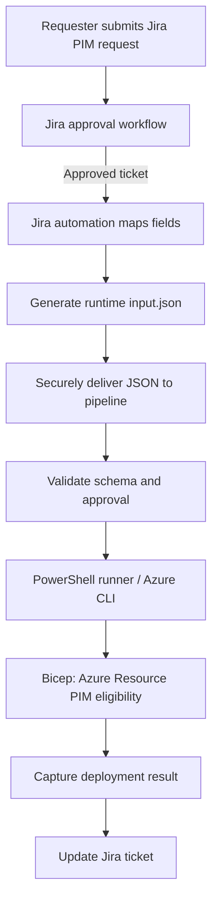

# BIFROST PIM reusable module — Mark-2

Mark-2 treats **Jira as the request source**. Jira automation creates the request JSON from the requester's ticket; the requester does not manually prepare a file.

## Jira → pipeline → Azure



**Important:** The generated request file is runtime data. Do not commit real requester data, ticket details, principal IDs, or production requests to Git. Transfer it to the pipeline using a protected artifact/secure integration. The root `input.json` in this repository is a sanitized example/template only.

## Repository layout

```text
input.json                         # Sanitized example, not a live ticket
schemas/pim-request.schema.json    # Request contract for Jira mapping
scripts/Invoke-PimRequest.ps1      # Validate + dry-run/execute Azure Resource PIM
modules/pim/
├── README.md
├── CLI_LOCAL_TESTING.md
├── pim.bicep
└── policies/
    └── pim-policy-settings.json  # Administrator-owned policy intent
```

## Request contract

Jira automation populates `input.json` using the fields in `schemas/pim-request.schema.json`:

- Jira ticket ID, requester, approval status, environment, justification
- Azure subscription ID
- Target platform, principal object ID, role, scope
- Assignment type, start date, expiration/duration

Request data must **not** set or bypass tenant security policy (MFA, Conditional Access, approval requirements, approvers, maximum activation duration, notification controls).

## Local CLI flow (Azure Resource PIM)

1. Download/receive the approved Jira-generated JSON as a secure runtime file.
2. Authenticate with Azure CLI and select/verify the intended tenant/subscription.
3. Run the PowerShell script in dry-run mode.
4. Review ticket, identity, role, scope, and duration.
5. Execute only after approval and review.

Dry run (no write):
```powershell
pwsh ./scripts/Invoke-PimRequest.ps1 -InputJsonPath ./input.json -DeploymentLocation eastus
```

Execute:
```powershell
pwsh ./scripts/Invoke-PimRequest.ps1 -InputJsonPath ./input.json -DeploymentLocation eastus -Execute -WhatIf
```

Remove `-WhatIf` only when the Azure operation is intended and the request is approved:
```powershell
pwsh ./scripts/Invoke-PimRequest.ps1 -InputJsonPath ./input.json -DeploymentLocation eastus -Execute
```

The script checks Jira approval, platform, assignment type, and current Bicep scope support. It currently supports **Azure Resource PIM eligible subscription assignment**. It does not perform active assignment activation.

## Scope/platform support matrix

| Jira request platform/scope | Status in Mark-2 |
|---|---|
| Azure Resource PIM — subscription eligible | Bicep runner supports this |
| Azure Resource PIM — resource group/resource | Not yet implemented in this runner; use separately validated ARM Authorization REST scope runner |
| Entra directory-role PIM | Not automated; Microsoft Graph implementation required |
| PIM for Groups | Not automated; Microsoft Graph implementation required |
| Active assignment / activation | Not enabled by this runner |

Azure Resource PIM, Entra directory-role PIM, and PIM for Groups use distinct APIs. Do not treat a single Bicep module as if it deploys all three.

## Security and operational notes

- Jira approval must be complete before the pipeline's privileged stage.
- Use least-privilege service connections and workload identity federation where possible.
- Never allow request fields to override policy settings.
- Prefer eligible access over permanent active access.
- Keep real JSON payloads out of source control and logs.
- A successful eligibility assignment does not activate the role immediately; the user must activate it under the tenant's PIM policy.
- Test in a non-production subscription first.

## Administrator policy configuration

`modules/pim/policies/pim-policy-settings.json` records policy intent based on the supplied examples. It is not a native ARM/Graph request payload and is not automatically applied by the current runner. Tenant policy application is a separate, admin-controlled implementation.

## CLI validation

See [CLI_LOCAL_TESTING.md](./CLI_LOCAL_TESTING.md) for detailed Azure CLI REST and Graph read-only exploration steps.
