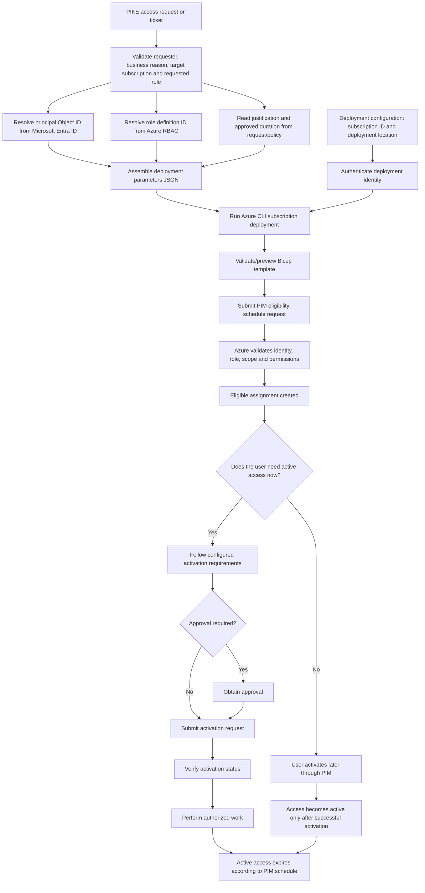

# Privileged Identity Management (PIM) Module

Reusable Bicep module for requesting **eligible Azure RBAC access** at subscription scope through Azure Privileged Identity Management (PIM).

> **Scope note:** This module manages Azure resource-role eligibility. It does not configure Microsoft Entra directory-role PIM, which uses a different management interface.

## Files

- `pim.bicep` — creates a `Microsoft.Authorization/roleEligibilityScheduleRequests` resource.
- `README.md` — documents dependencies, input sources, deployment, and the access lifecycle.

## Dependencies and prerequisites

1. **Target subscription ID (required)** — in the planned PIKE flow, obtain this from the approved Jira ticket/request payload. GitHub Actions must validate that it is an approved subscription and pass it to the deployment command as `--subscription`. Do not silently substitute the default subscription or assume the ID comes from a `.bicepparam` file. If the request contract later stores a subscription ID in an environment parameter file, define and validate which source takes precedence. The ID is not a parameter declared in `pim.bicep` because this template uses `targetScope = 'subscription'`; the deployment command selects the target.
2. **Deployment location** — an Azure region such as `eastus` for the subscription-level deployment record. This is not the region where PIM access is activated.
3. **Principal object ID** — the Microsoft Entra object ID of the target user, group, or service principal.
4. **Role definition ID** — the full Azure role definition resource ID for the requested built-in or custom role.
5. **Justification** — a reason from the approved PIKE access request, ticket, or change record.
6. **Deployment identity and permissions** — the identity running Azure CLI/GitHub Actions must be authenticated and authorized to submit the eligibility request at the target scope. Contributor alone does not automatically grant permission to manage role assignments.
7. **Supported principal and role** — confirm that the selected principal and role are supported for Azure RBAC PIM in the target environment.

## Parameters and where to get the values

The workflow passes parameters to Bicep through an **Azure deployment parameters JSON file** or explicit command-line parameters. The JSON file is an input to the deployment; it does not need to be stored inside this module directory. The **subscription ID is supplied separately** to Azure CLI using `--subscription`, from the validated ticket payload or parent workflow—not automatically from the `.bicepparam` file.

| Parameter | Required | Input source / how to obtain it | Default |
|---|---:|---|---|
| `subscriptionId` (deployment target) | Yes | **Production flow:** read it from the approved Jira ticket/request payload, then validate it against the approved subscription allowlist/configuration. For manual testing, find it in Azure portal > **Subscriptions** > **Subscription ID**, or run `az account list --query "[].{Name:name,SubscriptionId:id,IsDefault:isDefault}" -o table`. It is passed as the deployment target, not as a parameter inside `pim.bicep`. | Jira request payload → GitHub Actions validation → `az deployment sub --subscription` |
| `principalId` | Yes | Microsoft Entra admin center: select the target user/group and copy **Object ID**. For a service principal, use its service-principal object ID, not the application/client ID. | — |
| `roleDefinitionId` | Yes | Azure portal: target subscription > **Access control (IAM) > Roles**; obtain the full role definition resource ID. Azure CLI can query role definitions. | — |
| `justification` | Yes | Approved PIKE access request, service ticket, or change record. | — |
| `duration` | No | Organization's access policy / approved request, expressed as an ISO 8601 duration such as `P30D` or `P90D`. | `P90D` |
| `startDateTime` | No | Optional scheduled start supplied by the request/workflow; otherwise the template uses its deployment-time default. Validate the date-time format against the selected API version. | Deployment-time value |
| `requestName` | No | Normally generated by Bicep from the subscription, principal, and role. Supply an explicit value only if the process needs to manage request names itself. | Generated GUID |
| `principalType` | No | Determined from the identity being assigned: `User`, `Group`, or `ServicePrincipal`. | `User` |

Example Azure CLI command to look up a role definition ID:

```bash
az role definition list --name "Reader" --query "[0].id" -o tsv
```

For subscription-level deployment, the target subscription is selected separately from the module parameters, for example with `--subscription <subscription-id>`. The `--location` value is used for the deployment record.

## End-to-end workflow: inputs to eligible access

This diagram shows the intended PIKE process, including where the input values originate and what the module does with them.



### What happens at each stage?

1. **Request intake:** The PIKE request/ticket provides the requester, target identity, requested role, target subscription, business justification, and requested duration.
2. **Resolve IDs:** Find the target identity's **Object ID** in Microsoft Entra ID. Find the full **role definition resource ID** in Azure RBAC. Do not use an application/client ID in place of a service-principal object ID.
3. **Resolve the target subscription:** In the intended automated PIKE flow, read the subscription ID from the approved Jira ticket payload and validate it against approved configuration/allowlisted subscriptions. For manual testing, obtain it from Azure portal > Subscriptions or `az account list`. Confirm it is the intended target; do not assume the default subscription is correct.
4. **Build JSON input:** Put the required values and any approved optional overrides into a deployment parameters JSON file. Keep secrets out of the JSON file; use the organization's approved secret/configuration handling for authentication.
5. **Authenticate:** The operator or pipeline authenticates to Azure using an approved deployment identity. For GitHub Actions, workload identity federation is generally preferable to storing a long-lived client secret.
6. **Preview and deploy:** Run Bicep validation/what-if, review the target subscription and role, then submit the subscription deployment.
7. **Create eligibility:** Azure processes the `Microsoft.Authorization/roleEligibilityScheduleRequests` resource. The Bicep outputs return the eligibility request resource ID and name if deployment succeeds.
8. **Activate separately:** Eligibility alone does **not** make the role active. The user activates through PIM, or a separately designed supported API workflow handles activation while honoring MFA, approval, justification, and other configured requirements.
9. **Expire:** PIM applies the configured eligibility/activation schedule. Active permissions are available only after successful activation and end according to the applicable schedule/policy.

## Example JSON deployment parameters

The following is an example of the **Azure deployment parameters file format**. Replace the placeholders with approved values. It can be stored at a suitable location outside `modules/pim/` or generated by the pipeline.

```json
{
  "$schema": "https://schema.management.azure.com/schemas/2019-04-01/deploymentParameters.json#",
  "contentVersion": "1.0.0.0",
  "parameters": {
    "principalId": {
      "value": "<entra-object-id>"
    },
    "roleDefinitionId": {
      "value": "/subscriptions/<subscription-id>/providers/Microsoft.Authorization/roleDefinitions/<role-guid>"
    },
    "justification": {
      "value": "Approved PIKE access request: <ticket-or-request-id>"
    },
    "duration": {
      "value": "P90D"
    },
    "principalType": {
      "value": "User"
    }
  }
}
```

## Example deployment

Run from the repository root. Replace the subscription, location, and parameters-file path with your actual values. The subscription ID comes from Azure portal > **Subscriptions** > **Subscription ID**, or from `az account list` after Azure CLI login. Confirm it is the intended subscription before running either command.

Preview the deployment first:

```bash
az deployment sub what-if \
  --subscription "<subscription-id>" \
  --name "pim-eligibility-preview" \
  --location "eastus" \
  --template-file "modules/pim/pim.bicep" \
  --parameters "@pim.parameters.json"
```

If the preview is correct and the required approvals are in place, submit the deployment:

```bash
az deployment sub create \
  --subscription "<subscription-id>" \
  --name "pim-eligibility" \
  --location "eastus" \
  --template-file "modules/pim/pim.bicep" \
  --parameters "@pim.parameters.json"
```

The parameters JSON file is a deployment input, not an additional file required in `modules/pim/`. Keep the module directory to the two files `pim.bicep` and `README.md`.

## Important considerations

- Review the requester, principal, role, target subscription, justification, and duration before deployment.
- Use least privilege and the shortest practical eligibility duration.
- This template requests an **eligible assignment**; it does not automatically activate the role for the principal.
- The activation portion of the diagram describes the intended end-to-end process. Activation automation must be implemented separately using the appropriate supported API and must respect configured MFA and approval requirements.
- Confirm the exact API version and property requirements in the target Azure environment before production use.
- Validate the template before deployment:

```bash
az bicep build --file modules/pim/pim.bicep
```

---

# Creating Azure resource PIM eligibility: Portal, Azure CLI, and BIFROST module

> These instructions cover **Azure RBAC resource-level PIM eligibility** (for example, eligible Reader/Contributor on a Resource Group). They do not cover Microsoft Entra directory-role PIM such as Global Administrator. Eligibility is not active access; the user must activate the role through PIM when needed.

## 1. Manually assign PIM eligibility using the Azure Portal UI

1. Sign in to the [Azure portal](https://portal.azure.com) with an account authorized to manage PIM role eligibility.
2. Open **Subscriptions** and select the target subscription.
3. Navigate to **Access control (IAM)**.
4. Open the scope's **Privileged Identity Management** role-management experience. Portal labels can vary.
5. Select **Add assignments** (or **Add role** → **Add assignment**).
6. Choose the Azure role to make eligible (for example, Reader or Contributor); follow least privilege.
7. Select the target user and verify the identity. Supported principal types depend on the selected role and PIM scope.
8. Select **Eligible** rather than **Active** for assignment type.
9. Configure the eligibility start/end or duration according to organizational policy.
10. Provide justification and ticket/change reference if prompted.
11. Review scope, principal, role, assignment type, and duration.
12. Select **Assign** to submit the request.
13. Verify the assignment appears as **Eligible** in PIM at the target scope.
14. When access is needed, the user goes to **Privileged Identity Management → My roles → Azure resources**, selects the eligible role, and chooses **Activate**. Complete MFA, justification, and approval requirements.

**Licensing:** PIM may require Microsoft Entra ID P2 or Microsoft Entra ID Governance licensing. If Azure returns \`AadPremiumLicenseRequired\`, resolve the licensing prerequisite; changing deployment methods does not bypass it.

## 2. Create Azure resource PIM eligibility using Azure CLI (\`az rest\`)

Azure CLI versions do not all expose a dedicated simple PIM eligibility command. For Azure resource PIM, the Azure Resource Manager PIM API can be invoked using \`az rest\`. This is a direct API method; the BIFROST module below is the repeatable IaC approach.

### Prerequisites

- Azure CLI installed and authenticated.
- Correct tenant and subscription selected.
- Permission to submit Azure resource PIM eligibility requests at the target scope.
- PIM licensing prerequisite satisfied.
- Principal Object ID, role definition ID, and request GUID.

\`\`\`bash
az login
az account set --subscription "<subscription-id>"

SUBSCRIPTION_ID="<subscription-id>"
RESOURCE_GROUP="<resource-group-name>"
PRINCIPAL_ID="<entra-object-id>"
ROLE_ID="<role-definition-guid>"
REQUEST_GUID="$(python -c 'import uuid; print(uuid.uuid4())')"
SCOPE="/subscriptions/\${SUBSCRIPTION_ID}/resourceGroups/\${RESOURCE_GROUP}"
ROLE_DEFINITION_ID="/subscriptions/\${SUBSCRIPTION_ID}/providers/Microsoft.Authorization/roleDefinitions/\${ROLE_ID}"
\`\`\`

### Submit the eligibility request

\`\`\`bash
az rest \\
  --method put \\
  --url "https://management.azure.com\${SCOPE}/providers/Microsoft.Authorization/roleEligibilityScheduleRequests/\${REQUEST_GUID}?api-version=2020-10-01-preview" \\
  --headers "Content-Type=application/json" \\
  --body "{
    \\"properties\\": {
      \\"principalId\\": \\"\${PRINCIPAL_ID}\\",
      \\"roleDefinitionId\\": \\"\${ROLE_DEFINITION_ID}\\",
      \\"requestType\\": \\"AdminAssign\\",
      \\"justification\\": \\"Approved access request - <ticket-id>\\",
      \\"scheduleInfo\\": {
        \\"startDateTime\\": \\"$(date -u +%Y-%m-%dT%H:%M:%SZ)\\",
        \\"expiration\\": {
          \\"type\\": \\"AfterDuration\\",
          \\"duration\\": \\"P30D\\"
        }
      },
      \\"ticketInfo\\": {
        \\"ticketNumber\\": \\"<ticket-id>\\",
        \\"ticketSystem\\": \\"Jira\\"
      }
    }
  }"
\`\`\`

For subscription scope, set \`SCOPE="/subscriptions/<subscription-id>"\`. For Resource Group scope, use \`/subscriptions/<subscription-id>/resourceGroups/<resource-group-name>\`. Verify the request body/API version against the [Azure PIM ARM API documentation](https://learn.microsoft.com/en-us/entra/id-governance/privileged-identity-management/pim-resource-roles-assign-roles) before production use.

This creates an **eligibility request**, not immediate active access.

## 3. Grant PIM eligibility through the BIFROST reusable Bicep module

This is the intended automated repository workflow. The pipeline reads approved request values from \`input.json\`, validates them, creates deployment parameters, and deploys the reusable Bicep module.

### Repository files

- \`modules/pim/main.bicep\` — wrapper/orchestration template.
- \`modules/pim/pim.bicep\` — defines the \`Microsoft.Authorization/roleEligibilityScheduleRequests\` resource.
- \`.github/workflows/deploy.yml\` — PIM stage, authentication, parameter generation, and deployment.
- \`input.json\` — request configuration and deployment-plan selection.

### End-to-end steps

1. Populate the PIM section in root \`input.json\`: target scope/resource group, principal Object ID, role definition ID, justification, duration, ticket system, and ticket number.
2. Set the PIM deployment plan to \`create\` when an eligibility request is required.
3. Configure the GitHub Environment (currently \`bifrost-dev\`) with the Azure OIDC settings required by the workflow.
4. Ensure the GitHub Actions identity has appropriate PIM/role-assignment permissions at the requested scope.
5. Run the workflow and select the PIM deployment option (\`deploy_pim\`). Keep the workflow selection and JSON plan consistent.
6. The PIM stage reads the resolved JSON input and generates an ARM deployment parameters file. Request GUIDs should be generated deterministically or uniquely according to the implementation.
7. The stage submits \`modules/pim/main.bicep\` through Azure Resource Manager; the wrapper invokes the reusable \`pim.bicep\` module.
8. Azure validates the request, including tenant licensing, deployment permissions, principal, role, and scope.
9. Review the workflow result and verify the eligibility assignment in Azure Portal at the target scope under PIM.
10. The user activates the eligible role separately when access is required.

### What the module does—and does not do

**It does:**
- request Azure resource-role eligibility;
- use configured principal, role, scope, justification, schedule, and ticket metadata;
- make the request repeatable and reviewable as IaC.

**It does not:**
- bypass PIM licensing or permissions;
- automatically make the role active merely by creating eligibility;
- automate user activation, MFA, or approval unless a separate supported activation workflow is implemented;
- create Microsoft Entra directory-role PIM assignments.

### Troubleshooting

| Error / outcome | Meaning / next check |
|---|---|
| \`AadPremiumLicenseRequired\` | PIM licensing prerequisite is not satisfied; check Entra ID P2 / Governance licensing. |
| Authorization / insufficient permissions | Check the GitHub deployment identity's permissions at the target scope. |
| Principal not found | Verify principal Object ID and tenant. |
| Invalid role definition ID | Verify full role definition resource ID and target scope. |
| PIM “Not requested” stage | Expected when PIM is not selected; no eligibility request should be submitted. |
| Eligibility created but access unavailable | User must activate the eligible role; activation policy may require MFA, justification, or approval. |
