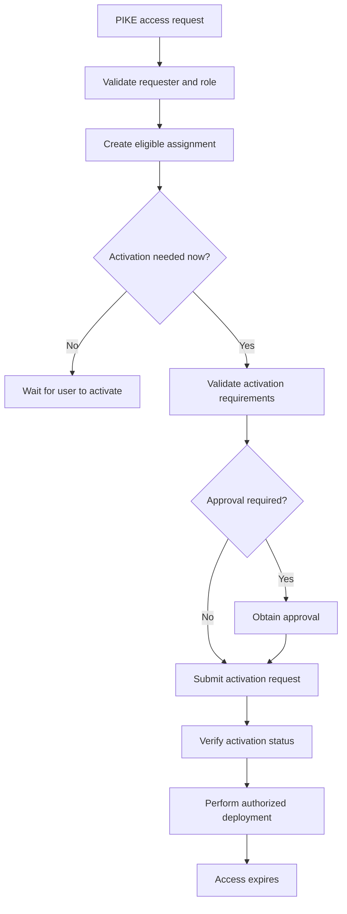

# Privileged Identity Management (PIM) Module

Reusable Bicep module for requesting **eligible Azure RBAC access** at subscription scope through Azure Privileged Identity Management (PIM).

> **Scope note:** This module manages Azure resource-role eligibility. It does not configure Microsoft Entra directory-role PIM, which uses a different management interface.

## Files

- `pim.bicep` — creates a `Microsoft.Authorization/roleEligibilityScheduleRequests` resource.

## Dependencies and prerequisites

1. **Target subscription** — the deployment must run against the subscription where eligible access is required.
2. **Principal object ID** — the Microsoft Entra object ID for the user, group, or service principal.
3. **Role definition ID** — the full Azure role definition resource ID, such as a built-in or custom role definition ID.
4. **Deployment permissions** — the deploying identity must have permission to create role eligibility schedule requests at the target scope. Verify the operator's authorization and the tenant's PIM/RBAC configuration before deployment.
5. **Supported principal and role** — ensure the principal type and selected role are supported for Azure RBAC PIM in the target environment.

## Parameters

| Parameter | Required | Default | Description |
|---|---:|---|---|
| `principalId` | Yes | — | Entra object ID receiving eligible access |
| `roleDefinitionId` | Yes | — | Full Azure role definition resource ID |
| `justification` | Yes | — | Reason for the privileged-access request |
| `duration` | No | `P90D` | Eligibility period in ISO 8601 duration format |
| `startDateTime` | No | Deployment time | Eligibility start time in UTC |
| `requestName` | No | Generated GUID | Request resource name |
| `principalType` | No | `User` | `User`, `Group`, or `ServicePrincipal` |

## PIM access lifecycle

The workflow below separates creating an eligible assignment from activating it. Creating the eligible assignment does **not** automatically make the role active.



## Example deployment

Run from the repository root, substituting the real object ID, role definition ID, justification, and subscription ID:

```bash
az deployment sub what-if \
  --name pim-eligibility-preview \
  --location eastus \
  --template-file modules/pim/pim.bicep \
  --parameters principalId='<entra-object-id>' \
               roleDefinitionId='/subscriptions/<subscription-id>/providers/Microsoft.Authorization/roleDefinitions/<role-guid>' \
               justification='Time-bound privileged access for approved operational work' \
               duration='P90D'
```

If the what-if output is correct, deploy using the same parameters with `az deployment sub create`.

## Important considerations

- Review the role, principal, target subscription, justification, and eligibility duration before deployment.
- Use least privilege and the shortest practical eligibility duration.
- This template requests an **eligible assignment**; it does not automatically activate the role for the principal.
- The activation steps in the diagram describe the intended workflow; activation automation must be implemented separately using the appropriate supported API and must respect configured MFA and approval requirements.
- Confirm the exact API version and property requirements in the target Azure environment before production use.
- Validate the template before deployment:

```bash
az bicep build --file modules/pim/pim.bicep
```
