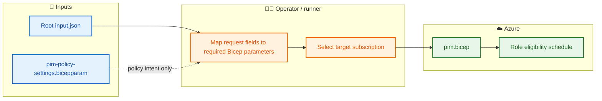

# 🛡️ BIFROST PIM module

This module contains the Azure Resource PIM eligibility Bicep implementation and the PIM policy configuration parameter file.

## 📦 Files

| File | Purpose |
|---|---|
| `pim.bicep` | Subscription-scoped Azure Resource PIM eligibility schedule request. |
| `pim-policy-settings.bicepparam` | Policy intent for Azure roles, Entra roles, PIM for Groups, and assignment defaults. |

Requester identity/access/ticket data belongs in root `input.json`, not duplicated in the policy parameter file.

## ⚙️ Bicep scope and parameters

```bicep
targetScope = 'subscription'
```

This declares subscription deployment scope, but does not select the subscription ID.

| Parameter | Description |
|---|---|
| `principalId` | Entra Object ID (GUID) of the principal receiving eligibility. |
| `roleDefinitionId` | Full Azure role definition resource ID. |
| `requestType` | Azure Resource PIM schedule operation; new eligibility commonly uses `AdminAssign`. |
| `justification` | Business reason for access. |
| `duration` | Eligibility duration in ISO 8601 format, validated against finite `@allowed` values. |
| `startDateTime` | Start time; currently uses the template's UTC time default. |
| `requestName` | Unique schedule request name. |

The template resource is:

```bicep
Microsoft.Authorization/roleEligibilityScheduleRequests@2024-09-01-preview
```

## 🛡️ Policy parameter file

`pim-policy-settings.bicepparam` contains:
- `azureResourcePimPolicy`: Owner and User Access Administrator settings.
- `entraRolePimPolicy`: Global Administrator and Exchange Administrator settings.
- `groupPimPolicy`: Group Owner and Member settings.
- `pimAssignmentDefaults`: eligibility and assignment defaults.

These objects are **not applied** by the current eligibility resource. Azure Authorization API and Microsoft Graph operations must be implemented separately to enforce those policies.

## 🔁 Current deployment flow



## 🧪 Local validation

```powershell
az login
az account set --subscription <SUBSCRIPTION_ID>
az account show
az bicep build --file modules/pim/pim.bicep
```

Required request parameters must be supplied. Bicep does not parse root JSON automatically; the caller/runner must map those values.

See [CLI local testing](../../docs/CLI_LOCAL_TESTING.md).

## ⚠️ Current limitations

- Azure Resource PIM eligibility schedule creation is the only implemented PIM operation in this Bicep template.
- Activation policy enforcement is not implemented.
- Entra directory-role and PIM for Groups policy writes are not implemented.
- Ticket metadata is not passed into the Azure resource.
- The deployment command must select the correct subscription.
