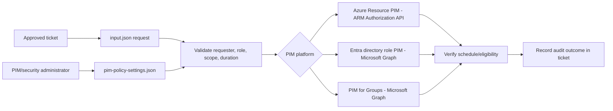
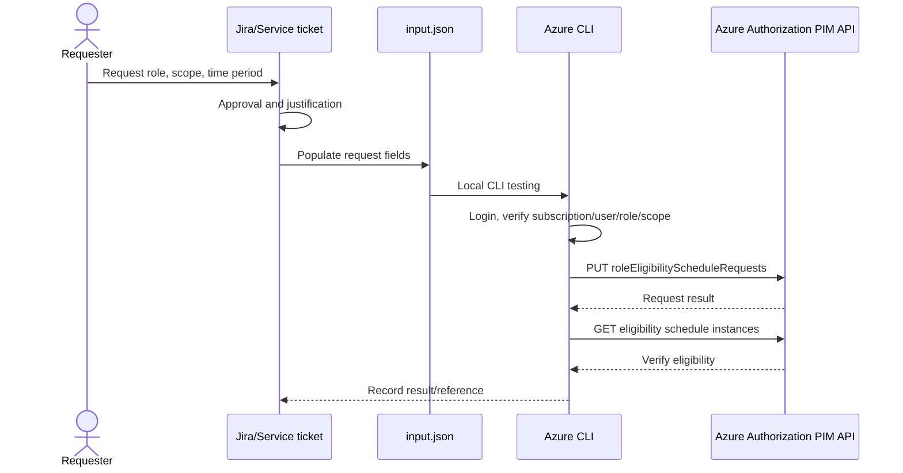

# BIFROST PIM reusable module — Mark-2

Mark-2 separates **request/ticket data** from **administrator-managed PIM security policy settings**. The goal is to validate the Azure CLI workflow locally before integrating it into GitHub Actions.

## Included files

```text
input.json
modules/pim/
├── README.md
├── CLI_LOCAL_TESTING.md
├── pim.bicep
└── policies/
    └── pim-policy-settings.json
```

- Root `input.json`: request-specific data (ticket, requester, principal, role, scope, assignment duration). It is a sanitized example/template.
- `policies/pim-policy-settings.json`: desired security policy settings for Azure Resource roles, Entra directory roles, and PIM for Groups.
- `pim.bicep`: subscription-scope Azure Resource PIM eligibility module retained from Mark-1.
- `CLI_LOCAL_TESTING.md`: local Azure CLI testing instructions, read checks, ARM REST request, Graph discovery commands, and Mermaid workflow.

The PIM Mark-2 branch deliberately does **not** include a GitHub Actions workflow yet. First validate the request path locally with Azure CLI; pipeline integration comes after local testing.

## Architecture and separation of responsibilities

### Request vs policy

| Source | Owner | Contains | Must not contain |
|---|---|---|---|
| `input.json` | Ticket/request process | ticket reference, approval, requester, target principal, role, scope, assignment period, justification | policy overrides such as disabling MFA or bypassing approval |
| `policies/pim-policy-settings.json` | PIM/security administrators | MFA, Conditional Access intent, approval, approvers, activation time, notifications, eligible/active defaults | per-ticket requester-controlled values |

A ticket can request a role and a time window; it cannot change the tenant's activation controls.

## PIM platforms

| Platform | API/service | Examples | Mark-2 scope |
|---|---|---|---|
| Azure Resource PIM | Azure Resource Manager Authorization API | Owner, Contributor, User Access Administrator; subscription/RG/resource | CLI-first eligibility test documented |
| Microsoft Entra directory-role PIM | Microsoft Graph `roleManagement/directory` | Global Administrator, Exchange Administrator | Policy intent/configuration captured; Graph writes require a separately validated implementation |
| PIM for Groups | Microsoft Graph `identityGovernance/privilegedAccess/group` | Group member/owner eligibility | Policy intent/configuration captured; Graph writes require a separately validated implementation |

**Important:** These are different API surfaces. Azure Resource PIM ARM requests cannot be reused as Graph directory-role or group PIM requests.

## Module flow



## Azure Resource PIM eligibility flow



## Role and activation policy examples

The screenshots provided example policy intent:

- **Azure Resource Owner (critical subscription):** MFA, notifications, Conditional Access, approval from another subscription owner, one-hour activation.
- **Azure User Access Administrator (less critical subscription):** MFA, notifications, Conditional Access, no approval, one-hour activation.
- **Microsoft Entra Global Administrator:** MFA, Conditional Access, notifications, incident/ticket, approval by another Global Administrator, one-hour activation.
- **Exchange Administrator:** MFA, Conditional Access, notifications, two-hour activation, no approval in the example.
- **PIM for Groups Owner:** MFA, notifications, Conditional Access, approval by another group owner, one-hour activation.
- **PIM for Groups Member:** MFA, notifications, Conditional Access, no approval, five-hour activation.

These are examples from the supplied deployment-plan screenshots, **not a recommended universal production baseline**. Review each role against your tenant's risk and policy requirements. Settings in the JSON are policy intent; they are not automatically applied by this branch.

## Azure CLI local test

Follow [CLI_LOCAL_TESTING.md](./CLI_LOCAL_TESTING.md) from top to bottom:

1. Login and select a sandbox subscription.
2. Verify the target user and role definition.
3. Set subscription, RG, or resource scope.
4. Submit an Azure Resource PIM eligibility request with `az rest`.
5. Verify the eligibility schedule.
6. Explore Entra/group PIM read endpoints separately using Graph.

Do not integrate the GitHub workflow until the CLI path succeeds in a test subscription/tenant.

## Security rules

- Use least privilege and prefer eligible over permanent active access.
- Ticket/request inputs cannot weaken policy.
- Keep permanent active Owner/Global Administrator assignments limited to approved emergency access accounts.
- Do not commit secrets, access tokens, real user IDs, or production ticket data.
- Require explicit approval before actual PIM writes.
- A successful eligibility request does not activate the role immediately; the user must activate it subject to policy.

## Current Mark-2 limitations

- The retained `pim.bicep` is subscription-targeted and only creates Azure Resource PIM eligibility schedule requests.
- Resource Group and individual resource PIM local testing uses the Authorization REST API at the selected scope.
- Entra directory-role policy/assignment and PIM for Groups policy/assignment are documented as separate Graph integrations; they are **not yet automated** by this branch.
- GitHub Actions/OIDC integration is intentionally deferred until Azure CLI validation is complete.
