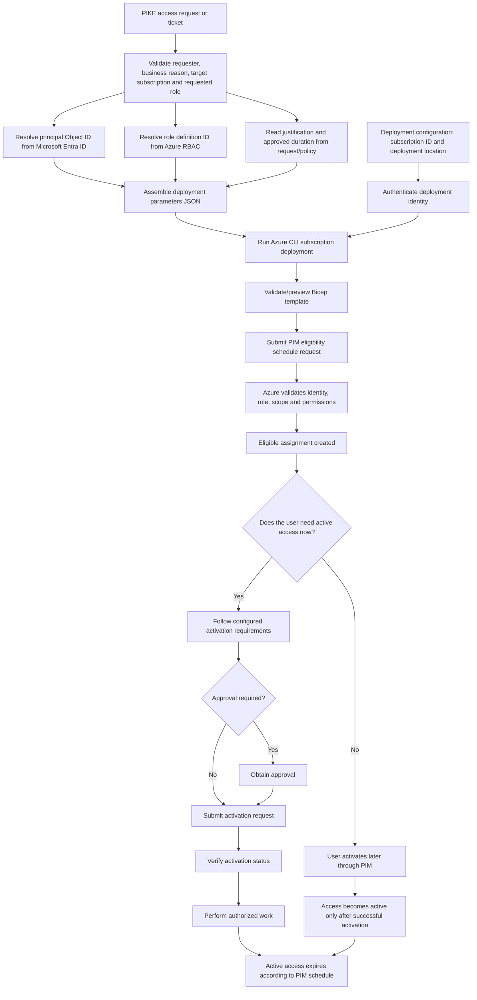

# Privileged Identity Management (PIM) Module

Reusable Bicep module for requesting **eligible Azure RBAC access** at subscription scope through Azure Privileged Identity Management (PIM).

> **Scope note:** This module manages Azure resource-role eligibility. It does not configure Microsoft Entra directory-role PIM, which uses a different management interface.

## Files

- `pim.bicep` — creates a `Microsoft.Authorization/roleEligibilityScheduleRequests` resource.
- `README.md` — documents dependencies, input sources, deployment, and the access lifecycle.

## Dependencies and prerequisites

1. **Target subscription** — the subscription where eligible access is required. The deployment command selects it with a subscription ID or name.
2. **Deployment location** — an Azure region such as `eastus` for the subscription-level deployment record. This is not the region where PIM access is activated.
3. **Principal object ID** — the Microsoft Entra object ID of the target user, group, or service principal.
4. **Role definition ID** — the full Azure role definition resource ID for the requested built-in or custom role.
5. **Justification** — a reason from the approved PIKE access request, ticket, or change record.
6. **Deployment identity and permissions** — the identity running Azure CLI/GitHub Actions must be authenticated and authorized to submit the eligibility request at the target scope. Contributor alone does not automatically grant permission to manage role assignments.
7. **Supported principal and role** — confirm that the selected principal and role are supported for Azure RBAC PIM in the target environment.

## Parameters and where to get the values

The workflow passes parameters to Bicep through an **Azure deployment parameters JSON file** or explicit command-line parameters. The JSON file is an input to the deployment; it does not need to be stored inside this module directory.

| Parameter | Required | Input source / how to obtain it | Default |
|---|---:|---|---|
| `principalId` | Yes | Microsoft Entra admin center: select the target user/group and copy **Object ID**. For a service principal, use its service-principal object ID, not the application/client ID. | — |
| `roleDefinitionId` | Yes | Azure portal: target subscription > **Access control (IAM) > Roles**; obtain the full role definition resource ID. Azure CLI can query role definitions. | — |
| `justification` | Yes | Approved PIKE access request, service ticket, or change record. | — |
| `duration` | No | Organization's access policy / approved request, expressed as an ISO 8601 duration such as `P30D` or `P90D`. | `P90D` |
| `startDateTime` | No | Optional scheduled start supplied by the request/workflow; otherwise the template uses its deployment-time default. Validate the date-time format against the selected API version. | Deployment-time value |
| `requestName` | No | Normally generated by Bicep from the subscription, principal, and role. Supply an explicit value only if the process needs to manage request names itself. | Generated GUID |
| `principalType` | No | Determined from the identity being assigned: `User`, `Group`, or `ServicePrincipal`. | `User` |

Example Azure CLI command to look up a role definition ID:

```bash
az role definition list --name "Reader" --query "[0].id" -o tsv
```

For subscription-level deployment, the target subscription is selected separately from the module parameters, for example with `--subscription <subscription-id>`. The `--location` value is used for the deployment record.

## End-to-end workflow: inputs to eligible access

This diagram shows the intended PIKE process, including where the input values originate and what the module does with them.



### What happens at each stage?

1. **Request intake:** The PIKE request/ticket provides the requester, target identity, requested role, target subscription, business justification, and requested duration.
2. **Resolve IDs:** Find the target identity's **Object ID** in Microsoft Entra ID. Find the full **role definition resource ID** in Azure RBAC. Do not use an application/client ID in place of a service-principal object ID.
3. **Build JSON input:** Put the required values and any approved optional overrides into a deployment parameters JSON file. Keep secrets out of the JSON file; use the organization's approved secret/configuration handling for authentication.
4. **Authenticate:** The operator or pipeline authenticates to Azure using an approved deployment identity. For GitHub Actions, workload identity federation is generally preferable to storing a long-lived client secret.
5. **Preview and deploy:** Run Bicep validation/what-if, review the target subscription and role, then submit the subscription deployment.
6. **Create eligibility:** Azure processes the `Microsoft.Authorization/roleEligibilityScheduleRequests` resource. The Bicep outputs return the eligibility request resource ID and name if deployment succeeds.
7. **Activate separately:** Eligibility alone does **not** make the role active. The user activates through PIM, or a separately designed supported API workflow handles activation while honoring MFA, approval, justification, and other configured requirements.
8. **Expire:** PIM applies the configured eligibility/activation schedule. Active permissions are available only after successful activation and end according to the applicable schedule/policy.

## Example JSON deployment parameters

The following is an example of the **Azure deployment parameters file format**. Replace the placeholders with approved values. It can be stored at a suitable location outside `modules/pim/` or generated by the pipeline.

```json
{
  "$schema": "https://schema.management.azure.com/schemas/2019-04-01/deploymentParameters.json#",
  "contentVersion": "1.0.0.0",
  "parameters": {
    "principalId": {
      "value": "<entra-object-id>"
    },
    "roleDefinitionId": {
      "value": "/subscriptions/<subscription-id>/providers/Microsoft.Authorization/roleDefinitions/<role-guid>"
    },
    "justification": {
      "value": "Approved PIKE access request: <ticket-or-request-id>"
    },
    "duration": {
      "value": "P90D"
    },
    "principalType": {
      "value": "User"
    }
  }
}
```

## Example deployment

Run from the repository root. Replace the subscription, location, and parameters-file path with your actual values.

Preview the deployment first:

```bash
az deployment sub what-if \
  --subscription "<subscription-id>" \
  --name "pim-eligibility-preview" \
  --location "eastus" \
  --template-file "modules/pim/pim.bicep" \
  --parameters "@pim.parameters.json"
```

If the preview is correct and the required approvals are in place, submit the deployment:

```bash
az deployment sub create \
  --subscription "<subscription-id>" \
  --name "pim-eligibility" \
  --location "eastus" \
  --template-file "modules/pim/pim.bicep" \
  --parameters "@pim.parameters.json"
```

The parameters JSON file is a deployment input, not an additional file required in `modules/pim/`. Keep the module directory to the two files `pim.bicep` and `README.md`.

## Important considerations

- Review the requester, principal, role, target subscription, justification, and duration before deployment.
- Use least privilege and the shortest practical eligibility duration.
- This template requests an **eligible assignment**; it does not automatically activate the role for the principal.
- The activation portion of the diagram describes the intended end-to-end process. Activation automation must be implemented separately using the appropriate supported API and must respect configured MFA and approval requirements.
- Confirm the exact API version and property requirements in the target Azure environment before production use.
- Validate the template before deployment:

```bash
az bicep build --file modules/pim/pim.bicep
```
