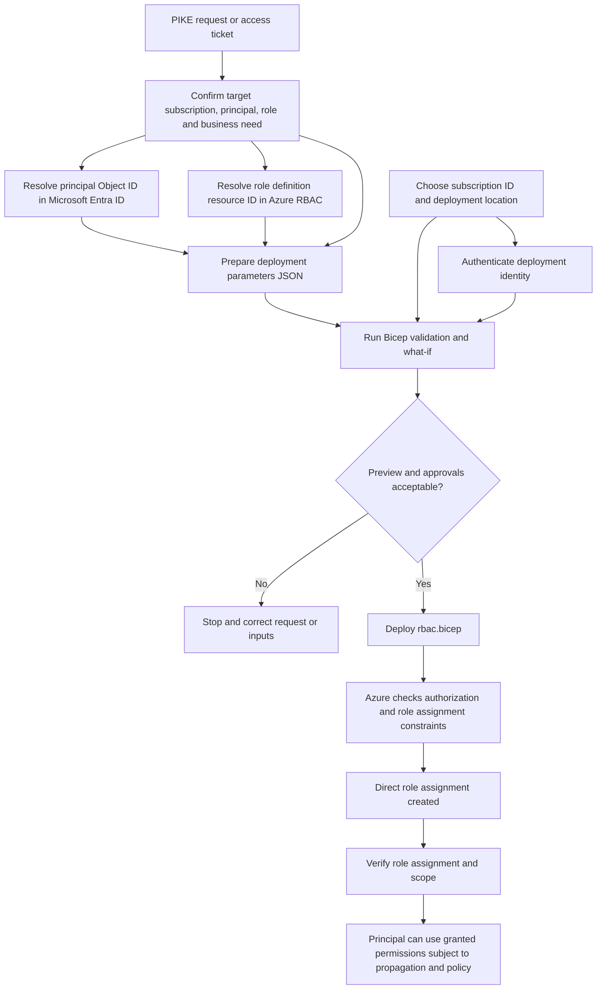

# Azure Role-Based Access Control (RBAC) Module

Reusable Bicep module that creates a **direct Azure RBAC role assignment at subscription scope**.

> **RBAC vs PIM:** This module assigns the role directly, so its permissions are available immediately after the assignment succeeds. The PIM module creates *eligible* access that must be activated separately. Use direct RBAC only when the approved access model calls for a standing assignment.

## Files

- `rbac.bicep` — creates a `Microsoft.Authorization/roleAssignments` resource.
- `README.md` — documents dependencies, input sources, deployment, and the workflow.

## Dependencies and prerequisites

| Dependency | Required? | Where to get it / how it is used |
|---|---:|---|
| **Target subscription ID or name** | Yes | The subscription where the role should be assigned. Select it with `az account set --subscription <subscription-id>` or pass `--subscription <subscription-id>` to the deployment command. |
| **Deployment location** | Yes for the subscription deployment command | A region such as `eastus`. This is the location of the subscription deployment record; it does not change the RBAC scope. |
| **Principal object ID** (`principalId`) | Yes | Microsoft Entra admin center → Users, Groups, or Enterprise applications → select the target principal → copy **Object ID**. For a service principal, use its service-principal Object ID, not its app/client ID. |
| **Role definition resource ID** (`roleDefinitionId`) | Yes | Full resource ID for the built-in or custom Azure role. Find it in the subscription's **Access control (IAM) → Roles**, or use the Azure CLI example below. |
| **Principal type** (`principalType`) | No | Use `User`, `Group`, or `ServicePrincipal` to match the target identity. Defaults to `User`. |
| **Role assignment name** (`roleAssignmentName`) | No | A GUID. Usually leave it unset so Bicep generates a deterministic GUID from the subscription, principal, and role. |
| **Deployment identity and permissions** | Yes | The operator or GitHub Actions identity must be authenticated to the correct tenant/subscription and have permission to create role assignments at subscription scope. Typical roles include **Owner**, **User Access Administrator**, or **Role Based Access Control Administrator**, subject to the organization's policy and role restrictions. **Contributor alone is not sufficient** to create role assignments. |
| **Approved access request** | Required operational control | Confirm the target principal, requested role, scope, business justification, and approval before assigning access. Least privilege should be used. |

This module is **subscription-scoped**. The role assignment applies to the selected subscription and is inherited by resources within that subscription, subject to Azure RBAC behavior. It does not create resource-group-scoped or resource-scoped assignments.

## Parameters and input sources

The pipeline or operator supplies inputs through an Azure deployment parameters JSON file or explicit command-line parameters. The JSON file is an input to deployment and does **not** need to be stored inside this module directory.

| Parameter | Required | Source | Default |
|---|---:|---|---|
| `principalId` | Yes | Microsoft Entra Object ID of the target user, group, or service principal | — |
| `roleDefinitionId` | Yes | Full Azure role definition resource ID | — |
| `principalType` | No | Identity type matching the principal | `User` |
| `roleAssignmentName` | No | Optional GUID when the workflow manages assignment names | Deterministic GUID |

### Find a role definition ID

For example, to get the Reader role definition ID in the currently selected subscription:

```bash
az role definition list \
  --name "Reader" \
  --query "[0].id" \
  --output tsv
```

Check that the returned ID is for the intended role and scope. For a built-in role, the role definition ID may be subscription-qualified or use the provider's role definition path; pass the full resource ID accepted by the target deployment.

## Example JSON deployment parameters

Replace the placeholders with approved values. This file can live outside `modules/rbac/` or be generated by the pipeline.

```json
{
  "$schema": "https://schema.management.azure.com/schemas/2019-04-01/deploymentParameters.json#",
  "contentVersion": "1.0.0.0",
  "parameters": {
    "principalId": {
      "value": "<entra-object-id>"
    },
    "roleDefinitionId": {
      "value": "/subscriptions/<subscription-id>/providers/Microsoft.Authorization/roleDefinitions/<role-guid>"
    },
    "principalType": {
      "value": "User"
    }
  }
}
```

## End-to-end workflow



### Workflow stages

1. **Validate request:** Confirm the business reason, principal, least-privilege role, subscription scope, and required approvals.
2. **Resolve IDs:** Use the principal's Entra Object ID and the full role definition resource ID.
3. **Prepare inputs:** Populate the deployment parameters JSON or pass parameters explicitly. Do not place credentials or secrets in the parameters file.
4. **Authenticate:** Sign in using an approved identity. For GitHub Actions, workload identity federation is generally preferable to storing a long-lived client secret.
5. **Preview:** Run Bicep build and subscription-level what-if. Review the target subscription and exact role before applying.
6. **Deploy:** Create the role assignment using the authenticated deployment identity.
7. **Verify:** Confirm the assignment ID, principal, role, and subscription scope. Azure RBAC changes may take time to propagate.

## Deployment commands

Run these commands from the repository root and replace the placeholders with actual values.

Build/validate the Bicep file:

```bash
az bicep build --file modules/rbac/rbac.bicep
```

Preview the deployment:

```bash
az deployment sub what-if \
  --subscription "<subscription-id>" \
  --name "rbac-role-assignment-preview" \
  --location "eastus" \
  --template-file "modules/rbac/rbac.bicep" \
  --parameters "@rbac.parameters.json"
```

Deploy after reviewing the preview and obtaining required approvals:

```bash
az deployment sub create \
  --subscription "<subscription-id>" \
  --name "rbac-role-assignment" \
  --location "eastus" \
  --template-file "modules/rbac/rbac.bicep" \
  --parameters "@rbac.parameters.json"
```

The subscription ID selects the deployment target; `--location` is required for the subscription deployment record. Neither value is a Bicep module parameter in this implementation.

## Important considerations

- **Direct assignment grants standing access.** Do not use this module where the requirement is PIM eligible access; use the PIM module instead.
- Grant only the minimum role required and validate the exact subscription before deployment.
- The deployment identity needs role-assignment write permissions; Contributor by itself is insufficient.
- Use the exact principal Object ID. A service principal's app/client ID is not its Object ID.
- The example JSON is documentation only. Keep the module directory to exactly `rbac.bicep` and `README.md`.
- This module is subscription-scoped. To support resource-group or individual-resource scope, implement a separate scope-aware design rather than assuming this template can assign at any arbitrary scope.
