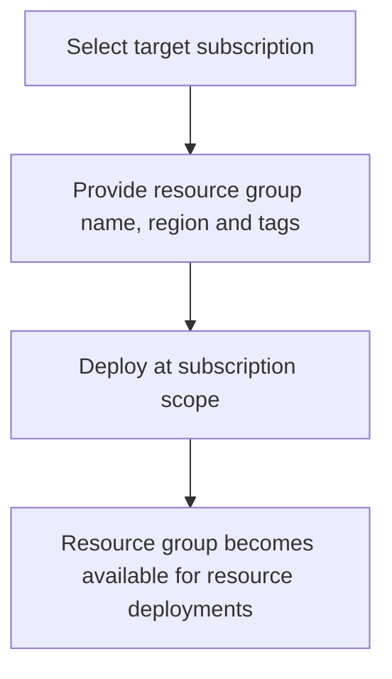

# Resource Group Module

**Source template:** [`modules/resourcegroup.bicep`](../resourcegroup.bicep)

## Purpose
Creates an Azure resource group at subscription scope, with a selected name, region, and tags.

## Inputs

| Input | Required | Description |
|---|---:|---|
| `rgname` | Yes | Resource group name. |
| `location` | Yes | Azure region associated with the resource group. |
| `tags` | Yes | Key/value tags for governance, ownership, environment, or cost allocation. |

## Dependencies and permissions
- A valid target subscription must be selected for the deployment.
- The deployment identity needs permission to create resource groups at subscription scope.
- Use naming and tagging standards approved for the environment.

## Workflow

## Important notes
The template currently has no outputs. Its caller should ensure the resource group is created before deploying resources into it.
