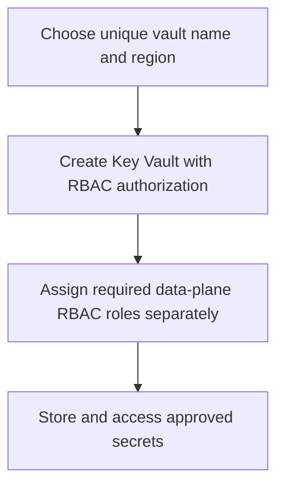

# Azure Key Vault Module

**Source template:** [`modules/security/keyvault.bicep`](../keyvault.bicep)

## Purpose
Creates an Azure Key Vault configured to use Azure RBAC authorization.

## Inputs

| Input | Required | Description |
|---|---:|---|
| `location` | Yes | Azure region for the vault. |
| `keyVaultName` | Yes | Globally unique Key Vault name meeting Azure naming requirements. |

The tenant ID is taken from `subscription().tenantId`; it is not a separate input.

## Dependencies and permissions
- The target resource group must exist.
- The deployment identity needs permission to create Key Vaults.
- Principals that need to read/write secrets require appropriate Key Vault data-plane RBAC roles in addition to deployment permissions.

## Workflow

## Outputs
- `keyVaultId` — vault resource ID.
- `keyVaultNameOut` — vault name.

## Security review before production
- The template currently sets `enableSoftDelete: false`; verify whether this property/value is accepted by the selected API version and align with current Azure recovery requirements.
- Purge protection is not enabled in the template.
- `enabledForDeployment`, `enabledForTemplateDeployment`, and `enabledForDiskEncryption` are enabled; confirm each is required.
- Network access restrictions, diagnostics, purge protection, and RBAC assignments are not configured here.
