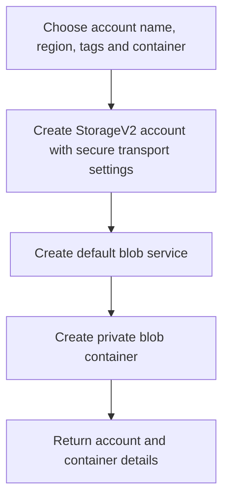

# Storage Account and Blob Container Module

**Source template:** [`modules/storage/storageAccount.bicep`](../storageAccount.bicep)

## Purpose
Creates an Azure StorageV2 account and a private Blob container. The current configuration uses Standard locally redundant storage (LRS), the Hot access tier, TLS 1.2 minimum, HTTPS-only traffic, and disables anonymous blob access.

## Inputs

| Input | Required | Description |
|---|---:|---|
| `location` | Yes | Azure region. |
| `storageAccountName` | Yes | Globally unique storage account name; Azure naming rules apply. |
| `tags` | Yes | Tags applied to the storage account. |
| `containerName` | No | Blob container name; defaults to `mycontainer`. |

## Dependencies and permissions
The target resource group must exist. The deployment identity needs permission to create storage accounts and blob containers. Applications/users that access data need appropriate data-plane permissions; control-plane deployment access alone may not grant blob data access.

## Workflow

## Outputs
- `storageAccountId` — storage account resource ID.
- `storageAccountNameOut` — storage account name.
- `containerName` — created container name.

## Important notes
The template currently uses `Standard_LRS` and `Hot`. Review redundancy, network rules, shared-key access, minimum TLS, diagnostics, lifecycle management, and private endpoint requirements against your production baseline.
